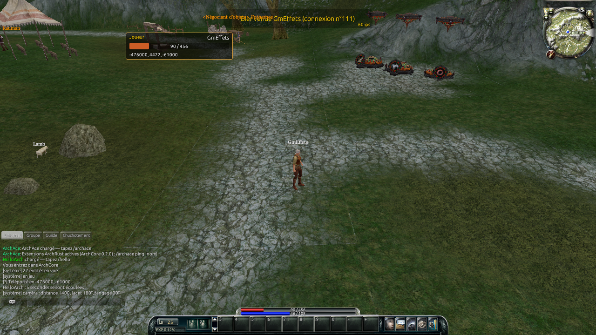
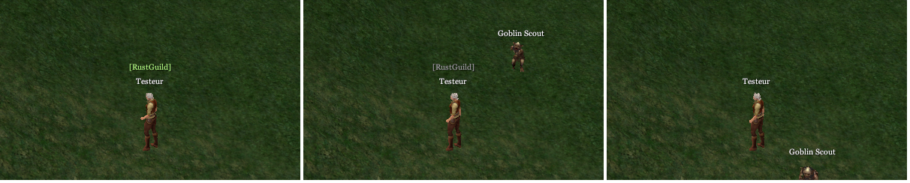
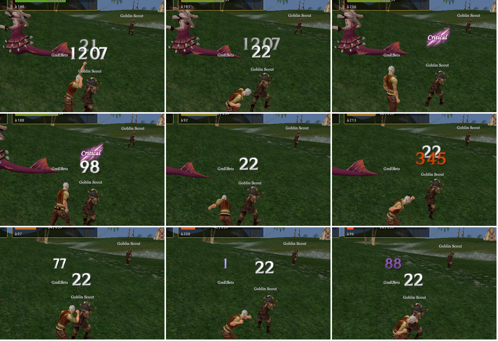
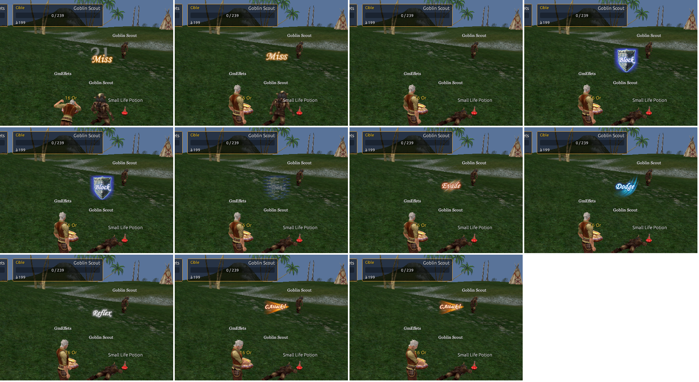

# Formats de fichiers du client ArchLord 64 bits

Relevés dans `Archonia.exe` (x86-64, sha256 `e9c7609b…`) avec Ghidra via REA, et vérifiés sur les
fichiers du client. Les adresses de fonctions changent à chaque mise à jour automatique du client ;
les formats, non.

## Cryptographie

| Usage | Algorithme | Détail |
|---|---|---|
| Tables `ini/*.ini`, fichier de serveurs | RC4 | clé = 16 octets du MD5 de la chaîne `1111` (CryptoAPI, `CryptDeriveKey`) |
| Textures `.tx1` | RC4 | même mécanisme, chaîne `asdfqwer` |
| Compte / mot de passe au login | RC4 | chaîne de 8 caractères envoyée par le serveur |
| Trames réseau | Blowfish ECB | mots 32 bits petit-boutistes, clés de 32 octets |
| Index des packs `Reference.Dat` | AES-128-GCM | clé `AgcmUIOPTIONSOFA`, IV `AgcmCharactersOf`, étiquette de 16 octets en fin |

La clé et l'IV AES sont stockés obfusqués (33 octets, `b[i] ^= (i % 0x38) + 0x32`) dans le
singleton `ApCrypto`.

## Packs `Reference.Dat` + `Data.Dat`

Index déchiffré :

```text
u32 nombre d'entrées
u32 longueur, puis nom racine terminé par 0 ("character", "\images", "packed_client"…)
par entrée : u32 longueur, nom terminé par 0 (mis en minuscules par le client), u64 offset, u64 taille
```

`Data.Dat` est la concaténation des fichiers. Contenus observés : `character/*.ecl` (clumps
RenderWare), `object/*.ecl`, `texture/<groupe>/*.tx1` (+ PNG pour l'interface et les cartes),
`character/animation/*.ean`, `effect/clump/*.ecl`, `world/octree|grass|water/*.dat`.

### Résolution des ressources

Le chargeur d'ArchRust reproduit les règles relevées dans `Archonia.exe` :

* Au démarrage, chaque dossier contenant `Reference.Dat` et `Data.Dat` est indexé comme un pack,
  sous son chemin relatif en minuscules (`character`, `texture\\character\\high`, etc.).
* Pour ouvrir `dossier\\fichier`, si un pack existe pour ce dossier, seule l'entrée du pack est
  consultée. Une entrée absente ne retombe pas sur le fichier du disque. Sans pack pour ce dossier,
  le client lit le fichier en clair sur le disque.
* Si cette lecture échoue, le chargeur peut chercher le chemin complet (`dossier\\fichier`) dans
  le pack de surcharge `etc` (racine `packed_client`). Les entrées de ce pack sont chiffrées par
  AES-128-GCM avec la seconde clé `AgcmCharacterOpt`, l'IV `AgcmOptionDesign` et une étiquette de
  16 octets en fin. Le contenu déchiffré conserve son format habituel (par exemple RenderWare ou,
  pour un `.tx1`, le chiffrement RC4 des textures). Le chiffrement et les clés sont documentés dans
  `crates/archrust-crypto/src/pack.rs`.
* Pour remplacer un modèle `.ecl` par un glTF/GLB natif, le client cherche d'abord le même nom de
  base avec l'extension `.glb` dans le même dossier.

Les textures RenderWare `.tx1` sont recherchées sous le nom `<nom>.tx1`, dans cet ordre de dossiers
(casse normalisée en minuscules) :

1. `texture\\effect\\<qualité>`
2. `texture\\ui`
3. `texture\\character\\<qualité>`
4. `texture\\object\\<qualité>`
5. `texture\\world\\<qualité>`
6. `texture\\skill`
7. `texture\\item`
8. `texture\\etc`
9. `texture\\minimap`
10. `texture\\notpacked`
11. `texture\\amboccl`
12. `map\\temp\\rough`

`<qualité>` est choisi indépendamment pour les effets, personnages, objets et monde par les clés
`TexEffect`, `TexCharacter`, `TexObject` et `TexWorld` de `[Patch_Option]` dans `ini/COption.ini` :
`0` ou valeur absente = dossier de base, `1` = `high`, `2` = `medium`, `3` = `low`. Le dossier
`texture\\ui` et les autres groupes n'ont pas de sous-dossier de qualité dans cet ordre de recherche.

ArchRust applique le repli du pack `etc` à chaque chemin de texture absent de la recherche normale.
Cette voie a été vérifiée sur les données du client : `texture\\character\\a0157caa.tx1`, présent
dans `etc` et absent des packs de textures parcourus, est déchiffré puis décodé en texture DXT3 de
512 × 512 (10 niveaux de mipmap). La preuve confirme le chargeur d'ArchRust sur les fichiers réels
du client ; l'appel direct du lecteur de textures à ce repli dans `Archonia.exe` reste une
inférence, car il n'a pas été observé dans le code désassemblé.

## RenderWare 3.7

Les modèles et textures sont des flux RenderWare (estampille `0x1C02002D` = 3.7.0.2) :
`Clump → FrameList, GeometryList → Geometry (Struct, MaterialList, Extension{BinMesh, Skin})`,
`Atomic`, extensions `HAnim PLG` et `Frame Node Name`. Les dictionnaires de textures sont en
format D3D9 (DXT1/3/5, A8R8G8B8, palette 8 bits).

## Tuiles du monde (`world/`)

* `a%06dx.ma1`, `a%06dx.ma2`, `b%06dx.ma2` : archives **MagPack Ver 0.1a**
  * en-tête de 50 octets (signature + zéros) ;
  * table des matières : `u8 longueur, nom, u32 taille ^ 0x6969`, jusqu'à une longueur nulle
    (toujours 256 entrées = 16 × 16 secteurs) ;
  * données : pour chaque entrée, `taille` octets puis un `u32` nul.
* Chaque entrée : `u32 taille décompressée ^ 0x6969`, puis un flux **aPLib** (littéraux, codes
  gamma, correspondances courtes et longues, fin sur décalage nul).
* Contenus :
  * `C{sx},{sy}.amf` (`.ma1`) : en-tête de 12 octets (`u32` version `0x1003`, `u32` 0, `u32`
    largeur 16), grille 16 × 16 de `u32` (attributs de cellule, ligne = z), puis `u32` nombre de
    segments de blocage et 28 octets par segment (voir « Sol et blocage ») ; 1040 octets sans
    segment. Les 16 bits hauts d'une cellule portent l'indice de région (`RegionTemplate.ini`),
    les 16 bits bas les attributs (octet 1, bit 0 : sol bloqué) ; voir « Sons » pour la musique de
    région ;
  * `R{sx},{sy}.dff` (`a.ma2`) : dictionnaire de textures du secteur (une texture 128 × 128 DXT1)
    suivi du sol grossier (voir « Distance de vue, eau et herbe ») ;
  * `D{sx},{sy}.dff` (`b.ma2`) : `u32` nombre d'atomics, puis des blocs `Atomic` autonomes
    (Struct de 24 octets, Geometry à 1536 sommets / 512 triangles / 6 jeux d'UV, matériaux
    multi-couches, extension Bin Mesh) ; voir « Textures du sol ».
* Coordonnées : secteur de **6400** unités, indice = `coordonnée / 6400 + 400`, tuile =
  `(sx / 16) * 100 + sy / 16`. Le secteur `D272,272` couvre x, z ∈ [-819200, -812800].

## Tables `ini`

Texte INI (`[section]`, `clé=valeur`, clés répétées autorisées) en CP949 pour `ini/`, en
Windows-1252 pour `ini_fr`, `ini_de`, `ini_es`. Certaines tables sont **positionnelles** : la
section d'en-tête `[]` nomme les colonnes (`0=ModuleData1`, `1=DFF`…) et chaque `[TID]` donne
`colonne=valeur` ; `charactertemplateclient.ini` colonne `DFF` = numéro du clump `a%07d.ecl`.

Une table peut être chiffrée (RC4 des `ini`) ou en clair : ArchRust la considère en clair si moins
d'un octet de contrôle sur 20 (hors tabulation, CR, LF) figure dans ses 256 premiers octets
(`assets::looks_plain`), puis la convertit depuis la page de code de son dossier
(`assets::decode_table_text`).

## Données du serveur (`server-data/`)

Couche de tables de valeurs écrite par le serveur (`archcore export-client-tables <dossier>`), lue
**avant** les packs de ressources et les données du jeu (`crates/archrust-engine/src/server_data.rs`).

* **Emplacement** : `--server-data <dossier>`, sinon la variable `ARCHRUST_SERVER_DATA`, sinon le premier
  dossier `server-data/` trouvé là où `realmlist.wtf` est cherché (dossier de l'exécutable, dossier
  courant, `Game`). Un dossier donné mais absent est signalé et ignoré.
* **Contenu** : mêmes chemins relatifs que le client, `ini/<table>` et `ini_<langue>/<table>`, mêmes noms
  de fichiers (`itemdatatable.txt`, `SKILL_CONST.txt`, `RefineryItem2.txt`, `LevelUpExp.txt`…, casse
  ignorée) et mêmes en-têtes que les tables d'Archonia ; une colonne propre à Archonia reste présente et
  vide. Texte en clair, fins de ligne CRLF, dans la page de code du dossier : CP949 pour `ini/`,
  Windows-1252 pour `ini_fr`, `ini_de`, `ini_es`, Shift-JIS pour `ini_ja`, GBK pour `ini_zh`, CP949
  pour `ini_ko`. Seuls les dossiers `ini` et `ini_*` sont servis ; tout autre fichier est ignoré (les
  packs gardent l'apparence).
* **Priorité** : `Assets::read_file` sert d'abord ce dossier, puis les packs (`patches/`, `free-assets/`),
  puis le système de fichiers du client. Le réglage des packs (`packs.toml`) ne s'y applique pas. Toutes
  les tables de valeurs passent par `read_file` (`Assets::table`, `Assets::read_text`, `client_text_in`).
  Pour les textes cherchés d'abord dans le dossier de langue (`client_text` : `itemoptiontable.txt`,
  `questtemplate.ini`, `questgroup.ini`, `bankslotprice.txt`…), les données du serveur passent avant,
  dans tous les dossiers : une table exportée seulement dans `ini/` l'emporte sur la copie d'Archonia de
  `ini_fr/`. Si `ItemTemplateAll.ini` vient du serveur, seul un `ItemTemplateAll2.ini` du serveur lui
  est ajouté. Les tables sont mises en cache : un nouvel export demande de relancer le client.
* **Tables de Webzen** : après `archcore import --webzen`, l'export écrit aussi `questtemplate.ini` (3 235 quêtes,
  textes de la langue du dossier), `questgroup.ini`, `titledatatable.txt`, `titlestringtable.txt`,
  `SkillMastery_High.txt` et `SkillMastery_Heroic.txt` ; `LevelUpExp.txt` porte la courbe des niveaux 1 à 121, au-delà
  de 2³² dès le niveau 113 (lue en `u64`, comme l'expérience reçue : `FACTOR_POINT` 3 + 4 << 32).
* **Empreinte** : `tables.toml` à la racine du dossier.

  ```toml
  format = 1                       # facultatif (1)
  fingerprint = "sha256:0f1e…"     # chaîne opaque, ASCII imprimable sans espace, 128 octets au plus
  software = "ArchCore 0.3.0"      # facultatif, pour le journal
  generated = "2026-11-02T10:00Z"  # facultatif, pour le journal
  ```

  Le serveur monde annonce la même chaîne dans son `HELLO_ACK` (extensions ArchCore `0xAC`, capacité
  `client-tables/1` demandée par ArchRust, **champ 21** `MEMORY_BLOCK` ASCII, proposition pour la
  version 1.2 de la spécification). Tant que le schéma d'`archcore-net` s'arrête au champ 20, ArchRust
  relit le `HELLO_ACK` avec ce seul champ ajouté (`ext::ext_schema`). Comparaison sans espaces ni casse
  (`server_data::compare`) ; résultat écrit dans le journal seulement : avertissement si les empreintes
  diffèrent, si le dossier manque ou s'il n'a pas de `tables.toml` alors que le serveur en annonce une ;
  information si elles concordent ou si le serveur n'annonce rien.

## Protocole réseau

Voir la documentation d'ArchCore (`docs/wiki/FR-Protocole-reseau.md`) et les commentaires de
`crates/archrust-protocol`. Points vérifiés avec le vrai client : en-tête AuPacket de 19 octets,
longueurs en `u32`, drapeaux de champs de 1/2/4 octets selon le module, un champ `PACKET` = `u32`
longueur + charge (une seule longueur), trames `A1/B1 … AF/BF` chiffrées Blowfish.

Le paquet optimisé d'action personnage `0x41` suit les neuf champs du schéma ArchCore : CID
attaquant, CID cible, résultat (`i8`), paquet de facteurs, PV cible (`i32`), combo (`i8`), attaque
forcée (`i8`), effet additionnel (`u32`) et index du coup (`u8`). Le callback Archonia
`ap_optimized_packet2_on_receive_char_action` lit précisément les CID, résultat, paquet de facteurs,
PV, combo, attaque forcée et effet additionnel ; l'index du coup n'est pas consommé par ce callback.
Archonia construit le paquet de facteurs avec `ap_factors_make_damage_packet` au format
`AGPMCHAR_FACTOR_POINT` : 20 champs `i32` à bitmap sparse (PV, PM, SP, EXP, AP, MAP, MI, aggro,
dégâts normaux, magique, eau, feu, terre, air, poison, foudre, glace, bonus d'EXP, héroïque).
Pour ce paquet de dégâts, le code fournit précisément PV, PM, dégâts normaux et élémentaires,
ainsi que les dégâts héroïques. ArchRust conserve les octets et décode ces champs avec le mini-schéma
`FACTOR_POINT`. Les PV courants de la cible sont conservés sur l'entité et affichés dans le panneau
du monde. Quand deux valeurs de PV connues diffèrent, le journal de discussion affiche aussi leur
variation (`+/- PV`) pour l'acteur et la cible. Les barres au-dessus des personnages, les animations,
les effets et le traitement des dégâts restent à implémenter. ArchCore n'émet pas encore le paquet
`0x41`.

Le paquet `CHARACTER` (`0x02`) utilise les opérations `ADD=0`, `UPDATE=1`, `REMOVE=2` et
`REMOVE_FOR_VIEW=3`, confirmées par `ap_character.h`. Le serveur Archonia envoie explicitement
`REMOVE_FOR_VIEW` aux observateurs lorsqu'un personnage sort de leur vue (`as_map.c`). ArchRust
traite les mises à jour incrémentales de position/facteurs et retire les personnages sur les deux
opérations de suppression. Le cache de vue et la liste d'entités du moteur sont synchronisés avec
ces événements.

Le schéma principal `AgpmItem` (`0x04`, drapeaux sur 4 octets) reprend les 25 champs relevés dans
`ap_item_create_module` (`ap_item.c`). ArchRust décode les opérations `ADD=0`, `REMOVE=1` et
`UPDATE=2`, conserve les objets par ID et affiche les statuts inventaire (2) et équipé (3) dans la
fenêtre Inventaire. À l'entrée en jeu, `OPT_VIEW` op 2 regroupe les `AgpmItem` dans le bloc mémoire
6 ; chaque enregistrement est préfixé par sa longueur u32 dans le format x64, puis contient drapeaux
et champs `AgpmItem`. ArchRust lit cet instantané et remplace son état local. Les emplacements
inventaire et banque sont des mini-paquets à drapeaux sur un
octet contenant trois `INT16` (onglet, ligne, colonne), d'après le constructeur `packet_inventory`.
`OPT_VIEW` op 1 transporte les objets équipés sous forme d'une liste de mini-paquets
`OPT_VIEW_ITEM` dans le champ 2. ArchRust en extrait ID, TID et quantité. Le nom d'un objet vient
de la colonne `Name` de `ItemTemplateAll.ini` ; `BASE_DFF` donne son clump `character/d%07x.ecl`.
Vérification sur les données réelles : le TID 1 « Short Bow » a `BASE_DFF=1` et
`character/d0000001.ecl` est présent (3 frames, 1 géométrie, 1 atomic). ArchRust charge ces clumps
pour les personnages en vue. L'alignement des modèles sur les os n'est pas encore validé en jeu.
ArchCore ne transmet actuellement aucun objet ni équipement à l'entrée en jeu ; le flux reste à
valider en session, de même que les icônes, les options d'objets et les mises à jour d'équipement.

Les entrées `D` portent, après les extensions RenderWare, des données privées du client (blocs
d'identifiants non RenderWare) : le lecteur s'arrête au premier en-tête qui ne tient pas dans le
bloc. Vérifié sur 1280 secteurs (tuiles 1717, 1924, 2024, 2025, 3232) : 1536 sommets et
512 triangles partout, de 1 à 85 matériaux selon le secteur.

## Sélection et création de personnage

Établi sur Archonia.exe (sha256 e9c7609b…) et les données du client ; implémenté dans
`login_settings.rs`, `net.rs` (`LoginCommand`), `ui.rs` (`character_select_panel`,
`character_create_panel`) et `app.rs` (`update_login_scene`).

* **Mise en scène** — `ini/LoginSettings.txt` (texte CP949 en clair, lu par AgcmUILoginSetting,
  …SettingCamera et …SettingCharacter) : `[ LoginDivision ]` `DivisionNumber=1817` (tuile chargée
  pour la scène), `[ CharacterSelect_Position ]` trois lignes `Pos : X=…, Y=…, Z=…, Rotate : …`
  (centre, gauche, droite), `[ CharacterSelect_MoveOffSet ]` `Race=… Class=… OffSet=196.f` (pas
  en avant du personnage choisi), `[ CharacterCreate_Position ]` une ligne par race,
  `[ CameraTM_CharacterSelect ]`, `[ CameraTM_CharacterCreate ]` par race et
  `[ CameraTM_CharacterCreateZoom ]` par race et classe (`Pos`, `LookAt`, `Perspective`). Races :
  Human, Orc, MoonElf, DragonScion ; classes de mise en scène : Knight, Ranger, Mage, Scion.
  `ini/logincharpos.ini` (chiffré, AgsmLoginClient) reprend les positions côté serveur.
* **Angles** — `Rotate` suit la convention des personnages : -90 = face à −X, vers la caméra de
  sélection placée 490 unités plus à l'ouest. `Perspective` est lue comme la demi-largeur de la
  fenêtre de vue RenderWare (`tan(champ horizontal / 2)` : 0,735 → 73° ; 0,31 en zoom).
* **Paquets** (`AGPMLOGIN`, 0x0D) — liste : op 6 → paquets `CHARACTER` → op 7 ; ArchRust lit aussi
  le visage (champ 20) et la coiffure (champ 21). Création : op 10, le serveur répond par un paquet
  `CHARACTER` par **modèle de base** puis op 10 ; op 11 avec le mini-paquet `LOGIN_CHAR_INFO`
  (0 TID, 1 nom, 6 coiffure, 7 visage) → `CHARACTER` du nouveau personnage puis op 12 (CID).
  Suppression : op 13 avec le nom (champ 1), réponse op 13. Entrée dans le monde : op 8.
* **Modèles de base** — ArchCore envoie les TID 1, 3, 4, 6, 8, 9, 96 (Archer, Sorcerer,
  Berserker, Mage, Hunter, Elementalist, Knight). Race et classe : colonnes `Name` et `Race` de
  `CharacterTemplatePublic.ini` (1 Human, 2 Orc, 3 MoonElf, 4 DragonScion) ; le TID 9 n'a pas de
  facteurs de type et sa race se déduit du nom de classe, comme les boutons de classe du client
  (`createcharacter_btnclass…_normal.png`). Nombres de visages et de coiffures :
  `charactertemplatecustomize.ini` (voir « Têtes par défaut »).
* **Interface d'origine** — `UI_LG_CHARCREATE` (et `_1280`, `_1600`), fonctions
  `CreateCharacter_OnSelectRace…`, `…OnSelectClass…`, `…OnBtnSelectHeadPrev/Next`,
  `…OnBtnSelectFacePrev/Next`, `LG_RotateLeftStart`, `LG_ToggleZoom`, `LG_CharacterCreateOK`,
  `LG_LoginMainSelectButtonClick`, `…CreateButtonClick`, `…DeleteButtonClick`,
  `LG_QUESTION_REMOVE_SELECTED_CHARACTER`, emplacements `LG_Slot01…03`. ArchRust reproduit ces
  commandes avec ses propres fenêtres ; la mise en page et les textures d'interface d'origine ne
  sont pas encore reprises.

## Connexion

Implémenté dans `realmlist.rs`, `net.rs` (`NetEvent::Worlds`, `NetEvent::AuthRefused`), `ui.rs`
(`login_panel`) et `app.rs`.

* **Panneau d'ArchRust**, seul écran de saisie du compte (`ui::login_panel`, image
  `assets/login-panel.png` 1710 × 919 intégrée à l'exécutable, zones des champs dans `login_layout` ;
  panneau egui simple si l'image est illisible) : serveur et port (préremplis par l'adresse
  ci-dessous), compte, mot de passe, case « Enregistrer le compte » (identifiant, mot de passe et
  dernier personnage chiffrés par DPAPI dans `saved-variables/compte.dat`, repris au démarrage,
  effacés à la connexion suivante si la case est décochée), « Connexion » (ou Entrée dans le mot de
  passe), « Options », ligne d'état. Erreurs et compte refusé s'affichent sur la ligne d'état, champs
  gardés.
* **Adresse** — `realmlist.wtf` (`set realmlist hôte[:port]`, convention d'ArchRust) ; sans lui,
  `ArchoniaTest.ini` d'Archonia, lu en clair (FUN_1408eb790) : XML
  `<IPInfo><ServerGroup><GroupName>…</GroupName><IP>hôte:port</IP>…</ServerGroup>…</IPInfo>`
  (FUN_1408ec080) ; ArchRust prend la première `IP` du premier groupe. `Archonia.ini` (même XML,
  chiffré RC4 « 1111 ») n'est pas lu.
* **Séquence** — serveur de connexion joint (`WORLD` op 0 → op 2, `LOGIN` op 0), mondes annoncés
  (`Nom=Groupe=0=Statut=Drapeau;…` de `WORLD` op 2) : ArchRust prend le premier, sans liste à l'écran,
  avec le panneau comme avec `--connect`. Puis `LOGIN` op 1 (compte), op 3 (monde), et sélection et
  création comme ci-dessus.

## Barre de raccourcis gardée par le serveur (AgpmUIStatus 0x14)

Constructeur `AgpmUIStatus` FUN_140266520 : type 0x14, drapeaux 2 octets, 12 champs — 0 op, 1 CID,
2 `PACKET` × 50 (mini `AGPMSKILL_BASE` par case), 3 `INT8` index, 4 `PACKET` contenu, 5 bloc (op 2),
6/7 `INT32` TID des potions de vie / mana, 8 casque, 9/10 `INT8` seuils de prise automatique (%),
11 bloc (op 2). Mini `AGPMSKILL_BASE` : drapeaux 1 octet, `INT8` type de base, `INT32` identifiant ;
types 5 objet (IID) et 7 compétence (identifiant d'instance), les seuls affichés et envoyés. Liste du
champ 2 : compteur `u8` puis `u32` longueur + mini pour chacun ; mini vide, absent ou illisible = case
vide.

* **Disposition** — 5 couches × 10 cases, index = couche × 10 + colonne (deux grilles de 5 par
  couche). Dans ArchRust, case du serveur i = case locale i + 2 (potions 0 et 1, barre principale 2-11,
  barres en plus 12-51).
* **op 0 reçue** (FUN_1402671f0) — les 50 cases remplacées (IID → TID par l'inventaire, identifiant de
  compétence → TID par la liste des compétences ; une case pas encore résolue l'est dès que l'objet ou
  la compétence arrive), potions 6/7 copiées telles quelles, seuils 9/10 s'ils sont ≥ 0. Sans champ 2
  (serveur qui ne garde pas la barre), ArchRust garde en repli `saved-variables/raccourcis-<nom>.txt` ;
  sinon ce fichier ne garde que le nombre de barres affichées.
* **op 1 reçue** — index 0-49 : avec contenu, la même base est retirée des autres cases de sa rangée de
  10 (`index / 10 × 10` … `+ 9`) puis posée ; sans contenu, case vidée. Potions appliquées si ≠ 0,
  seuils si ≥ 0.
* **op 1 envoyée** (FUN_140650c50 → FUN_140266e90) — pose : champ 3 index + champ 4 mini ; retrait :
  champ 3 seul ; potion posée : champ 6 ou 7, jamais 0 (rien au retrait) ; seuil : champ 9 ou 10, une
  seconde après le dernier mouvement du curseur, si la valeur a changé. Un échange de cases envoie les
  deux. Raccourci sans base connue (compétence non possédée, objet absent) : rien n'est envoyé.
* **Non employé** — op 2 (barre encodée en texte, champs 5 et 11 : aucun abonné dans le client) ; le
  client n'envoie jamais d'op 0.

Côté serveur (proposition de la spec, rien dans le client) : table `character_quickbelt`
(personnage, case, type, TID, IID), op 0 après les objets et les compétences, compétences retrouvées
par TID (identifiants attribués à l'entrée en jeu), objet consommé remplacé par un autre de même TID.

## Objets du monde

Établi sur Archonia.exe (sha256 e9c7609b…) et les données du client ; implémenté dans
`crates/archrust-engine/src/objects.rs`.

* **Placement** — `ini/obj%05d.ini`, une table par tuile (`(sx / 16) × 100 + sy / 16`, ex.
  `obj02024.ini` = Anchorville, 1874 objets). Une section par objet, clés nommées écrites par
  ApmObject (`FUN_140233e40`) : `TID`, `ObjectType`, `Scale=x,y,z` (`+0x58`),
  `Position=x,y,z` en coordonnées monde (`+0x64`), `DegreeX` (`+0xb0`), `DegreeY` (`+0xb4`),
  `OcTreeIDNum` / `OcTreeIDData…`.
* **Modèle** — `ini/objecttemplate.ini` (5509 modèles), table positionnelle : 1 `Name`,
  4 `Category`, 10 `DFF` = `lod:fichier` dans le pack `object` (ex. `0:H003b100.ECL`),
  5 `COLLISION_DFF`, 9 `OCTREE_MAXBBOX`, 11 `BSPHERE`, 12-14 LOD, 26 `ANIMATION` (arbres,
  moulins). La colonne 2 apparaît deux fois : `ObjectType` d'ApmObject puis celui d'AgcmObject
  (drapeaux).
* **Repères** — dans la tuile 2024, seule la catégorie « spawn » (lumières `Point_Light` sans
  modèle, effets, repères `monster`) porte le bit `0x10000` des drapeaux AgcmObject : ces objets ne
  sont pas dessinés. La catégorie `NPC` place des modèles de PNJ que le serveur envoie déjà comme
  personnages (`<Garde> Yuan`) : ArchRust l'ignore aussi.
* **Frame racine** — la frame racine des clumps d'objets garde la position d'export du modèle
  (`(1280, 5, 1790)` pour la barrière `h004ac00.ecl`, `(-3100, 15, -3654)` pour l'arbre
  `h003b100.ecl`) ; la matrice de l'objet la remplace. Sans ce retrait, les objets sont décalés
  de plusieurs milliers d'unités.
* **Matrice** — `T(Position) × RotY(DegreeY) × RotX(DegreeX) × S(Scale)`, angles en degrés avec la
  convention des personnages (+Z envoyé sur (sin, 0, cos)). Contrôle (`examples/object_rotation_check.rs`) :
  avec `DegreeY` tel quel, 54 à 59 % des extrémités des barrières (catégorie `필드_펜스`) touchent
  celle d'un autre segment sur les tuiles 2024, 2025 et 1924, contre 9 à 15 % avec l'angle opposé.

ArchRust lit les tuiles des secteurs à moins de 3 secteurs du joueur, prépare un secteur d'objets
par image et dessine les objets à moins de 25 000 unités de la caméra. Vérifié en jeu à
Anchorville : maisons, tours de garde, enclos, champs, étals et arbres en place, 60 ips. Niveaux
de détail : voir « Distance de vue, eau et herbe ». Non
couverts : animations (`ANIMATION`), effets attachés et octree (sols
praticables : voir « Sol et blocage »).

## Sol et blocage

Établi sur Archonia.exe (sha256 e9c7609b…) et les données de Tullan ; implémenté dans
`world.rs` (`HeightField`, `Terrain::blocked`, `Terrain::clip_move`), `objects.rs`
(`WorldObjects::ridable_height`, `ridable_raycast`) et `app.rs` (`ground_height`, `step_entity`,
`click_ground`). Sonde : `examples/collision_probe.rs`.

* **Hauteur** (`FUN_140528910`) — rayon vertical de y = 100 000 à −20 000 : d'abord le terrain
  (triangles du secteur `D{sx},{sy}.dff`, `FUN_140528f30`), puis les objets des listes
  « praticable » de la cellule de 400 unités ; le premier triangle touché (le plus haut) l'emporte
  s'il dépasse le terrain, **quelle que soit la hauteur du personnage**. ArchRust interpolait les
  coins de cellule ; il suit maintenant les triangles du sol.
* **Objets praticables** — `ObjectType` d'ApmObject (le premier de la section dans
  `obj%05d.ini`) : 0x100 range l'objet dans les listes « bloquant », 0x200 dans les listes
  « praticable » des cellules couvertes par sa boîte (`FUN_140235640`, `FUN_140235fc0`, 10
  objets par cellule) ; la hauteur exige 0x100 et 0x200 (`FUN_14030de10`). Géométrie : le modèle
  `COLLISION_DFF` (colonne 5 d'`objecttemplate.ini`, lue par `FUN_1406e0250`, ex.
  `I00001ce.ECL`, 42 triangles, pour l'escalier `H001ce00.ECL`, 476 triangles), matrice de
  l'objet, frame racine annulée ; à défaut le modèle dessiné. `RidableMaterialType` (colonne 6 :
  7 dallage et escaliers, 8 pont) ne sert pas à la hauteur.
* **Escaliers de Tullan** (`튤란계단a`, TID 462, en (-352200, 9446, 72627), échelle 1,58 × 1 × 1,5) :
  les marches descendent de 9946 à 9456 entre z = 72 260 et 74 960 ; la rampe du terrain tombe de
  9942 à 9446 entre z = 72 260 et 72 800, au haut de l'escalier. Sans les objets, le personnage
  suivait cette rampe et s'enfonçait dans les marches (point 25 du retour de test n° 1).
* **Cellules bloquées** — octet 1 de la cellule `.amf`, bit 0 = sol bloqué (bit 1 : ciel). Archonia
  refuse un déplacement dont la destination est bloquée (`FUN_140183bd0` dans `FUN_140168070`) et
  arrête le trajet 0,05 cellule (20 unités) avant la première cellule bloquée traversée
  (`FUN_140196ab0`, cellule globale = x × 0,0025 + 6400) ; un départ bloqué ne bouge pas (ArchRust
  laisse en sortir). Autour de Tullan, les remparts et talus sont bloqués (`C343,412` : 40
  cellules) ; c'est ce qui empêche de « grimper aux murs » (point 26).
* **Formats AMF** — le lecteur natif `FUN_140223d30` distingue les versions `0x1000` à
  `0x1003`. `1000` : en-tête de 8 octets, cellules de 6 octets converties en `u32` par
  `u16(cellule+2) | (u8(cellule+4) << 16)` ; `1001` : même conversion après 12 octets
  d'en-tête. `1002` copie les cellules de 4 octets puis efface les bits absolus 12–15 ;
  `1003` conserve leur valeur. Les versions modernes portent la largeur : 34 grilles
  locales font 8 × 8. Le drapeau d'en-tête `0x2` provoque un retour avant la grille
  (1 728 entrées locales). Le parseur actuel d'ArchRust suppose 12 octets et 16 × 16
  sans ce dispatch : c'est un écart à corriger, pas une règle native.
* **Diagonale et indexation AMF** — colonne x dans une ligne z. Le bit absolu 0 choisit
  la diagonale des triangles et la formule d'interpolation de hauteur dans les deux
  consommateurs examinés. Le bit absolu 12 force un argument de hauteur à 100 000 dans
  `FUN_140528370` ; son nom métier reste ouvert, comme les bits 11 et historiques 13–15.
  Les 18 échecs de décompression recensés sont une référence deux octets avant le tampon
  de sortie, non contrôlée par le décodeur natif. Un octet dépend alors d'un état mémoire
  inconnu ; le rejet du parseur sûr ne permet pas de reconstruire cette valeur.
* **Segments** — après la grille, `u32` nombre puis `{x1, y1, z1, x2, y2, z2, f32}` (28 octets,
  écriture `FUN_1402241d0`) : murs à ne pas franchir (Anchorville : 4 à 18 par secteur, aucun à
  Tullan). Un segment ne bloque que le déplacement de sens opposé à sa normale `(−dz, dx)` de
  `p1 − p2` (`FUN_1401822a0`), élargi du rayon du personnage, plus un cercle à chaque extrémité
  (`FUN_140182070`). Rayon : `+0x3fa0` du modèle de personnage, absent des tables ; 0 dans ArchRust.
* **Clic au sol** — le point visé est le plus proche du terrain et des triangles praticables ;
  destination bloquée refusée, sinon arrêtée devant le premier blocage ; hauteur recalculée.

## Textures du sol

Établi sur Archonia.exe (sha256 e9c7609b…) et les secteurs réels ; implémenté dans
`rw::read_material_extension`, `world::build_terrain_mesh` et `terrain.wgsl`.

* **Extension de matériau `0xfffff001`** — enregistrée par `FUN_1405ec940` (0x60 octets par
  matériau ; lecture `FUN_14087fee0`, taille `FUN_14087fe60`) : `u16` nombre d'entrées, puis pour
  chacune un `u32` type et, s'il est non nul, un bloc `Texture` complet. La taille écrite vaut
  2 + Σ (4 + taille des données de la texture) : elle **omet les 12 octets d'en-tête** de chaque
  bloc Texture. L'erreur se répercute sur l'extension, le matériau, la liste de matériaux, la
  géométrie et l'atomic ; un lecteur qui suit les tailles déclarées perd tous les matériaux après le
  premier (d'où, auparavant, des matériaux « sans texture » et l'absence du Bin Mesh). ArchRust lit
  ce bloc par sa structure : `D325,389` donne ainsi 72 matériaux texturés et 71 sous-maillages.
* **Couches** — sur le terrain, les entrées vont par paires : type 3 = masque
  (`a0001c0t`), type 1 = texture de la couche. Un matériau a une texture de base et 0, 1 ou 2
  couches (`D325,389` : `a0a1a00t` + [masque, `a0a1200t`]…).
* **Jeux d'UV** — l'étage n du matériau (0 = base, puis chaque entrée) lit le jeu d'UV n. Chaque
  cellule de 400 unités a ses six sommets propres : UV0 et les UV des couches vont de 0 à 1 par
  cellule (une répétition de texture par cellule ; quelques bases en atlas 2 × 2, pas de 0,5) ;
  les UV des masques sont en pas de 0,25 (case de l'atlas 4 × 4) ; les étages inutilisés gardent un
  UV par défaut en pas de 0,5. Le shader général lit UV5 et le transmet à `oT5.xy`,
  mais les couches des chemins examinés s'arrêtent à UV4. Les voies optimisées
  remappent explicitement UV4/UV3 vers les étages 5/6.
* **Masque** — `texture\world\a0001c0t.tif` : TIFF 256 × 256 non compressé, quatre échantillons
  (RGB blanc + un échantillon `ExtraSamples = 0`, « non précisé ») ; le quatrième porte 16 masques
  de transition 64 × 64 (bords, coins, coins inversés, plein noir, plein blanc). Les décodeurs
  génériques le perdent (alpha 255 : chaque couche recouvre toute sa cellule, en carrés nets) ;
  ArchRust le lit avec `archrust_data::tiff`. Contrôle sur quatre secteurs
  (`examples/terrain_mask_check.rs`) : sur les bords entre une cellule à une couche et une
  voisine sans couche, l'alpha lu tel quel vaut 1 vers une voisine de la texture de la couche et 0
  vers une voisine de même base (écart moyen 0,02 à 0,03, contre 0,3 à 0,8 si la case est retournée).
* **Rendu ArchRust** — couleur = base(UV0), puis pour chaque couche k :
  `mix(couleur, couche(UV 2k+2), masque(UV 2k+1).a)`, multipliée par la couleur prélit des
  sommets et l'éclairage. Les textures reçoivent des mipmaps (moyennes 2 × 2) au téléversement.
  Le pipeline natif utilise `BLENDCURRENTALPHA`, des variantes en plusieurs passes
  `SRCALPHA/INVSRCALPHA`, et selon la voie une modulation, `SPECULAR` et `TEMP`.
  Ses seuls nombres d'entrées supplémentaires traités sont 0, 2 et 4 : avec 6
  (trois couches supplémentaires), le répartiteur dessine la base seule. Les états
  récupérés ne prouvent pas une équivalence numérique sur tout pilote, notamment
  lorsque `ALPHAOP=DISABLE` accompagne un `COLOROP` actif.
* **Texture `R`** — 128 × 128 pour tout le secteur, elle n'est référencée par aucun matériau du
  sol détaillé ; c'est celle du sol grossier (voir « Distance de vue, eau et herbe »).
  L'ancien rendu la plaquait sur l'UV0 de chaque cellule (le secteur entier réduit 16 fois par
  cellule, d'où un sol « miniaturisé ») ; elle n'est plus qu'un repli pour un matériau sans base.

Vérifié en jeu sur ArchCore (Anchorville) : herbe à l'échelle, chemins et route pavée aux bords
fondus, plus de damier.

## Décor animé et lumières du décor

Module `decor.rs` (relevés dans `Archonia.exe`, sha256 e9c7609b…).

* **Groupes d'un modèle d'objet** — dans `objecttemplate.ini`, le premier nombre de la colonne 10
  `DFF` (`%d:%s`), 26 `ANIMATION` (`%d:%d:%d:%d:%s`) et 27 `ANIM_SPEED` (`%d:%d:%f`) est l'indice
  du **groupe** (AgcmObject `FUN_1406dfb80`, liste `+0x1f20`) : chaque groupe a son clump, son
  animation et sa vitesse ; tous sont dessinés (`FUN_1406e2f30`). Un seul modèle en a plusieurs : la
  roue à eau `수차` (TID 339), dont les groupes 1 et 2 tournent. Les trois autres nombres
  d'`ANIMATION` ne sont pas lus par le client.
* **Animation des objets** — `object\animation\<nom>.ean` (349 clips HAnim ; les données nomment le
  fichier sans extension, ex. `E0016940`). Initialisation `FUN_1406e22d0` : clip posé sur la
  hiérarchie du clump, temps 0, peau liée. Rappel de mise à jour du clump rendu (`FUN_1406ddff0`) :
  `AddAnimTime(Δt_ms × ANIM_SPEED × 0,001)`, clip bouclé sur sa durée, puis matrices de la
  hiérarchie et de la peau. 368 modèles animés hors PNJ et repères (arbres, moulins, drapeaux,
  bateaux…) : 113 groupes à peau, 244 rigides. ArchRust : une horloge par modèle (Archonia : une par
  objet, partie de son premier affichage), pièces rigides posées sur les cadres animés, peaux
  déformées 30 fois par seconde au plus (un tampon partagé par les objets du modèle).
* **Lumières du décor** — fonction d'événement **30** des objets placés (`obj%05d.ini`) : bloc
  `PointLightStart` … `PointLightEnd` avec `Color` (entier : octet 0 rouge, 1 vert, 2 bleu), `Radius`,
  `Flag` (lecteur AgcmEventPointLight `FUN_14065e140`). 6 159 lumières (rayon 2 000 surtout, couleurs
  orangées des torches). Création `FUN_14065dab0` : `RpLightCreate(rpLIGHTPOINT)`, couleur / 255,
  rayon `Radius`, à la position de l'objet ; `Flag & 0x1000000` → AgcmRender (terrain, objets,
  personnages), `& 0x2000000` → AgcmDynamicLightmap ; ni clignotement ni variation. **Horaire** :
  rappel 0 d'AgcmEventNature (`FUN_14065dd80`, appelé par `FUN_140581fd0` avec le ciel courant) :
  toutes allumées si le bit 0x10 de `WeatherEffect1` est nul, toutes éteintes sinon
  (`FUN_14065ddb0`) ; seules quelques tranches de jour portent ce bit (valeurs 24, 25), la plupart des
  régions gardent leurs lumières jour et nuit. ArchRust : lumières des secteurs lus, les plus proches
  de la caméra après celles des effets, 16 au plus (`render::MAX_POINT_LIGHTS`), atténuation
  `1 − d/R` comme les lumières d'effet (celle du pilote RenderWare est inconnue).
* **UV animées des modèles** — 78 fichiers du pack `object` commencent par un dictionnaire
  d'animations UV RenderWare (bloc 0x2B). AgcmUVAnimation (`FUN_1406bc5a0`) ne fait que tenir la liste
  des matériaux animés des clumps rendus ; aucune fonction n'avance leur temps
  (`RpMaterialUVAnimSetCurrentTime` `FUN_140375970` et `SubAnimTime` `FUN_140375d50` sans appelant,
  `RtAnimInterpolatorAddAnimTime` appelé seulement par AgcmObject et l'interne RtAnim) : ces UV restent
  figées dans Archonia, et dans ArchRust.
* **Multiéchantillonnage** — l'option `Multisampling` (`OP_AntiAliasing`) est gardée mais
  `FUN_14070ed10` et `FUN_140711e10` passent toujours 1 à `RwD3D9EngineSetMultiSamplingLevels`
  (`FUN_140357fb0`, 1 = sans multiéchantillonnage) : Archonia ne l'applique jamais ; ArchRust non plus.
* **Ombres des objets (AgcmShadow2)** — voir « Ombres projetées des objets » plus bas ;
  AgcmShadowmap toujours éteint (`+0x1a00 = 0`).
* **Post-traitement des compétences** — aucune base `AgcdEffPostFX` (type 9) ni caméra (type 10) dans les
  3 428 jeux d'effets : Archonia n'en joue aucun ; rien à faire.

### Ombres projetées des objets (AgcmShadow2)

Relevé sur Archonia.exe (sha256 e9c7609b…) ; ArchRust : `shadow.rs` (règles, tests),
`shadow_render.rs` (passe GPU), `terrain.wgsl` (lecture), `app_shadow.rs` (colle),
`objects.rs` (`shadow_casters`).

* **Option** — `OP_Shadow` (`FUN_140711840`) : 0 et 1 éteignent AgcmShadow2, 2 à 4 l'allument
  (`FUN_140621da0`, `+0x1a10 = 1`) ; l'ombre ronde des personnages (AgcmShadow) reste au-dessus de 0.
* **Ce n'est pas une carte de profondeur** : la caméra de lumière (`RwCameraCreate`, projection
  parallèle, sans tampon de profondeur, `+0x88 = 0`) rend des **silhouettes** dans une texture
  512 × 512 (`+0x17cc`, deux rasters 32 bits, `FUN_140386c70`), projetée ensuite sur le sol.
* **Lumière fixe** — repère construit une fois (`FUN_140621b90`) : `RwMatrixRotate` de 50° autour de Y
  (remplace) puis de 300° autour de Z (post-concaténé) ; direction `at` ≈ (0,383 ; −0,663 ; 0,643),
  élévation 41,6°. `FUN_1406214d0` (angle `15 × heure + 90`, heure bornée à 0–24) n'a aucun appelant
  (seule référence : `.pdata`) : ni l'heure ni le ciel ne déplacent l'ombre.
* **Zone** (`FUN_140621fe0`) — `N = +0x1770 = 4` ; demi-fenêtre `N × 4524,8` = 18 099 unités
  (`RwCameraSetViewWindow`), plan lointain `2 × demi-fenêtre`, proche `demi-fenêtre × 0,001` ; caméra
  au centre du secteur courant (milieu de sa boîte, hauteur 0) reculée d'une demi-fenêtre le long de
  `at`. Secteur courant : rappels 2 et 4 d'AgcmMap (`FUN_140621440`).
* **Objets** — secteurs chargés de `±N` autour du secteur courant (`AgcmMap+0x16e8`) : objets dont le
  type (`+0x80` des données du clump, masque `0xffffff00`) porte `0x100000` et dont le rayon
  (`+0x24` de l'entrée de secteur) dépasse 100 ; chemin par octree (`FUN_1406215c0`) : bit seul.
  Ce bit est celui des drapeaux AgcmObject (seconde colonne `2` d'`objecttemplate.ini`) : 2 168 des
  5 508 modèles. Personnages exclus.
* **Prise** — passe 1 dans le raster de la caméra : effacé en blanc (`0xffffff`), objets rendus
  lumières ambiante et directionnelle coupées (`+2` des lumières `+0x1728`/`+0x1730` mis à 0), puis
  rectangle plein écran blanc `source × (1 − destination)` (inversion) ; passe 2 dans la texture :
  rectangle texturé par le raster, couleur `0x82` (130/255), `SRCALPHA / INVSRCALPHA` à alpha 255
  (`FUN_140621ca0`). Texture : 0 hors ombre, 0,51 dans l'ombre ; filtrage linéaire (`+0x50 = 2`).
* **Matrice** (`FUN_140621160`) — inverse du repère de la caméra, échelle `(−0,5 / dw, −0,5 / dw,
  0,8 / dw)`, translation `(0,5 ; 0,5 ; 0)` ; seules les lignes u, v vont au shader (`c12`, `c13`).
* **Sol** — second passage des maillages de terrain (`FUN_1406d31b0`, si les vertex shaders sont
  disponibles) : shader assemblé `DAT_140f99368` (`FUN_1406d3730`) :
  `oT0 = (dp4 c12, dp4 c13)` de la position monde, `oD0 = facteur de brouillard × (N·−L ≥ 0)`,
  `oFog = 1` ; étage 0 `texture × diffuse`, mélange `ZERO / INVSRCCOLOR` : **sol × (1 − ombre ×
  brouillard)**. Objets, personnages et herbe ne reçoivent rien.
* **Mise à jour** — machine à états `+0x1758` : demande (secteur changé, événements 2 / 5, 120 000 ms
  écoulés dans `OnIdle` `FUN_140621b20`) → 1, puis deux `OnIdle` → 3, prise au rendu suivant.
* **ArchRust** — passe GPU 512 × 512 R8 (silhouettes `130/255 × alpha` des textures, test alpha 0,3
  comme le rendu des objets, cumul alpha = inversion du noir sur blanc d'Archonia), rejouée seulement
  sur demande ; `terrain.wgsl` applique `× (1 − ombre × (1 − brouillard) × (N·L ≥ 0))` après le
  brouillard. **Choix** : objets rendus en silhouette pleine (la couleur prélit d'Archonia sans
  lumières n'est pas reproduite), bords de texture bloqués (adressage d'Archonia non relevé), objets
  animés du décor exclus, niveau de détail le plus fin, nouvelle prise quand le nombre de secteurs
  d'objets chargés change (chargement progressif d'ArchRust).
* **Inconnu** — la grille de bits 512 × 512 (`+0x17d0`, pixels > 0x1f, `FUN_1406226f0`) remplie à
  l'allumage depuis la texture : aucun lecteur relevé.

## Armes serties : pierres d'esprit, runes et renforcement

Module `app_stones.rs` (relevés dans `Archonia.exe`, sha256 e9c7609b…).

* **Déclencheur** — rappels d'AgpmItemConvert (`FUN_14056a840`) sur un objet porté (statut 3) :
  retrait des effets précédents (`FUN_14056e490`), puis `FUN_1405725e0` selon `Kind` (`+0x3cc`) et
  `Part` (`+0x3c8`) du modèle (écrivain `FUN_1401d20d0`).
* **Points** (`FUN_14028e610`, `ItemConvertPoint.txt`, colonnes par paires niveau / points) :
  renforcement (si le niveau ne dépasse pas le maximum de l'objet) + nombre de sockets + rang de
  chaque pierre d'esprit (`Elemental Stone Point`) + rang de chaque rune (`Rune Points`).
* **Catégorie** (`FUN_14056bb10`) : plus fort total parmi AIR (élément 5), WATER (2), MAGIC (1),
  EARTH (4) (`FUN_14028ec70` : pierres `UsableType` 2 de cet élément), PHYSICAL (renforcement) et
  RUNE ; égalité tranchée par l'ordre des sockets. **FIRE n'est jamais retenu** : son total est
  demandé sans objet (`FUN_14028ec70(…, 0, 3)` rend 0). Indices `FUN_140831280` (FIRE 0 … PHYSICAL 8,
  RUNE 9), élément → indice `FUN_140831210`.
* **Arme** (`Kind` 2, `FUN_140574100`) : lignes d'`ee_ss_change.txt` (`SPIRIT_STONE POINT EID OFFSET_*
  SCALE NODE_ID GAP …`) de la catégorie, parcourues de la dernière à la première : toutes celles du
  plus haut `POINT` ≤ total sont jouées sur l'objet (`FUN_1405706d0`) — paliers 2, 20, 30, 45, 60
  (`SS_Air_1LV`, `SS_Air_2-3LV`…). ArchRust : effets permanents posés au nœud de la main qui tient
  l'arme, recalculés toutes les 500 ms.
* **Armure de corps** (`Kind` 1, `Part` 2, `FUN_1405724b0`) : matériau `uvAnim.fx` d'`ee_ss_fx.txt`
  posé sur les atomics du modèle de l'objet (`FUN_140572410` : atomics de type 2, 4–8, vertex shaders
  > 1.0 ; aucun palier → matériau retiré). Lecture `FUN_14082f0f0` : colonnes `TYPE POINT FX TEXTURE
  AMBIENT DIFFUSE SPECULAR "Uv Translation" "UV Scale" "UV Rotation" "UV Anim weight" "U Selection
  vector" "V Selection vector"` ; couleurs entières × 1/255 (alpha 1) ; au plus 5 paliers par catégorie,
  triés par `POINT` décroissant (comparateur `0x14082c8c0` : `b − a`), une ligne de même `POINT`
  remplace la précédente. Palier (`FUN_14082cf80`) : premier `POINT` ≤ total, soit le plus haut.
  Données : 7 catégories × paliers 2, 20, 30, 45, 60 ; palier 2 : `uv = 0,001 × (x, y) + t × (0 ;
  0,04)`, poids 0,3 ; paliers 20–30 : `0,026 × 0,33 z` sur u et v, `+ t × 0,12`, poids 0,4 ; 45–60 :
  `0,05 × 0,33 z`, `+ t × 0,23`, poids 0,65 ; rotation 0 ; spéculaire 60/255.
  Technique `UVAnim` (ps_1_1, la première) : `VS` `uv1 = rot(rotation × t) × (scale × (pos·uSel,
  pos·vSel)) + t × velocity` (position du maillage, skinnée), `PS` `r0 = sat(N·L × diffuse +
  ambiante) × base` → `lrp(t1.a × poids, t1, r0)` → `mad_x2 : 2 × (r0 + (N·H)^8 × spéculaire ×
  lumière)`. ArchRust : `render::ArmorGlow` posée par `app_stones.rs` sur les pièces d'armure de corps
  (`Mesh::item_tid`, `Mesh::glow`), dessinée par `shader.wgsl` (groupe 3 = texture `SOUL_*`, sans
  l'extension `.tif` du fichier) ; temps = horloge du rendu (origine de `Time` d'Archonia inconnue).
* **`ee_ss_target.txt`** — **joué** par Archonia (`FUN_1405725e0`) sur l'arme (`Kind` 2, `Type` 0, non
  expirée) : `FUN_14082d0b0` rend une entrée par tranche (1–2, 3–4, 5–6, 7–8, 9–10, `+0xe18…+0xe38`)
  d'une valeur de l'objet (`FUN_1403416e0`, donnée attachée d'AgpmItemConvert non identifiée), jouée
  sur l'objet (`FUN_1405706d0`) et rangée sous la clé 0x14d du personnage pour être retirée
  (`FUN_14056ea10`). Lecture du fichier vers les tranches non relevée : **non reproduit**.
  `ee_item_rune.txt` : non joué.

## Distance de vue, eau et herbe

Établi sur Archonia.exe (sha256 e9c7609b…) et les données du client ; implémenté dans
`archrust_data::{lod, water, grass}`, `world.rs` (`TerrainView`), `water.rs`, `grass.rs`,
`world_render.rs` (`water.wgsl`, `grass.wgsl`) et `objects.rs` (`LodModel`).

* **Sol grossier** — `R{sx},{sy}.dff` n'est pas qu'un dictionnaire : après le TXD de la texture
  128 × 128 viennent `u32 1` et un Atomic autonome (17 × 17 sommets, 512 triangles, un jeu d'UV de 0
  à 1 sur le secteur, prélit, normales ; second matériau texturé `R{sx},{sy}`). `MapView`
  (`FUN_140711050` → `FUN_140537f60`) : sol détaillé sur 1 / 1 / 2 / 3 secteurs, grossier jusqu'à
  4 / 6 / 7 / 9 (zones carrées, forme déduite), facteur LOD 0,5 / 0,8 / 1,3 / 1,8. ArchRust garde
  les hauteurs, le blocage et les objets sur l'ancien rayon (2 à 5 secteurs).
* **`loddistancetype.txt`** (`FUN_1405570d0`) — texte à tabulations chiffré comme les tables :
  colonnes `default`, `type1`…`type9` (`type10` ignorée), lignes `level 1`…`level 5`, `atoi`.
  Niveau (`FUN_140556460`) : premier `i` tel que distance < `dist[type][i] × facteur`, sinon le
  dernier ; retombe sur le plus haut niveau qui a une géométrie. Les objets ne disparaissent donc pas
  avec le LOD ; seul le modèle des `H00153xx` (`DFF` 1 et 2) change de géométrie.
  `objecttemplate.ini` : 12 `LOD_LEVEL` = `0:n`, 23 `LOD_TYPE_DISTANCE` = type ; 13 `LOD_BOUNDARY` et
  14 `LOD_MAX_DISTANCE` (sens inconnu).
* **Eau** (`world/water/wt%d.dat`, `FUN_14058d210`) — `u32` version (2, ou 1 : +2000 ms aux
  vagues), 256 × `{u32 offset, u32 taille}` (secteur `z·16 + x` de la tuile) ; bloc : `u32 n`,
  n × {`u32` statut, `i16` x, z, largeur, hauteur en cellules, `f32` y}, `u32 m`, m × 40 octets de
  vague {`u32` statut (< 20), `i16` cellule x, z, `i32` demi-largeur, demi-hauteur, décalage de vie
  (ms), `f32` angle (°), vitesse, x, y, z}. L'option `Water` est ramenée à un mode ≥ 2
  (`FUN_1405909a0`) : l'eau à shaders de `HWaterStatus.ini` n'est **jamais** dessinée ; le rendu
  est celui de `WaterStatusT1.ini` (`FUN_14058a7c0`, `FUN_14058bcc0`) : quadrilatère à la hauteur
  `y`, UV = cellule / `TILESIZE_L1`, prélit `RED…ALPHA_L1`, matériau ambiante 0,3 / diffuse 0,7,
  couche 1 `WaterTextures[WATERFILE_L1]` puis seconde étape MatFX « dual »
  `[WATERFILE_L2]` (`BLENDSRC/DEST_L2` = 2/2 : additif), défilement de `U/V_L*` **par image**
  (ArchRust : 60 images/s supposées). Vagues (secteurs détaillés seulement, `FUN_140590d70`) :
  quadrilatère ±demi-hauteur en X, ±demi-largeur en Z, texture `WaveTextures[WAVEFILE]`, mélange
  SRCALPHA/ONE ; elles avancent de (cos a, −sin a) × vitesse (×0,9 après 50 % de la vie, ×0,7
  après 60 %), grandissent de `2/LIFETIME × SCALE × sin(f·180°)` par ms, s'allument en
  `LIFETIME/1,667` ms puis s'éteignent en `LIFETIME/2,5`, oscillent de ±6 en hauteur et repartent
  du début.
* **Herbe** (`world/grass/gr%d.dat`, `FUN_140594090`) — même index ; bloc : `u32` groupes, puis
  {`u32` n, `u32` sx, sz (> 800 : fin), `u32` ?, `f32` cx, cy, cz, rayon (700 en version 1), y max,
  n × {`u32` gabarit, `f32` x, y, z, rotX, rotY (°, > 360 écarté), échelle}} ; lecture tolérante
  (mot absent = 0, brin incomplet = fin du groupe). `GrassTemplate.ini` (`FUN_140594920`) : touffe
  de 12 sommets (`FUN_140595000`) en croix (forme 0) ou en « ㄱ » (forme 1), largeur et hauteur
  tirées une fois par gabarit, UV du rectangle `IMAGE_*`. Brin (`FUN_140593b40`) :
  S(0,9–1,09 ; 0,8–1,19 ; 0,9–1,09) × échelle · RotX · RotY, phase aléatoire ; balancement
  (`FUN_140592b40`) : phase += dt × `ANIM_SPEED` × 0,025, inclinaison RotX = sin(phase) ×
  `ANIM_AMOUNT` (table de 256 sinus), au niveau 0 seulement. `NaturalObj` : 0 aucune herbe, 1 type de
  distance 2 / 3 niveaux, 2–3 type 3 / 4 niveaux ; l'herbe n'existe que dans les secteurs détaillés.
  Couleur : `MODULATE2X` × min(A × 0,5 + B, 1) (couleurs de la lumière, `0x140592cb0`).
  ArchRust remplace `rand()` par un hachage déterministe de la position.

## Modèles de personnages

Les numéros de fichiers du pack `character` sont les valeurs de `charactertemplateclient.ini`
écrites en **hexadécimal sur 7 chiffres** (`%07x`) :

| Colonne | Fichier | Contenu |
|---|---|---|
| `DFF` | `a%07x.ecl` | squelette (frames + HAnim) et corps de base, parfois sans géométrie |
| `DEFAULT_ARMOUR_DFF` | `b%07x.ecl` | armure/vêtements par défaut (peau sur le même squelette) |
| `PICK_DFF` | `c%07x.ecl` | volume de sélection (boîte) |
| objets équipés | `d%07x.ecl` | 3557 fichiers d'équipement (à relier à `ItemTemplateAll.ini`) |

Exemples vérifiés : TID 96 (joueur humain) → `a0000060.ecl` (87 frames, 0 atomic) +
`b0000060.ecl` (8 géométries) ; PNJ TID 584 → `a0000248.ecl` ; TID 179 → `a00000b3.ecl`. Les
textures suivent la même numérotation (`A00096AA` pour le fichier `a0000096`, c'est-à-dire le
TID 0x96 = 150). Le chargeur générique du client assemble `"%s%s.%s"` (dossier, nom, extension).

Objets : Archonia lit `ItemTemplateAll.ini` puis `ItemTemplateAll2.ini` (0x1400f7cab) ; la seconde
porte les objets récents (ailes TID 60731…) avec d'autres numéros de colonnes : `Assets::table` les
fusionne par nom de colonne. Anneaux (genre 8) et colliers (genre 0x10) ne se dessinent pas sur le
personnage : leur `BASE_DFF` (`d00000c4.ecl`, un coffret) n'est que leur modèle au sol. Textures des
modèles récents : le nom du matériau garde parfois l'extension de la source (`Anduril_DIFF.png`) alors
que le pack range `anduril_diff.tx1` ; l'inverse existe aussi (`raven_female_body.png.tx1`). Restent
absents du client (Archonia ne peut pas les afficher non plus) : 21 modèles `d%07x` (dont
`d00015d6.ecl`, 463 objets, et les ailes `d0001000.ecl`), la texture `bake`, 67 icônes `l%07x`
(sonde : `examples/item_texture_audit.rs`).

## HUD en jeu (interface Archonia)

Implémenté dans `crates/archrust-engine/src/hud.rs` d'après les fichiers du client et Archonia.exe.

**Fenêtres** — `ini/UI_1024X768.ini` décrit 278 fenêtres AgcmUIManager2. Une section `[Fenêtre]`
donne `Pos`, `Size`, `Texture=i:nom` et `UIPos=n:x,y`, puis ses contrôles. Chaque contrôle commence
par `CtrlParent=<nom>` (facultatif) et `CtrlType=<type>:…`, et se place relativement à son parent.
Types utilisés : 1 image ou texte (`CtrlDisplay`), 3 bouton (textures `…a/b/c/d.png`), 8 grille
(`Grid=…:écart x:écart y:largeur:hauteur:…:nom`), 9 jauge (`Bar=…:<source> <max> <courant>`),
16 minicarte. Les images de `texture/ui` sont dessinées au pixel près depuis leur coin haut-gauche,
sans étirement (jauge PV : image 512 × 16 pour un contrôle de 372 × 11). Positions en 1920 × 1080 :
`ini/UIPosition_1920x1080.ini`, index 1 (`UI_CharInfo` 448,789 ; `MiniMap` 1746,0).

| Élément | Fenêtre / contrôle | Donnée |
|---|---|---|
| PV, PM | `UI_CharInfo` · `CONTROL_HPBar`, `CONTROL_18458` (`CharInfo_HP/MP_Bar.png`) | `FACTOR_POINT` 0/1 sur `FACTOR_POINTMAX` 0/1 |
| Expérience | `CONTROL_10445` (`CharInfo_EXP_Bar.png`), texte `Exp_현단계_백분율` | `FACTOR_POINT` 3 + 4 << 32 sur `LevelUpExp.txt` |
| Niveau | `CONTROL_25173` (`현재_레벨`) | `FACTOR_STATUS` 7 |
| Raccourcis | `CONTROL_GRID_LEFT_0` / `RIGHT_0`, 2 × 5 cases de 50 px, touches 3…7, 8, 9, 0, -, + ; potions 1 et 2 | contenu : AgpmUIStatus (0x14) champ 2, voir « Barre de raccourcis gardée par le serveur » |
| Menus | `MainBtnCharacter`… `MainBtnOption` | — |
| Minicarte | `MiniMap` · `CONTROL_MINIMAP1` (148 px), `Main_Minimap_Base.png` | voir ci-dessous |
| Améliorations | rangée sous la minicarte (choix d'ArchRust) | AGPMSKILL op 4/5 |

**Minicarte** — `texture/minimap/map%04d%c.png` (FUN_140702310), une image de 193 px par quart
`a`…`d` d'une tuile de 16 × 16 secteurs, à 0,0037695 px par unité. Origine d'un quart
(FUN_140703bf0 et FUN_140703c30) : x0 = (tuile / 100 − 25) × 16 × 6400, plus 51 200 si le bit 0 du
quart vaut 1 ; z0 = (tuile % 100 − 25) × 16 × 6400, plus 51 200 si quart / 2 ≠ 0. Archonia compose un
raster de 237 px centré sur le joueur (FUN_1408d5220), affiché dans le contrôle de 148 px et masqué
par `Main_Minimap_Alpha.png`. Le fond `Main_Minimap_Base.png` a un disque intérieur opaque : il se
dessine avant la carte. Vérifié en jeu : « Haunted Inn » apparaît au même endroit que dans Archonia.

**Inventaire** — fenêtre `UI_Inventory` (288 × 402, `UIPos=1:810,350`) : fond `INV_BASE.png`, cinq
sacs `CONTROL_Inven_Layer0…4` (« Bag 1 »…« Bag 5 », `INV_TAB.png` / `INV_TAB_SEL.png`), grille
`CONTROL_Inventory_Grid` de 258 × 258 (`Grid=0:0:2:2:50:50` : 5 × 5 cases de 50 px, écart 2), argent
`InventoryMoney` (paquet CHARACTER, champ 8), titre, corbeille, cadenas, boutons « Sell All », « Sell »,
« Expanded Inventory », « Chantra Bag ». Un objet du sac a le statut 2 et sa case `[sac, ligne,
colonne]` dans le mini `ITEM_GRID` (champ 7 d'AGPMITEM) ; ArchCore utilise les 5 × 5 cases des 5 sacs.
Icône : colonne `TEXTURE` d'`ItemTemplateAll.ini`, fichier `l%07x` de `texture/item` en hexadécimal
(vérifié : au-delà de 255, seuls les noms hexadécimaux existent). À l'entrée en jeu, les objets
arrivent dans le champ 6 de `OPT_VIEW` op 2 sous forme de paquets AGPMITEM complets mis bout à bout
(forme d'ArchCore, garde `0xD6`) ; le client accepte aussi des mini-paquets préfixés de leur longueur
u32. ArchCore envoie un second op 2 au champ vide : les objets de chaque op 2 s'**ajoutent** à ceux
déjà reçus. Ouverture : touche I (défaut d'ArchLord, non relevé dans `UI_Hotkey.ini`), bouton
« Inventaire » ou `/sac [1-5]`. Fenêtre déplaçable ; seuls la fermeture et les onglets agissent.

**Améliorations** — paquet AGPMSKILL (0x05, drapeaux 2) : 0 opération (4 ajout, 5 retrait),
1 identifiant de la compétence, 2 porteur (mini `AGPMSKILL_BASE` : type, CID), 8 liste de
`AGPMSKILL_BUFF` (TID, durée en ms en `u64`, TID du lanceur…). Icône : colonne `SMALL_SKILL_TEXTURE`
(`Q…`) de `SKILLTEMPLATE.ini`, sinon `SKILL_TEXTURE` (`P…`), dans `texture/skill`. La commande de
développement `/buff <TID> [secondes]` ajoute une amélioration locale pour essayer l'affichage.

**Cible** — fenêtre `UI_TargetInfo` (339 × 264, haut centre) : cadre `TargetInfo_HP_Bar_Off`, jauge
`TargetInfo_HP_Bar_On` (contrôle de type 9), icône `TargetInfo_On`, nom `CONTROL_TargetName`. Un clic
sur un personnage (silhouette projetée : des pieds à 180 unités au-dessus) le cible sans déplacer le
joueur et déclenche `PLAYER_TARGET_CHANGED` pour les AddOns. Le serveur n'envoie pas le maximum de PV
des monstres : la jauge rapporte les PV au plus haut PV vu pour ce CID.

**Tab** — dans `UI_1024X768.ini`, la section `[EventMap]` déclare des raccourcis `Hotkey=<mod>:<DIK>`.
Le premier nombre est le modificateur (0 aucun, 1 Maj), le second un code DirectInput. Ces entrées
sont reprises dans `UI_Hotkey.ini` (`CustomHotkey42` = 0:15, `CustomHotkey43` = 1:15).
`Hotkey=0:15` « Target Nearest » appelle `Targeting_FuncAutoTargetingF`, et `Hotkey=1:15` appelle
`Targeting_FuncAutoTargetingB`. Dans Archonia.exe, ces deux fonctions ne font rien : F rend seulement
`UIManager != NULL`, B rend 0. ArchRust leur donne la logique de ciblage de benilla
(`targeting.rs`, voir `REFERENCE-BENILLA.md`) :
- seuls les monstres à moins de 3 750 unités sont candidats ;
- ceux visibles à l'écran passent d'abord ;
- le meilleur score combine l'écart au centre de l'écran et la distance ;
- les cibles prises dans les 4 dernières secondes sont sautées ;
- Maj+Tab revient à la cible précédente.

**Messages système** — AGPMSYSTEMMESSAGE : texte orange « [Système] … » aligné à droite vers
y = 800/1080, dessiné par le code du client comme dans Archonia (pas de fenêtre du fichier
d'interface) ; 10 s puis 1 s de fondu, huit au plus.

**Discussion** — barre `Chat_Input_Normal` (395 × 25, `UIPosition_1920x1080` : 0, 961) : texture
`Chat_Input_Normal.png`, saisie posée sans cadre sur le contrôle `Input_Message` (type 16,
ChattingEdit, 334 × 16 en 53, 5). Les lignes ne sont pas une fenêtre du fichier d'interface :
ArchRust les dessine au-dessus de la barre (neuf lignes, 520 px de large, ombre portée, voile
sombre au survol ou pendant la saisie, molette pour remonter). Entrée ouvre la saisie, Entrée
envoie, Échap la quitte. `UI_ChatTab_Option` (réglage des onglets) n'est pas encore repris.

**Chuchotement** — commandes d'Archonia (`sysstr` 542-547) : `/w nom message` (aussi `/W`, `/ㅈ`) et
`/r message`, qui répond au dernier joueur ayant chuchoté. AGPMCHATTING type 5, destinataire au
champ 5 ; le serveur renvoie le message à l'émetteur, avec le destinataire au champ 5.
- **Affichage** : en-tête `Chat_Whisper_Header` « [Chuchotement] » à la réception,
  `Chat_WhisperSelf_header` « [Envoyer] » à l'envoi, couleur `WHISPER_RECV`/`WHISPER_SEND` de
  `color.ini` (00EE90), onglet Chuchotement.
- **Barre privée** : `/w nom` sans message ouvre `Chat_Input_Private` (`Chat_Input_Prv.png`,
  382 × 24, à l'endroit de la barre normale), avec le destinataire dans `Input_ID`. Un texte sans
  « / » y part au destinataire ; un `Input_ID` vidé puis validé, ou Échap, revient à la barre
  normale.
- **Fenêtre de guilde** : le bouton « Chuchotement » des membres (`CONTROL_24708`,
  `Guild_Enable_Chat_Whisper`) n'est actif que pour un membre en ligne, soi compris
  (`FUN_1408c10f0`). Le clic (`Guild_WhisperChat`, `FUN_1408c0b40` → `FUN_140787d30`) écrit
  « `sysstr` 542 nom » suivi d'une espace dans la barre normale, qui prend la main.

**Fenêtres d'Archonia à la place d'egui (2026-10-25)** — ArchRust n'affiche que des images du
client. Les fenêtres egui suivantes sont remplacées par leurs équivalents d'`UI_1024X768.ini` :
- **Boîtes de dialogue** (`hud_dialogs.rs`) :
  - confirmation sur `Common_Message_Base2.png` pour la destruction, la vente et l'invitation de
    groupe ; le texte vient de l'`[EventMap]` (`Action=4:1:-1:`) ;
  - séparation de pile `UI_SplitItem` : pavé numérique, + / −, « CR », « ◀ » ;
  - quantité à acheter `UI_NPCTrade_BuyStackCount` ;
  - or de la banque `UI_BankConfirm`, avec les phrases `Bank_InputMoneyConfirm` /
    `Bank_OutputMoneyConfirm`.
- **Groupe** (`hud_party.rs`) : cadres `UI_Party` (joueur, puis lignes de 36 px), menus
  `UI_SelfCharacterMenu` / `UI_TargetCharacterMenu`, options `UI_PartyOption`. Le visage est
  `Party_Face_<race><classe>.png` : race H, O, M, D ; classe K mêlée, A archer, W magie, S scion.
- **Menus principaux** (`hud_menu.rs`) : boutons `MainBtn*` de `UI_CharInfo` et listes
  `UI_MainMenu*`. Ils remplacent les boutons « Inventaire » et « Groupe ».
- **Sélection des personnages** (`hud_login.rs`) : `UI_LG_CHARSELECT` (écran 1024 × 768 agrandi
  sans déformation, voile `LG_Base_1024.png`) et `UI_ConfirmDeleteChar`.
- **Parchemin aller-retour** : Archonia enregistre `Item_OpenReturnScrollUI`, mais aucune fenêtre
  ne l'appelle. Le bouton egui est donc retiré et le retour passe par `/retour`.

- **Création de personnage** (`hud_login.rs`) : `UI_LG_CHARCREATE`. Panneau
  `CreateCharacter_BG.png`, boutons de race et de classe `CreateCharacter_Btn*`
  (`_Normal` / `_Over` / `_Push`), coiffure et visage, rotation tant que la flèche est
  enfoncée, zoom, descriptions `RaceDesc<Race>` et `CharDesc<Race><Classe>` (nom de classe
  pour les orcs, type générique sinon).
- **Options** (`hud_options.rs`) : onglets `Option_Video` (GFX), `Option_Sound` (Son),
  `Option_System` (Affichage), `Option_Option` (Fonction) et `Option_Advanced` (Avancé).
  - **Son** : réglages réels (cases `OP_Check` et curseurs `OP_Sound_Volume`). Les
    interrupteurs « activé/désactivé » sont enregistrés dans `music_on`, `effects_on` et
    `ambience_on` d'`options.toml`.
  - **Avancé** : sa liste générique porte la langue des textes du serveur et l'activation des
    packs de ressources.
  - **GFX**, **Affichage**, **Fonction** : réglages réels pour ce qu'ArchRust sait honorer,
    les autres contrôles restent inactifs (texture « d ») ; détail plus bas (« Options GFX,
    Affichage et Fonction »).

Les libellés viennent d'`ini_fr/UI_1024X768.ini`, et les phrases d'`uimessage.txt` (`ini_fr`
d'abord). Restent en egui :
- la console Lua et le tableau de bord de développement, visibles seulement avec la console
  (touche `) ;
- les fenêtres de secours, quand les données d'interface manquent.

### Prise automatique des potions

Deux curseurs `PointScrollBar.png` (15 × 15) sont posés sur les jauges de PV et de PM de `UI_CharInfo` :
`CONTROL_9745` (« Use Life Potion Automatically ») et `CONTROL_24256` (« Use Mana Potion
Automatically »), 370 × 15, `Scroll=0:0:350`. Le rappel `ChangeHPPointScrollBarValue` d'Archonia
(`FUN_14060c520`) garde position × 100 comme seuil en pourcentage. ArchRust boit la potion de la case 1
(vie) ou 2 (mana) de la barre quand la jauge passe sous le seuil, une fois par seconde au plus ; seuils et
potions sont envoyés au serveur (AgpmUIStatus op 1 ; le seuil une seconde après le dernier mouvement du
curseur) qui les renvoie à l'entrée en jeu (op 0). Commande
d'essai : `/potionauto vie|mana 0-100`.

### Langue et AddOns

La langue choisie dans l'onglet Avancé des options vaut pour les textes du serveur (extension ArchCore) et
pour ceux du client : le dossier `ini_*` lu au démarrage suit la langue comme dans Archonia (`ini` pour
l'anglais, `ini_fr`, `ini_de`, `ini_es`, `ini_ko`, `ini_ja` en Shift-JIS, `ini_zh` en GBK), ainsi
que `GetLocale()` des AddOns. Le même onglet active ou désactive chaque AddOn
(`saved-variables/AddOns.txt`, une ligne « Nom: disabled » ; `EnableAddOn` et `DisableAddOn` font de
même), appliqué aussitôt en jeu par un rechargement de l'interface.

### Options GFX, Affichage et Fonction

Établi sur Archonia.exe (rappels enregistrés par `FUN_1407099d0`, module AgcmUIOption). Archonia garde
tout dans `Ini\COption.ini` (écrit par `FUN_14070dc20`, lu par `FUN_140708400`), sauf le casque et les
refus, qu'il envoie au serveur. ArchRust relie un contrôle par son rappel `Action=3:OP_…` (des noms de
contrôle se répètent dans `Option_Option`) et garde les réglages dans `saved-variables/options.toml`,
sections `[display]`, `[refuse]` et `[video]` ; ce fichier fait foi comme `COption.ini`.

Réglages honorés :

| Onglet | Rappel (clé de `COption.ini`) | Effet dans Archonia | Dans ArchRust (`options.toml`) |
|---|---|---|---|
| GFX | `OP_CharView` (`CharView`) | facteur de distance des personnages (AgcmTuner) : 0,25 / 0,45 / 0,875 / 999 (`FUN_14070f7f0`) | `video.char_view` : personnages (et leurs noms) tracés jusqu'à 31 250 × facteur, sans limite pour « Global » |
| GFX | `OP_MapView` (`MapView`) | facteur de la carte 0,5 / 0,8 / 1,3 / 1,8 ; sol grossier sur 4 / 6 / 7 / 9 secteurs, détaillé sur 1 / 1 / 2 / 3 (`FUN_140711050`, `FUN_140537f60`) | `video.map_view` : objets tracés jusqu'à 31 250 × facteur (25 000 pour « Moyen », la valeur d'avant), sol et objets chargés sur 2 à 5 secteurs (un seul niveau de détail) ; la CVar `objectDrawDistance` garde la main |
| Affichage | `OP_ViewNameMine` (`VN_MINE`) | nom du joueur (`board+0x100` = 1) | `display.name_self` |
| Affichage | `OP_ViewNameMonster` (`VN_MONSTER`) | noms des monstres (sorte 2) | `display.name_monster` |
| Affichage | `OP_ViewNameOthers` (`VN_OTHERS`) | noms des autres joueurs (sorte 8) | `display.name_others` |
| Affichage | `OP_ViewNameGuild` (`VN_GUILD`) | ligne de guilde (`board+0x46c`) | `display.name_guild` |
| Affichage | `OP_ViewNameParty` (`VN_PARTY`) | nom d'un membre du groupe sur un cadre `0xBF8B3F3F` (`board+0x464`, `FUN_140825a20`) | `display.name_party` |
| Affichage | `OP_VisibleViewHelmet` (`VS_HELMET`) | AgpmUIStatus op 3 (`FUN_140267160`) | `display.helmet` : même paquet, casque (`Part` 3) retiré du modèle du joueur |
| Fonction | `OP_RefuseTrade` (`REF_TRADE`) | drapeau 1 (serveur) | `refuse.trade` : drapeau envoyé (pas d'échange entre joueurs dans ArchRust) |
| Fonction | `OP_RefusePartyIn` (`REF_PIN`) | drapeau 2 (serveur) | `refuse.party` : drapeau envoyé, invitation reçue déclinée aussitôt (op de refus) |
| Fonction | `OP_RefuseGuildIn` (`REF_GIN`) | drapeau 0x10 (serveur) | `refuse.guild` : drapeau envoyé, invitation reçue déclinée sans boîte |
| GFX | `OP_Effect` (`Effect`, défaut 2) | niveaux terrain/combat/interface/compétences : 0 → tout à 0, 1 → 1/1/0/1, 2 à 4 → n/n/1/1 (`FUN_14070fb80`) | `video.effect` : 0 = aucun effet d'Archonia, interface (montée de niveau, apprentissage) dès 2 ; libellés `Option_Msg_OFF/LOW/MEDIUM/HIGH/VERY_HIGH` (ordre supposé) |
| GFX | `OP_TurnOffAllEffects` (`DisableOtherPlayerSkillEffect`) | effets des compétences des autres joueurs | `video.hide_other_effects` |
| GFX | `OP_Nature` (`Nature`, défaut 2) | liste « Environnement » bas / moyen / haut (effet non relevé) | `video.nature` : densité des particules de météo ×⅓ / ×⅔ / ×1 (hypothèse d'ArchRust) ; libellés `Option_Msg_LOW/MEDIUM/HIGH` |
| GFX → `Option_Detail_Nature` | `OP_LensFlare` (`LensFlare`) | reflets du soleil (`LensFlare.ini`) | `video.lens_flare` |
| GFX → `Option_Detail_Nature` | `OP_Fog` (`Fog`) | brouillard du ciel | `video.fog` |
| GFX → `Option_Detail_Nature` | `OP_Sky` (`Sky`, libellé « Weather FX ») | effets météo | `video.sky` : particules de pluie et de neige (le ciel météo s'applique toujours) |
| GFX → `Option_Detail_Nature` | `OP_NaturalObj` (`NaturalObj`, défaut 1) | herbe AgcmGrass (`FUN_140711350` → `FUN_140597390`) : 0 aucune, 1 type de distance 2 / 3 niveaux, 2–3 type 3 / 4 niveaux | `video.natural_obj` (voir « Distance de vue, eau et herbe », `grass.rs`) |
| GFX | `OP_Shadow` (`Shadow`, 0 à 3) et `Option_Detail_Shadow` (`ShadowChar`, `ShadowObject`) | ombre ronde des personnages (AgcmShadow) ; ombres projetées des objets (AgcmShadow2) dès 2 | `video.shadow`, `video.shadow_detail` : `app_decals.rs` (ombre ronde), `app_shadow.rs` (ombres des objets) |
| GFX → `Option_Detail_Effect` | `OP_EffectField`, `…Combat`, `…UI`, `…Skill` | niveaux par catégorie, à la place de ceux d'`OP_Effect` | `video.effect_detail` |
| GFX | `OP_Water` (`Water`, 0 à 4) | `FUN_1407128a0` → `FUN_1405909a0` ramène tout mode sous 2 à 2 : même eau à tous les niveaux | `video.water` : enregistré, même eau dessinée (`water.rs`), comme Archonia |
| GFX | `OP_AntiAliasing` (`Multisampling`) | enregistré, jamais appliqué (`FUN_14070ed10`, `FUN_140711e10` passent 1 à `RwD3D9EngineSetMultiSamplingLevels`) | `video.multisampling` : enregistré, sans effet, comme Archonia |
| GFX | `OP_HighOptimization` (`VSync`, libellé « V-Sync », `FUN_140707970`) | présentation synchronisée | `video.vsync` : `Fifo`, sinon `AutoNoVsync` (`app_capture.rs`) |
| GFX | `OP_BrightVal` (`BRIGHT=100:v`, `FUN_14070f5d0`) | rampe `IDirect3DDevice9::SetGammaRamp`, sans effet en fenêtré | `video.bright` : `SetDeviceGammaRamp` en plein écran seulement, rampe neutre rendue en quittant (`app_capture.rs`) |
| Affichage | `OP_ViewBaloonChat` (`VH_BALOONCHAT`) | bulles de discussion (`TextBoard.ini` `[Textures1/2]`) | `display.balloon_chat` (`app_balloon.rs`) |
| Affichage | `OP_ViewSelfBars` (`VS_BARS`, `FUN_1408291b0`) | barres PV / PM 120 × 7 sous le nom du joueur | `display.self_bars` (`app_boards.rs`) |

Les noms masqués reviennent pour la cible (Archonia les rallume au survol, `FUN_14082b250`) ; ceux des PNJ
(sorte 4) ne dépendent d'aucune option. Les listes de distances se règlent d'un clic (choix suivant, comme
les listes du groupe) ; libellés `Option_Msg_NEAR`, `_NORMAL`, `_FAR`, `_ALL` d'`uimessage.txt`. La base
de 31 250 unités est un choix d'ArchRust : la distance à laquelle Archonia applique ces facteurs (modèles
LOD) n'est pas relevée.

**Refus envoyés au serveur** (appliqués par ArchCore : invitations et demandes arrêtées à la source, messages
d'Archonia renvoyés à l'auteur, voir « Refus des options » dans le protocole d'ArchCore) :
- paquet **AgpmCharacter (0x02) op 0x11**, client → serveur : champ 1 = CID, champ 22 = drapeaux (`INT32`) ;
  Archonia l'envoie à l'entrée en jeu (`FUN_140706ef0`, tous les drapeaux de `COption.ini`) puis à chaque
  case (`FUN_14070ea70` → `FUN_1404b7f80` → `FUN_14017ae50`) ; ArchRust fait de même ;
- bits : 1 échange (`REF_TRADE`), 2 invitation de groupe (`REF_PIN`), 4 combat de guilde (`REF_GBAT`),
  8 combat (`REF_BAT`, sans case), 0x10 invitation de guilde (`REF_GIN`), 0x40 alliance/hostilité de
  guilde (`REF_GR`), 0x80 ami (`REF_BUDDY`) ; bits 9-10 : une préférence de discussion (`CHATSAFETY_PREF`,
  `FUN_140704950`), non envoyée par ArchRust ;
- attendu du serveur : garder la valeur (ArchCore la renvoie déjà au champ 22 du paquet du personnage,
  colonne `option_flag`), la recopier au champ 22 d'un op 0x11 vers le client (rappel 0x2d, `FUN_1404ac840`,
  qui la range en `character+0xbf8`), et refuser à la source : invitation de groupe, de guilde, demande
  d'échange visant un joueur qui a le bit. L'inviteur reçoit alors les phrases `Option_Party_Off_User`,
  `Option_Trade_Off_User`, `Option_Guild_Off_User` (`%s` = nom) d'`uimessage.txt`. Paquets (mêmes numéros dans le
  client de Webzen) : gestion du groupe op 14, échange op 25, messages de guilde 42 (invitation), 43 (combat de
  guildes, `Option_GBattle_Off_User`) et 94 (alliance ou hostilité, `sysstr` 712), AGPMBUDDY op 3 (ami). Archonia ne
  vérifie lui-même que 0x80 (`FUN_140733660`) et 0x40 (`FUN_1408cbb00`).

Réglages restés inactifs (ArchRust ne sait pas les honorer) :
- GFX : `OP_SpeedTuning` (réglage automatique de la qualité par AgcmTuner, sans équivalent), `OP_ShadowSelf`
  (« Avancé » d'`OP_Shadow` : module `+0x1738` d'Archonia, carte d'ombre du joueur à caméra propre,
  `FUN_1406ee1d0` / `FUN_1406edf10`), `OP_WideView` (drapeau rangé en `caméra+0x770` par `FUN_1404a6ad0` ; la
  projection recalculée par `FUN_1404a6920` ne le lit pas : son effet n'est pas relevé) ; listes remplies,
  modifiables et enregistrées dans `[video]` sans rendu : `OP_AutoExposure`, `OP_MatEffect`, `OP_Impact`,
  `OP_Bloom`, `OP_BloomVal` (voir « Bloom et post-traitements » ci-dessous) ;
- Affichage : `OP_ViewHelpBaloonTip`, `OP_ViewHelpUclie` (pas de bulles d'aide),
  `OP_VisiblePartyBuffIcon` (icônes d'améliorations des membres dans la fenêtre du groupe : il faudrait les
  améliorations des autres membres, que ni ArchCore ni le protocole d'ArchRust ne portent aujourd'hui) ;
  `OP_VisibleViewItem`, `OP_UseNewSlot`, `OP_SlotIndicators`, `OP_AshtalScionIndicators`, `OP_PartyTargetMarks`,
  `OP_VisibleMurderer`, `OP_VisibleWanted`, `OP_VisibleCriminal` sont déjà en texture « d » dans le
  fichier d'interface (radar, indicateurs, noms du butin absents d'ArchRust) ;
- Fonction : `OP_RefuseGuildBattle`, `OP_RefuseGuildRelation`, `OP_RefuseBuddy` (ni combats de guilde, ni
  alliances, ni amis dans ArchRust et ArchCore ; les drapeaux 4, 0x40 et 0x80 restent réglables à la main
  dans `[refuse]`), `OP_PreventDelete` (pas de suppression par glisser), `OP_CastingToggleStop`,
  `OP_CastingMode`, `OP_ClickStopMacro` (pas de suites d'incantations ni de macros), `OP_NoAutoAttack`,
  `OP_SwitchItem`.

**Bloom et post-traitements (AgcmPostFX, `+0x1798` d'AgcmUIOption).** Archonia les fait avec
`effect/post.fx` (HLSL d'effets D3D9 en clair, techniques indexées : 0 `ControlExposure`, 1 `Average`, 2 `Copy`,
3 `DownSample`, 4 `BlurH`, 5 `BlurV`, 6 `BlurHLC`, 7 `BlurVLC`, 8 `BloomComp`, 9 `LightAdapt`, 10 `Grayscale`,
11 `Sepia`, 12 `EdgeDetect`, 13 `X2`, 14 `BoxBlur1`, 15 `BoxBloomComp`…). `FUN_14070f1a0` monte la chaîne selon le
mode `+0x18f0` : 0 aucune (`Light_Adapt` seul selon `AutoExposure`), 1 `DownSample` (3) → `BlurH` (4) → `BlurV` (5)
→ `BloomComp` (8), 2 `DownSample` (3) → `BoxBlur1` (14) → `BoxBloomComp` (15) ; les autres valeurs ne montent rien.
`GlowIntensity` (`OP_BloomVal`) règle le paramètre du même nom de `post.fx` (0 à 2 dans le fichier). Le rendu
d'ArchRust dessine la scène directement dans l'image de la fenêtre : il faudrait une cible intermédiaire (scène, passes
en résolution réduite, composition avant l'interface) puis traduire en WGSL les techniques citées. Non fait :
réglages enregistrés seulement.

Données d'origine : dans `ini_fr`, les deux contrôles nommés `CONTROL_5393` d'`Option_Option` portent le
même libellé « Desactiver la suppression par glisser » ; celui de gauche est la case du refus d'échange
(« Block Trades » en anglais). ArchRust l'affiche tel quel.

## Panneaux au-dessus des personnages

Établi sur Archonia.exe (sha256 e9c7609b…) ; implémenté dans `engine/src/boards.rs` (calculs,
tests) et `engine/src/app_boards.rs` (état du jeu, dessin egui sous le HUD). Le gestionnaire
`AgcmTextBoardMng` (objet `0x140f9bd88`, initialisé par `FUN_140561ec0`) lit `ini/TextBoard.ini`
(`FUN_140562e10`) dans `texture/ui` :

| Section | Rangement | Contenu |
| --- | --- | --- |
| `Textures1`, `Textures2` | `+0x1cd0`, `+0x1d18` | cadres et queues des bulles de discussion (`TB_*.tif`) |
| `Textures3` | `+0x1de0` | `DM_NUMBER.png` (256 × 32, « 1234567890 ») |
| `Textures4` | `+0x1d30 + 8·n` | `IM_miss`, `IM_critical`, `IM_block`, `IM_levup`, `IM_evade`, `IM_dodge`, `IM_reflex`, `IM_attack`, `IM_charismaup1-3` |
| `Textures5` | `+0x1dc0` | `HP_Blank`, `HP_Bar`, `MP_Bar` |
| `Texture6` | `+0x1d88` | marques `TAG_*` à droite du nom (PC bang, PK, attaque, hors-la-loi 1-3, expédition) |
| `Texture7`, `Texture8` | `+0x1ca8`, `+0x1dd8` | emblèmes de guilde, `GoMark.png` |
| `Texture9`, `Texture10` | vecteur `+0x1df0`, `+0x1de8` | titres de charisme et rangs, `WantedCriminalAlarm.png` |



### Panneau d'identité (`AgcmIDBoard`)

Création `FUN_140563f90`, dessin `FUN_1408270a0` → `FUN_140825a20` (nom) et `FUN_140824b20`
(guilde).

- **Ancre** : position du personnage avancée de `DEPTH` et relevée de `HEIGHT` × échelle (plus le
  `RIDER_HEIGHT` de la monture), colonnes de `charactertemplateclient.ini` (`+0x90`, `+0x94`,
  `+0x9c` du gabarit, écrivain `FUN_14050db50`) ; projection `FUN_140561300`.
- **Police** : police n° 0 d'AgcmFont (`FUN_1404ed830`), « Georgia » 11 pour l'anglais, l'allemand,
  le français et l'espagnol (`FUN_1401417b0`), « 굴림 » 13 en coréen. Ombre d'un pixel, alpha au
  plus 0xB8 (`FUN_1404f0f80`). Les couleurs de police sont en `0xAABBGGRR`.
  La taille 11 est une hauteur en pixels demandée au moteur FreeType embarqué, avec largeur 0
  (`FUN_1409cb5d0`, appel `0x1404ee0f3`), pas une taille GDI en points. La face provient de
  `texture/notpacked/af1.grp` (Georgia Bold). Une échelle optionnelle multiplie cette taille,
  puis tronque en entier et impose un minimum de 8 (`0x1404edb0b`–`0x1404edb29`).
- **Nom** : centré (`x = ancre − largeur/2`), haut à `ancre − hauteur de police`.
- **Couleur du nom** (`board+0xEC`) : joueur blanc ; PNJ `0xFF0099FF` (#FF9900) ; monstre la
  colonne `name_color` du gabarit public (`CharacterTemplatePublic.ini`, absente de ce client,
  donc `0xFFFFFF`, rouge et bleu échangés). Puis `FUN_140827ca0` : `IDColor_MurdererLevel1/2/3`
  (niveau de hors-la-loi 40, 60, 100) et `IDColor_FirstAttacker` de `color.ini`, et les couleurs
  de relation (guerre de races, champs de bataille `BG_*_NAME`, sanctuaires `SH_*_NAME`, combats
  vert `0xFF00FF00` / rouge `0xFF0000FF`).
- **Guilde** (`board+0x474`, `FUN_140560140`) : texte `[%s]`, ligne au-dessus du nom (haut à
  `ancre − 2·h − 6`), centrée. Couleur (`board+0x4F0`) : celle du nom, sauf si elle est blanche ;
  alors `FUN_140560c60` : vert clair `0xFF81FAB2` (#B2FA81), gris `0xFFA0A0A0` pour un membre en
  demande d'adhésion ou de départ de la guilde du joueur (rangs 2 et 3), vert `0xFF009900` pour
  une guilde alliée. Les emblèmes suivent (`FUN_14055ffb0`).
- `board+0x501` n'est pas la guilde mais le **titre** (`FUN_1405f51f0`, couleur `FontColor` du
  module de titres).



### Chiffres de dégâts (`AgcmDmgBoard`)

Création `FUN_140563930`, rendu `FUN_140822660`, mise à jour `FUN_140822b00`. Un panneau naît
seulement si le joueur porte ou reçoit le coup (`FUN_1408202a0`), au-dessus de la cible.

```text
Table des chiffres (+0x1c00, 12 octets par chiffre d) : u gauche, u droite, largeur ; v de 0 à 1.
  0 : 0,789 062 / 0,886 719 / 30,0     5 : 0,347 656 / 0,437 5 / 27,6
  1 : 0 / 0,082 031 / 25,2             6 : 0,437 5 / 0,527 344 / 27,6
  2 : 0,082 031 / 0,167 969 / 26,4     7 : 0,527 344 / 0,609 375 / 25,2
  3 : 0,167 969 / 0,253 906 / 26,4     8 : 0,609 375 / 0,699 219 / 27,6
  4 : 0,253 906 / 0,347 656 / 28,8     9 : 0,699 219 / 0,789 062 / 27,6
Largeurs sur le joueur (+0x1c78) : 22,8 16,8 20,4 21,6 21,6 20,4 21,6 18,0 22,8 20,4.
Hauteur 38,4 (31,2 sur le joueur). Chiffres de poids faible d'abord (8 au plus), dessinés de
droite à gauche : chaque chiffre se place à x − largeur du précédent.
Type 3, coup (résultats 5, 0xd) : 800 ms ; x = −29 + Σ ⌊l/2⌋ (−17 + Σ ⌊l'/2⌋ sur le joueur),
  y = −55 ; ancre à hauteur + 15 + 40·t/vie ; alpha 255 puis 255 − (r − 0,5)·510.
Type 4, critique (résultat 6) : 700 ms, blanc, y = −105 × 0,5, sans montée ;
  r < 0,15 : alpha r·853,3 + 0,5, zoom 1,3 − 2r ; r > 0,85 : alpha 255 − (r − 0,85)·1000,
  zoom 1 + 1,5·(r − 0,85)².
Couleur (FUN_14055fbd0, ARGB) : blanc ; 0xFFBBB5F3 sur le joueur ; facteur 9 (physique) > 0 :
  blanc ; l'élément le plus fort l'emporte (10 magie 9057B2, 11 eau 3286CD, 12 feu DA4D0A,
  13 terre A06636, 14 air A2D089, 15 poison 2DD23C, 16 foudre E2BA00, 17 glace 89D0CD,
  19 héroïque blanc). Valeur = somme des facteurs négatifs.
```



### Mentions (`AgcmImoticonBoard`)

Création `FUN_140564850`, rendu `FUN_140829a10`, mise à jour `FUN_14082a670`. Type `0x212 + n`,
image `n` de `Textures4` : raté (résultat 1), critique (6), parade (9, 0x10, 900 ms), esquives
`evade` (7) et `dodge` (8), renvoi (0xf), attaque (0xc) ; 800 ms sinon. `0x215` (`IM_levup`)
n'est **jamais dessiné** : le passage de niveau n'a pas de mention.

- Image 64 × 64, non mise à l'échelle ; ancre à hauteur + 35, coin à (−32, −32 − 35) (−52 au
  lieu de −32 pour critique et attaque). Fondu après la moitié de la vie :
  `alpha = 255 − u·255`, `u = (t − vie/2) / (vie/2)`.
- Raté, esquives, renvoi : montée de 14 px sur la vie ; au fondu, un écho rétrécit (décalage
  19,2·u) et l'image grandit de 16·u × 8·u.
- Critique, attaque : au fondu, l'image se brise en biais (coupe à 32 ± r en haut et 32 ∓ r en
  bas, `r = rand() % 16`, côté `rand() & 1`) ; morceau gauche −4u / −3u, droit +8u / +6u
  (éventail RenderWare, type 5).
- Parade : au début du fondu, rebond horizontal d'une image à l'autre (position, vitesse 0,5,
  borne 2 ; au dépassement borne × −1,4 et vitesse × −1,5, ± 0,3) ; puis bandes de 4 px
  (v = y/64 à y/64 + 0,0625) décalées alternativement de ±d, d oscillant entre −5 et 5.



### Dans ArchRust

- Noms : tous les personnages visibles, le joueur compris ; classe joueur / PNJ (`npc.ini`) /
  monstre. Guilde : `GuildState.links` (op 8 d'ArchCore) et rangs de la guilde du joueur.
- Chiffres et mentions : actions 0x41 (`app_combat.rs` → `boards_on_hit`) ; facteurs 9 à 19 du
  coup. Commande de test `/panneau <résultat> [dégâts] [facteur] [moi]`.
- L'AddOn ArchAce garde ses plaques Lua (`Nameplates.lua`), masquées par défaut
  (`/aace plates on`).

Écarts :
- constante locale d'échelle des panneaux fixée à 1. Le facteur natif `+0x82c` de
  `0x140f8a1c0` est désormais identifié : `[Patch_Option] UIScale` d'`Ini/COption.ini`,
  borné de 1 à 2, choix 1 / 1,25 / 1,5 / 1,75 / 2, appliqué avec `max(1, UIScale)`.
  ArchRust possède déjà un zoom egui via la CVar `uiScale` : son équivalence doit être
  vérifiée avant d'ajouter une deuxième multiplication ;
- « Georgia » est lue dans `%WINDIR%\Fonts\georgia.ttf` et rendue par egui ; sa taille 11 est
  prise comme taille egui. Archonia charge Georgia Bold depuis `af1.grp` et demande une hauteur
  de 11 pixels à FreeType ; l'équivalence des métriques et du rendu reste à vérifier.
  Sans le fichier système, ArchRust emploie la police par défaut d'egui ;
- non gérés, faute de données d'ArchCore : couleurs de hors-la-loi et de premier attaquant,
  relations (guerre de races, champs de bataille, combats de guildes), guildes alliées,
  titres, marques `TAG_*`, emblèmes, charisme, monture ;
- options d'affichage des noms d'Archonia (`+0x1e1c` soi, `+0x1e20` monstres, `+0x1e24`
  guildes, `+0x1e28` groupe, `+0x1e30` autres) : suivies (voir « Options GFX, Affichage et
  Fonction ») ;
- Archonia ne dessine un nom que pour un personnage rendu à l'image ; ArchRust dessine tout
  personnage dont l'ancre est devant la caméra ;
- les chiffres et mentions prennent l'ancre `HEIGHT` ; Archonia prend un nœud du squelette
  quand le modèle en a un (`FUN_140822b00`, `FUN_14082a670`).

## Animations des personnages

Établi sur Archonia.exe (sha256 e9c7609b…) et sur les données réelles du client ; implémenté dans
`crates/archrust-engine/src/animation.rs` et `Clump::skin_matrices`.

**Choix du clip** — `ini/charactertemplateanimation.ini` (lu par `FUN_14050b1b0`) : section
`[TID]` positionnelle, l'en-tête `[]` nommant les colonnes (`2=ANIMATION_NAME000`…). Chaque valeur
`ANIMATION_NAME…` vaut `type:équipement:variante:fichier` (`"%d:%d:%d:%s"`), rangée dans une table
`[type][équipement]` ; `ANIMATION_ACTIVE_RATE…` (`"%d:%d:%d:%d"`) donne le taux de tirage d'une
variante, `ANIMATION_FLAGS…` des drapeaux, `ANIMATION_POINT…` l'instant d'impact des attaques.
L'équipement est converti par `FUN_1404addf0` selon `ANIMATION_TYPE2` (0 = sans arme). Les types 1
et 2 reçoivent d'office le drapeau 1. Le sens des types est **déduit des données** (amplitude des
clips du TID 96) : 0 = attente, 1 = marche, 2 = course, 3 = attaque, 4 = coup reçu, 5 = mort.

| Clip (TID 96) | Type, variante | Durée | Mouvement |
|---|---|---|---|
| `a0060000.ean` | attente, taux 80 | 1,53 s | respiration, 4° au plus |
| `a0060002.ean` | attente, taux 20 | 7,33 s | attente animée, jusqu'à 122° |
| `a0060200.ean` | course | 0,80 s | cycle, membres jusqu'à 101° |
| `a0060300.ean` | attaque | 1,00 s | jusqu'à 103° |

**Clip `.ean`** — bloc RenderWare `0x1b` (animation HAnim standard) : préfixe de 20 octets
(version `0x100`, type d'interpolateur 1, nombre de clés, drapeaux, durée en `f32`), puis des clés
de 36 octets : temps, quaternion x/y/z/w, translation, décalage en octets de la clé précédente de
la même piste. Les `n` premières clés (lien sans valeur, reste mémoire) ouvrent les pistes des `n`
nœuds HAnim, dans l'ordre du tableau de nœuds ; la clé `n + i` désigne la clé `i` (vérifié 86/86
sur `a0060000.ean`). Le quaternion s'applique tel quel en convention glam : appliqué conjugué, il
écarte le torse de `b0000060.ecl` de 140 unités, tel quel le corps garde ses proportions.

**Skin** — les 86 matrices inverses de bind de `b0000060.ecl` ont une quatrième ligne nulle (mots
de drapeaux/remplissage de `RwMatrix`) : elle est imposée à (0, 0, 0, 1) à la lecture. La matrice
de chaque os vaut `inverse(monde de la frame de l'atomic) × monde animé de l'os × inverse de bind`,
comme RpSkin ; les sommets restent dans l'espace de la frame de l'atomic. En pose de bind, l'écart
est de 4e-6 sur les huit géométries (sans le retrait de la frame de l'atomic, il restait la
translation de 0,45 de ses ancêtres). L'ancienne formule transposée ne revenait au bind que parce
qu'elle perdait les translations, d'où les 180 unités observées une fois animée.

**Taches noires pendant l'animation (2026-10-25)** — en course, des taches noires en escalier
clignotaient à la ceinture, là où l'ourlet de la chemise recouvre le pantalon (3 images sur 8).
Les vérifications :
- **Audit des données** (`archrust-data/examples/skin_audit.rs`, 5 216 modèles du pack
  `character`) : aucun os hors palette, aucune normale nulle, aucune matrice de bind dégénérée,
  tous les atomics avec le drapeau de rendu. En revanche, 0,27 % des sommets ont une somme de
  poids différente de 1 (jusqu'à 1,5).
- **Rejeu des animations** (`archrust-engine/examples/anim_audit.rs`) : aucune normale NaN.
- **Bandes de triangles** (`clump_parts.rs`) : leur déroulage donne exactement la liste de
  triangles du fichier.
- **Cause** : ArchRust dessinait toutes les faces recto-verso, alors que RenderWare cache par
  défaut les faces arrière (`rwCULLMODECULLBACK`). L'intérieur des vêtements, dont les UV tombent
  sur des zones noires de la texture, se disputait la profondeur avec les faces avant.

Corrections :
- **Culling** : pipeline `lit-culled` (faces arrière cachées, ordre trigonométrique) pour toutes les
  pièces des personnages et des créatures (`DrawItem::character`), skinnées ou rigides : chapeau,
  manteau, armes ou ailes accrochés à un os clignotaient encore en noir (2026-10-26, signalé sur
  le personnage du joueur et sur un PNJ ailé ; Thorn vérifié complet sous quatre angles). Les
  objets du monde restent recto-verso, leur mode d'Archonia n'étant pas relevé.
- **Superposition des pièces d'armure** (2026-10-26, cause principale du clignotement restant) : les
  pièces d'une panoplie partagent un même modèle (`BASE_DFF`, ex. `d0000150.ecl` pour la cuirasse,
  les jambières et les bottes Reinforced Alloy), qui contient toutes les pièces (corps, jambes,
  mains, pieds) ; seuls `Part` et `TEXTURE` changent. ArchRust ajoutait le modèle entier par objet,
  par-dessus les vêtements par défaut (`DEFAULT_ARMOUR_DFF`) : plusieurs surfaces au même endroit se
  disputaient la profondeur. Désormais (`scene::entity_meshes_with_equipment`), une armure de partie
  2, 5, 6 ou 7 ne garde que sa pièce et remplace la pièce de cette partie. Le code
  actuel d'ArchRust déduit cette partie des os (`scene::atomic_part`). La reprise
  native du 4 novembre établit un autre critère : l'entier `PartID` du plugin
  utilisateur `0x11f` de la géométrie, copié à `atomic+0x114`, puis comparé au `Part`
  normalisé (16–29 deviennent 2–15). Les modèles `b0000060.ecl` et `d0000150.ecl`
  corroborent les parties 2 corps, 4 bras, 5 mains, 6 jambes, 7 pieds.
  `TEXTURE` sélectionne l'icône `L%07x` de l'interface ; `BASE_DFF` sélectionne
  `D%07x.ECL`, dont les matériaux portent les textures 3D. Leur différence ne demande
  pas une substitution de texture d'armure dans ces chemins.
- **Poids** renormalisés dans `animation::deform`.
- **Normale dégénérée** : `deform` garde la normale de bind, et le shader remplace une normale
  nulle ou NaN (`safe_normal`), qui noircissait toute la couleur.
- **Profondeur inversée** (2026-10-27, encoche noire de la ceinture) : dans `b0000060.ecl`
  (vêtements par défaut, TID 96), le haut du pantalon est plaqué sur une zone noire opaque de
  `b00060aa` (DXT3, aucun texel transparent) et passe juste sous l'ourlet kaki et la ceinture de
  la même pièce. `examples/gap.rs` mesure l'écart sur le cycle de course : 0,3 à 1,3 unité en pose
  de bind, jusqu'à 0,03 en mouvement. Avec `near` = 10 et une profondeur classique, ces couches
  n'étaient plus départagées à quelques centaines d'unités : un triangle noir surgissait dans le
  dos à certaines poses (filmé à 60 images/s : environ une image sur trois pendant la course,
  aussi de près, en tournant la caméra). Le rendu utilise désormais `render_view_proj` (near et
  far échangés), un tampon vidé à 0 et le test `Greater`. Le code CPU (clics, cadres, AddOns)
  garde `view_proj` et sa convention classique. Même film après correction : plus aucun
  triangle noir sur 48 images de course consécutives ni sur le plan rapproché. Deux triangles
  passent réellement devant l'ourlet (-0,9 unité) sur quelques poses : c'est la géométrie
  d'origine, non vue à l'écran.

**Rendu** — les géométries skinnées gardent leur liaison au squelette ; le moteur rejoue
l'attente (variantes tirées selon les taux à chaque fin de cycle) ou la course quand l'entité se
déplace, et réécrit positions et normales à chaque image près du joueur ou de la caméra
(2 000 unités), à 30 Hz au plus au-delà et jusqu'à 8 000 unités, pas du tout hors du champ de la
caméra (le temps du clip avance ; retour du champ : pose réécrite à l'image suivante).
Vérifié en jeu sur ArchCore : TID 96 debout bras le long du corps au lieu de la pose de bind, et
foulée de course pendant un `/goto`. Sondes : `examples/ean_probe.rs` (conventions) et
`examples/ean_motion.rs` (amplitude des clips).

## Orientation des personnages

Établi sur Archonia.exe (sha256 e9c7609b…) ; implémenté dans `scene::turn_towards` et
`Entity::model_matrix`.

* **Angles** — un personnage porte deux angles en degrés, X (`+0x180`) et Y (`+0x184`).
  `FUN_14016a070` (TurnCharacter, aussi exposé au Lua sous ce nom) les range puis construit sa
  matrice avec `D3DXMatrixRotationY(turnY × 0,017453289)` ; X vaut 0 dans les appels de
  déplacement observés.
* **Avant du modèle = +Z** — `FUN_14016bf60` calcule l'angle vers un point :
  `atan(dx / dz) × 57,29579`, corrigé de ±180° selon le quadrant (±90° si `dz = 0`), soit
  `atan2(dx, dz)` en degrés. `D3DXMatrixRotationY` envoie +Z sur (sin, 0, cos) : le modèle regarde
  donc vers sa destination, comme avec `Mat4::from_rotation_y` de glam.
* **Déplacement** — MoveCharacter (`FUN_140168070`) appelle `TurnCharacter(0, angle vers la
  destination)` au départ de chaque déplacement de direction 0 (vers un point) ; les directions
  clavier 3 à 7 ajoutent 45° × (d − 1) ou 180° × (d − 1) à l'angle du vecteur. À l'arrêt, l'angle
  est conservé.
* **Paquet 0x40** — aucun champ d'angle : le récepteur `FUN_140261840` rappelle MoveCharacter, qui
  recalcule l'angle depuis position → destination. Le champ 6 est la direction de déplacement
  (0 = vers la destination), pas un angle. Avec le drapeau `0x08` (synchronisation), l'angle
  courant est réappliqué tel quel ; avec `0x40` (suivi), le personnage est tourné vers sa cible.
* **Vue optimisée (`OPT_VIEW_CHAR`)** — `FUN_140260d40` convertit les champs 12 et 13 (`INT16`)
  en flottants et les passe comme angles X et Y du mini-paquet `CHAR_MOVE` (champs 4 et 5) qu'il
  reconstruit avec position, destination, cible suivie et distance de suivi : le champ 13 est
  l'orientation initiale (ArchCore y met `degree_y` des apparitions de PNJ).
* **Mise à jour `CHARACTER` op 1** — le récepteur `FUN_140173f10` appelle
  `FUN_140176730`, qui décode les champs 4/5 flottants de `CHAR_MOVE`. Dans la branche
  reçue du serveur, avec `personnage+0x6b8` non nul et le drapeau `0x8`, il arrête le
  déplacement puis applique X/Y via `FUN_14016a070` si X diffère de la sentinelle
  −123, avant de réappliquer la position. Le setter écrit immédiatement les champs
  `+0x180/+0x184` et la matrice, sans interpolation temporelle interne. Ce constat
  suppose les deux angles présents et finis ; il ne démontre pas l'absence de
  lissage dans tous les rappels et chemins de rendu.

ArchRust tourne l'entité vers sa destination tant qu'elle marche, garde l'angle à l'arrêt, et part
du champ 13 de la vue (sinon de la direction position → destination). Vérifié en jeu sur ArchCore :
en marche vers +X puis vers −Z, le TID 96 court face à sa destination ; arrivé, il garde l'angle.

## Têtes par défaut

Établi sur Archonia.exe et les données du client ; implémenté dans `scene::default_head_files`.

* **Table** — `ini/charactertemplatecustomize.ini`, section `[TID]` positionnelle :
  `DEFAULT_FACE_NUM`, `DEFAULT_FACE0000…` (noms `*.RWS` d'origine, ex. `H_KNI_M_FACE_A.RWS`),
  `DEFAULT_RENDER_TYPE_FACE…` (`6:0`), les mêmes colonnes pour `HAIR`, puis `CUSTOMIZE_REVIEW`.
  TID 96 : 24 visages, 58 coiffures.
  `DEFAULT_RENDER_TYPE_FACE/HAIR%04d` se lit avec `%d:%d` : le suffixe est l'indice de
  variante, le premier entier un sélecteur de rendu, le second une valeur indépendante.
  Le mode 6 est suivi jusqu'au répartiteur `FUN_1404d42e0`, aux callbacks et aux lots du
  moteur ; le nom du mode et les consommateurs généraux du second entier restent à établir.
* **Fichiers** — `FUN_14074fc70` (visages) et `FUN_14074ff40` (cheveux) parcourent la liste du
  modèle ; quand l'octet `+0x2ad` du modèle est non nul, chaque fichier est
  nommé `"%s%.*x.%s"` avec `V` et 7 chiffres, soit `V%07x.ecl` = `TID × 0x200 + i` pour le visage i
  (dossier `DefaultHead\Face\`) et `TID × 0x100 + i` pour la coiffure i (`DefaultHead\Hair\`).
  Les packs `character\defaulthead\face` (210 entrées) et `…\hair` le confirment : TID 96 →
  `v000c000…v000c017` et `v0006000…v0006039`, autant que les compteurs de la table ; TID 1 et 3 :
  14 et 15 visages en `v00002xx` / `v00006xx`. Les packs ne contenant que ces noms `v…`, c'est ce
  chemin qui sert (sinon le nom `*.RWS` de la table serait chargé tel quel).
* **Choix** — le paquet `CHARACTER` porte le visage (champ 20) et la coiffure (champ 21).
  La vue initiale optimisée les transporte aussi : mini `OPT_VIEW_CHAR`, champs **16**
  (visage) et **17** (coiffure), octets signés, absence = −1. `FUN_140260d40` les transmet
  à `FUN_140175bb0`, qui applique les valeurs ≥0 aux champs `+0xbf0/+0xbf4` du personnage.
  ArchRust lit les champs CHARACTER pour le joueur, prend encore 0 à l'apparition des
  autres personnages et retombe sur 0 hors liste : le transport initial identifié est
  un écart d'implémentation à raccorder, pas un champ réseau encore inconnu.
* **Squelette** — chaque clump de tête porte sa propre copie de la hiérarchie (88 frames, 86 nœuds
  HAnim) et une peau à 86 os, dans le même ordre que `b0000060.ecl` : visage et cheveux se
  déforment avec le clip du corps, sans attache à un os. Vérifié en jeu : TID 96 avec visage et
  cheveux blancs, à l'arrêt comme en course. Sonde : `crates/archrust-data/examples/head_probe.rs`.

## Sons

Dossier `sound/` du client (lecteur : `crates/archrust-data/src/soundpak.rs`, moteur :
`crates/archrust-engine/src/audio.rs`, zones : `crates/archrust-engine/src/zones.rs`) :

| Sous-dossier | Contenu | Format |
|---|---|---|
| `bgm/*.mp3` | 64 musiques (`hft_` humains, `oft_` orcs, `eft_` elfes, `nft_`, villes `htt_`/`ott_`/`ett_`/`ntt_`, batailles `bt_`, `cem_`, `ice_`…) | MP3 |
| `stream/*.mp3` | 65 ambiances par lieu et moment (`a_grn_d` plaine humaine de jour, `_e` aube, `_n` soir, `_m` nuit ; `water_*`, `lightning_*`), choisies par les jeux d'effets de `skyset.ini` (voir « Musique et ambiance de région ») | MP3 |
| `ui/` | pack `Reference.Dat` + `Data.Dat` : 137 sons d'interface (`block.wav`, `alarm2.wav`…) | WAV PCM |
| `effect/*.pk`, `effect/mono/*.pk` | WAV mis bout à bout, sans en-tête de pack | WAV PCM 16 bits, 22,05 kHz |
| `effect/*.wav` | 59 WAV en clair (`mo*`) | WAV PCM |
| `soundpak.info` | index des packs `effect/*.pk` (les packs `mono/` n'y figurent pas) | voir ci-dessous |

### `soundpak.info`

Petit-boutiste, chaînes terminées par 0 dans des champs de taille fixe. Le lecteur natif
`FUN_1405c8380` utilise un nombre global de groupes :

```text
u32 nb_groupes (= 1 dans ce fichier)
groupe (36 octets) : char[32] nom ("EFFECT"), u32 nb_packs
  pack (20 octets) : u8 drapeau (0x02), char[7] fichier ("SD.pk"), char[4] préfixe ("SD"),
                     u32 nb_entrées, u32 dernier_index
    entrée (28 octets) : u32 index, char[12] nom ("SD0000.WAV"), u32 décalage, u32 taille, u32 id
```

Les six anciens « u32 réservés » sont les 24 derniers octets du tampon de nom,
après son premier zéro dans le groupe observé. Le drapeau de pack est sauté par
ce lecteur ; l'`id` final d'entrée est conservé dans les métadonnées mais n'est pas
consommé par le chargeur suivi. Leurs sens historiques restent ouverts. Le chargeur
transmet le chemin du pack, le décalage et la taille à FMOD. Le parseur ArchRust
actuel représente encore le préfixe comme une version et des groupes de 40 octets.

Le décalage et la taille situent le WAV complet (en-tête `RIFF` compris) dans le `.pk` du même
dossier ; `dernier_index` peut dépasser `nb_entrées - 1` (trous de numérotation : `NP.pk` compte
245 sons, dernier index 8012). Le client Archonia indexe 58 packs et 4 519 sons. Les packs absents
de l'index (`effect/mono/*.pk`, 33 packs) se découpent en balayant les en-têtes `RIFF….WAVE`
(taille = champ RIFF + 8, bornée au fichier) ; ArchRust les nomme `<pack><numéro sur 4 chiffres>.wav`
(`maa0003.wav` = quatrième WAV de `maa.pk`). `archrust inspect sound index|<pack>|<son>` et
`archrust extract sound <son> <sortie.wav>` lisent tout cela ; le `.pk` d'un son s'obtient par
l'index (nom d'entrée) ou, pour le repli, par le préfixe du nom.

### Musique et ambiance de région

`RegionTemplate.ini` (331 régions : `Name`, `ParentIndex`, `Type`, `WorldMap`, `SkySet`,
`VisibleDistance`…) ne nomme ni musique ni ambiance ; c'est `skyset.ini` (159 jeux de ciel,
section `[SkySet]`, 23 clés par tranche, toutes lues par Archonia avec le format `%02d_…`) qui
porte, par tranche horaire, les couleurs du ciel, le brouillard, les nuages, la météo et :

* `HH_BackGroundMusic` : nom d'un MP3 de `sound/bgm/`. Archonia ne suit pas la tranche : il tire au
  hasard un morceau parmi les noms distincts et non vides des six tranches du gabarit, le joue une fois
  et en tire un autre 10 s après la fin (liste vide : nouvel essai 5 s plus tard ; `FUN_1405804b0`,
  `FUN_140580ab0`). ArchRust fait de même (`sky::MusicPlaylist`) ;
* `HH_EffectIndex_01..05`, `HH_EffectRate_01..05`, `HH_EffectInterval` : jusqu'à cinq **jeux
  d'effets** (`effect/ini/new/efffile_set.eff`, voir ci-dessous). Au changement de tranche ou de
  ciel, Archonia (`AgcmSkySet`, fonction `FUN_140581fd0`) arrête les flux en cours puis joue en
  boucle, depuis `SOUND\STREAM\`, le fichier de chaque effet de type 6 (son) de ces cinq jeux ; les
  `EffectRate` ne servent qu'au tirage de l'effet visuel (`rand % 100` contre les taux cumulés).

Les six tranches sont les mêmes pour tous les jeux et fixes dans le code : `00` (0–4 h), `05`
(5–6 h), `07` (7–12 h), `13` (13–17 h), `19` (18–20 h), `21` (21–23 h) ; l'heure vient du temps du
jeu `(ms / 3 600 000) % 24` entretenu par AgpmTimer à partir du paquet `AGPMTIMER` (voir « Heure du
monde, ciel et météo »), sans correction de fuseau. ArchCore envoie par défaut l'époque Unix
décalée du fuseau local du serveur (`world.timeZone = "local"` ; `"utc"` pour l'époque UTC brute) ;
sans serveur (`play` seul), ArchRust part comme Archonia de 12 h 00, vitesse ×6.

Chaîne : position → secteur → cellule de la grille `.amf` → région (16 bits hauts) → `SkySet` →
musiques du gabarit ; tranche de l'heure du jeu → `HH_EffectIndex_NN` → sons des jeux d'effets.
Vérifié : Anchorville (`C325,389`, région 9) → `SkySet` 13 → musique `HFT_001`/`HFT_006`/`HFT_008.mp3`
et ambiance 3828 « 휴먼-심야 » `A_GRN_M.mp3` (0–6 h), 3825 « 휴먼-새벽 » `A_GRN_E.mp3` (7–12 h),
3826 « 휴먼-낮 » `A_GRN_D.mp3` (13–17 h), 3827 « 휴먼-저녁 » `A_GRN_N.mp3` (18–23 h) ; vérifié en
jeu sur ArchCore (région 0 « 라임라이트 북쪽 », même `SkySet` 13) à 7 h en jeu (alors heure UTC) : `hft_008.mp3` et
`a_grn_e.mp3`. La salle du trône de la scène de connexion est la région 22 (`SkySet` 103). Les `SkySet` « 엠비언스 » (17, 21,
25, 28) et « Water_* » (29–34, 45) ne sont référencés par aucune région de `RegionTemplate.ini` :
ils ne portent que des `EffectIndex` : ce sont les ciels locaux des événements Nature (zones
d'ambiance, voir « Sons des personnages, pas et sons 3D »).

Table des ambiances de `sound/stream/` (jeux 3821–3873, nommés par lieu et moment ; les suffixes
sont ceux des fichiers : 새벽 aube → `_E`, 낮 jour → `_D`, 저녁 soir → `_N`, 심야 nuit → `_M`) :

| Lieu (jeux) | Fichiers |
|---|---|
| 오크 orcs (3821–3824) | `A_CID_E/D/N/M` |
| 휴먼 humains (3825–3828) | `A_GRN_E/D/N/M` |
| 고원 plateau (3829–3830) | `A_CLB_D`, `A_CLB_M` |
| 유적지 ruines (3831–3832) | `A_TOM_D`, `A_TOM_N` |
| 벼랑지대 falaises (3833–3834) | `A_HIG_D`, `A_HIG_N` |
| 해안 côte (3835–3838) | `A_WAT_E/D/N/M` |
| 던전 donjon (3839–3842) | `A_DUN_E/D/N/M` |
| 엘프1 / 엘프2 elfes (3843–3846, 3851–3854) | `A_EFN_*`, `A_ETN_*` |
| 광산 mine (3856–3859), 동굴 grotte (3860–3863) | `A_MIN_*`, `A_CAV_D/N/M` (+ `A_CID_E` à l'aube) |
| météo, foudre (3864–3869) | `AMB_Rain` (absent du client), `A_SNW_M`, `Lightning_00..03` |
| eau (3806–3807, 3816–3820, 3870) | `OE0000..OE0006`, `WATER_FALL` |
| zones épiques (3871–3873) | `A_EPIC_00..02` |

`archrust-data/examples/eff_probe.rs <Game> [id]` liste les jeux ayant un son et le bloc d'un jeu.

### Sons des personnages, pas et sons 3D

Code : `crates/archrust-engine/src/app_sounds.rs` (tables, déclencheurs), `audio.rs` (3D),
`animation.rs` (`Animator::take_started` : départ de chaque clip et de chaque cycle d'un clip en
boucle). Relevés détaillés d'Archonia.exe dans les en-têtes de ces fichiers.

* **Sons d'animation** — `ini/charactertemplateeventeffect.ini`, colonnes
  `AGCMEVENTEFFECT_CAAD_SOUND_DATA<type><équipement><variante>` = `type:équipement:variante:?:fichier`
  (6 697 valeurs) et `…_CAAD_SOUND_CONDITION_FLAGS…` = `type:équipement:variante:?:moment`, qui suit
  chaque son et pose le moment du **dernier son ajouté** à cette animation : 0 au départ de
  l'animation (`FUN_1405695d0`), 1 quand le coup de l'attaque touche (`FUN_14056d890`, 127 sons).
  Exemple, TID 1 attaque à mains nues : `CA0210.WAV` au départ, `CA0110.WAV` (deux fois) au coup.
  La donnée d'animation est celle de `charactertemplateanimation.ini` de même type, équipement et
  variante : ArchRust la retrouve par le fichier du clip lancé. Tous les sons de l'animation sont joués.
* **Pas** — `ini/ee_move_sound.txt` (tabulations) : bloc par TID (`0` défaut, montures `567` 백마Lv1…)
  ouvert par la ligne `TID LEFT RIGHT nom`, puis une ligne par sol (`SOIL` 0, `SWAMP`, `GRASS`, `SAND`,
  `LEAF`, `SNOW`, `WATER`, `STONE`, `WOOD`, `METAL`, `BONE`, `MUD`, `SOILGRASS`, `SOILSOLID`, `SPORE`,
  `MOSS`, `GRANITE` 16) : fichier du pied gauche, du pied droit. Joueur seulement, en 2D (volume 1,1) :
  au départ de chaque cycle de marche ou de course, pied gauche à 0,25 s, droit à durée × 0,5 + 0,25 s.
  Sol = octet 0 de la cellule `.amf` sous le joueur, décalé d'un bit (`FUN_14018c380`) ; données :
  sols 0, 2, 4, 7 observés. Table : TID de la monture si le joueur est monté, sinon 0.
* **Compétences** — `ini/charactertemplateskillsound.ini`, `SKILL_EFFECT_SOUND<r><e><n>` =
  `rang:équipement:n°:fichier` (rang < 200) : son de la donnée d'effet n° `n°` des `SKILL_EFFECT_DATA`
  du même rang (rang dans `UsableSkillTName`) et du même ensemble ; joué avec l'effet, après son délai.
* **Montures** — le départ d'animation passe de `FUN_1404be4f0` à `FUN_1404bd870`,
  puis au rappel commun `FUN_1405695d0`, avec l'entité et l'état d'animation de la
  monture. Le choix 2D/3D utilise cet identifiant, avec le forçage 2D éventuel ; il
  ne remplace pas simplement le modèle sonore par celui du cavalier. Ce relevé
  établit le déclenchement statique, sans observation sonore en jeu.
* **Actions sociales** — colonne SOUND de `SOCIAL_PC.txt`. `ini/socialsound.ini` (`[111]
  soundname=A`…) n'est cité nulle part dans Archonia.exe : non lu.
* **3D** (AgcmSound sur FMOD) — sons des autres personnages (volume 1,0, source suivie) et effets son
  de type 1 des jeux d'effets (nom « mono », au repère de la base ; type 3 : 2D ; types 2 et 4 : non
  joués ici ; 0 boucle = en boucle jusqu'à la fin du jeu). Un son ponctuel n'est lancé qu'à 8 000
  unités au plus de la caméra ; atténuation **linéaire** de 1 à 0 entre 0 et 6 000 unités
  (`FMOD_3D_LINEARROLLOFF`, distances de `SoundResource`) ; auditeur = caméra. Panoramique :
  loi à puissance constante sur l'axe droit de la caméra dans ArchRust. La DLL FMOD
  2.2.3 fournie a été relevée séparément : pour la voie mono 3D vers sa paire stéréo,
  la réduction mathématique est `s=sin(azimut)×sinc(étalement/2)`,
  `L=G×(sqrt(2−s²)−s)/2`, `R=G×(sqrt(2−s²)+s)/2` (angles en radians dans ces formules,
  `sinc(x)=sin(x)/x`, limite 1 en zéro). Au centre, chaque gain vaut environ
  `G/√2`. Les approximations flottantes natives, paramètres effectifs, entrées
  non mono et traitement final empêchent d'en déduire une équivalence sonore globale.
  `AudioSettings::spatial = false` (comme `Sound=2D` de `COption.ini`) : tout en 2D.
* **Ambiances** — Archonia joue à la fois, en boucle, tous les effets son des cinq `EffectIndex` de la
  tranche composée (`FUN_140581fd0`) ; la composante « effets » (bit 8 des gabarits) se choisit
  séparément des couleurs (`FUN_14057ed30`) : un ciel local d'événement Nature (`Function=11`,
  sphère `CondAreaSphereRadius`, `SkyTemplateID` 25 « 엠비언스 », 29–34 « Water_* »… ; 690 objets dans
  les `obj*.ini`) change l'ambiance sans toucher au ciel. ArchRust compose région, ciel local et météo
  (`sky::compose`) et joue chaque flux sur sa piste.

### Jeux d'effets (`effect/ini/new/*.eff`)

Lecteur : `crates/archrust-data/src/effset.rs`. Deux fichiers en clair, petit-boutistes
(chargeur `AgcdEffSetMng`, `FUN_1408db350` lit `efffile_set.eff` fiche par fiche) :

```text
efffile_set.eff : u32 nombre (3 428), puis fiches de 124 octets :
  u32 id ; char[32] nom (CP949) ; u32, u32, u32 ; 16 octets ; 16 octets ; 24 octets ;
  u32 nb_bases ; u32 nb_effets ; u32 ; u32 décalage ; u32 taille (bloc dans efffile_var.eff)
efffile_var.eff : blocs mis bout à bout (bases puis effets, chacun écrit par la méthode virtuelle
  de son type ; taille propre au type).
effet son (type 6, 196 octets) : u32 type = 6 ; 52 octets (1 en 0x2c, 1 en 0x32, 2 en 0x38) ;
  char[128] fichier (`A_GRN_M.mp3`, `OE0000.mp3`, `EA0055.WAV`) ; f32 volume (1,1)
```

Le lecteur des sons (`EffectSet::sounds`) est gardé pour l'ambiance. Le décodage complet
(`EffectSets::decode`, `decode_block`) suit les écrivains d'Archonia (`AgcdEffSetMng::bMakeEffFile`
FUN_1408db680 → FUN_1408da030) et lit exactement les 3 428 jeux du client :

```text
fiche (124 o) : 0x24 durée (ms), 0x28 mode temporel, 0x2c drapeaux du jeu,
       0x30..0x3c quatre mots préservés au rôle ouvert,
       0x40 centre xyz + rayon (sphère initiale), 0x50 deux coins AABB (24 o),
       0x68 nb textures, 0x6c nb bases,
       0x70 nb dépendances, 0x74/0x78 bloc
bloc : textures (0x84 o : u32 indice, char[64] nom, char[64] masque), dépendances (12 o), bases
dépendance : u32 parent (drapeau 2 : 16 bits bas = indice de base, 16 bits hauts = ID de nœud HAnim
       du modèle de l'objet parent), u32 enfant, u32 drapeaux (1 : drapeaux de l'enfant |= 0x80,
       2 : nœud HAnim) — FUN_1408386d0 ; 5 207 dans le client : 5 191 sans drapeau, 3 drapeau 1,
       13 nœud HAnim (toujours sur un objet, ex. jeu 14 : K0000e00.ECL, nœuds 990–993)
base : u32 type, char[32] titre, u32 délai, u32 durée, u32 boucle, u32 drapeaux, u32 nb animations
       (FUN_1408f8610) ; types 0, 1, 2, 3, 4, 8 : + u32 mélange, i32 texture, vec3 position,
       vec3 rotation (FUN_1408f86f0) ; puis selon le type :
  0 planche, 8 planche au sol : rien | 1 particules : 204 o | 2 particules « SBH » : 11 u32
  3 traînée : 5 u32 | 4 objet : char[64] modèle (effect/clump) + u32 couleur | 5 lumière : 0x30 o
  6 son : u32 type, char[64] fichier, char[64] mono, u32 boucles, f32 volume | 7 cadre mobile : 6 u32
animation : u32 type, u32 drapeaux, u32 durée, u32 boucle (FUN_1408f46f0), puis (méthode +0x38) :
  0 couleur : n × (u32 t, RwRGBA) | 1 TuTv : n × (t, u0 v0 u1 v1) | 2 projectile : 8 o
  3 linéaire, 8 échelle : n × (t, vec3) | 4 révolution : 2 vec3 + n × (t, vec3)
  5 rotation : vec3 axe + n × (t, f32 vitesse) | 6 spline, 7 RtAnim : char[64] | 9 : n × (t, f32)
```

Rendu dans ArchRust (`app_effects.rs`) : planche = carré de ±7,064 (FUN_1408d2e20) mis à l'échelle,
face à la caméra quand le drapeau 1 de la base est mis (déduit : seules les planches sans rotation
l'ont) ; rotation de la base appliquée x puis y puis z (hypothèse) ; vitesse de rotation en degrés
par seconde cumulée (FUN_1408f4020) ; TuTv par paliers (FUN_1408f45b0) ; couleur RwRGBA (le contrôle
la passe en ARGB, FUN_140839610). Mélanges (FUN_1408f8030, états RenderWare 10/11 et `BLENDOP`) :
2 = 1 + 1, 3 = alpha source + 1, 6/7 = soustractions inverses, 4 et le défaut = alpha classique.
Boucle d'animation : 2 = répétée, 1 = une fois (déduit). Déclencheurs : `ee_common_char.txt`
(`LV_UP` 3610 + 3611, `LEARN_SK` 3614), `charactertemplateskill.ini` (`SKILL_EFFECT_DATA` =
`rang:équipement:n°:EID:x:y:z:échelle:nœud:délai`, rang = indice du nom dans les `UsableSkillTName`
de `CharacterTemplatePublic.ini`), `charactertemplateeventeffect.ini` (`n:EID:x:y:z:échelle:nœud:délai`,
conditions filtrées par FUN_1405748b0 : 0x1 apparition (FUN_14056a0e0, effets permanents), 0x40
attaque (FUN_140568e80), 0x100 coup reçu (FUN_140571d80) ; 0x200 mort confirmé par le rappel
d'animation de type 5 (reprise ci-dessous).

Relevés ajoutés (code : `effset.rs`, `effect_particles.rs`, `app_effects.rs`) :

```text
base (mémoire) : +0x2c délai, +0x30 durée, +0x38 boucle, +0x3c drapeaux ; rotation (a, b, c) :
  a autour de Y, b autour de X, c autour de Z ; ordre Z·Y·X (objets : X·Y·Z) (FUN_1408f83d0)
boucle (FUN_1408ec780) : 0 une fois (la base s'arrête), 1 temps brut, 2 répétée, 3 aller-retour
particules (type 1, 204 o) : max, intervalle, 64 o lus/réécrits sans usage opérationnel établi,
  vitesse±, décalage±, nombre+écart,
  2 vitesses d'angle, 2×(min, max), direction, axe, cône, drapeaux de direction (1 sphère,
  2 cône, 0x40 sans repère, 0x80 aucune), forme (0 point, 1 boîte, 2 cercle, 3 sphère), dims,
  rotation±, vie+écart, gravité, vent, écarts (FUN_1408f8f30) ; p = p0 + v·t·échelle
  + ½t²(g·(0,−980,0) + vent·(1,0,0)) ; drapeaux de base 0x10000 couleur au hasard, 0x40000 repère
  local, 0x80000 face caméra, 0x100000 verticale, 0x200000/0x400000 anneau, 0x800000 plafond
trou noir (type 2, 44 o) : max, nombre, écart, intervalle, vie, vitesse±, angles min/max, pas,
  anneau ; 0x80000 départ à −v·vie, 0x400000 plan de l'écran (planche : drapeau 1 face caméra,
  2 verticale)
traînée (type 3, 20 o) : max points, intervalle, vie d'un point, bords haut/bas sur l'axe Y de
  l'émetteur (0x20000 axe X, 0x10000 / 0x40000 tourné de 45° / 135°) ; ≤ 5 points, la queue
  glisse vers le suivant, ruban u 0→1 et opacité 0→1 de la queue à la tête (FUN_140839e80)
spline (animation 6, effect/animation/*.ESP) : morceau RW 0x0C = char[32], i32 n, i32 type,
  n vec3 ; position par B-spline cubique (RpSplineFindMatrix chemin 10, FUN_1403734c0)
nœud des données d'effet (FUN_140573480) : > 0 nœud HAnim suivi, 0 personnage suivi, −1 position
  de départ, −2 au-dessus de la tête (HEIGHT + 50) suivi, −3 nœud au hasard, −4 + HEIGHT,
  −5 décalage tourné ; délai (GAP, ms) divisé par la vitesse d'animation (FUN_140570c20)
drapeaux du jeu (fiche 0x2c, FUN_140714b60) : 0x4 orienté vers la cible, 0x40 cadre mobile (repère
  inséré au-dessus du porteur 0x80, de la cible 0x100 ou de la caméra 0x200), 0x400 traînée à
  deux nœuds ; 0x1, 0x2, 0x10 non relevés
dépendances (FUN_1408386d0) : enfant non traînée → son repère devient enfant du repère du parent
  (ou du nœud HAnim) ; l'échelle animée du parent (RwFrameScale, FUN_1408f44e0) passe aux enfants.
  Enfant traînée → mode à un repère sur le repère du contrôleur parent, h1/h2 = hauteurs de la
  traînée ; parent traînée, son ou cadre mobile (3, 6, 7) : jeu arrêté. 710 des 713 traînées sont
  enfants (parents : objet 429, planche 264, trou noir 16, particules 1)
traînée indépendante (FUN_140714b60) : jeu sans 0x400 → repère du jeu, h1 = 70, h2 = −20 codés en
  dur (aucun cas) ; jeu 0x400 (2627, 2960, 6082) → bord haut = nœud HAnim 702, bas = 701 de la
  hiérarchie du porteur, en monde chaque image ; un nœud manquant : jeu non joué. Hiérarchie =
  AgcmStartEventEffectParams +0x20 = AgcdCharacter+0x80, celle du clump du personnage
  (FUN_140570410 → FUN_140570c20 → use-info +0x30), pas celle de l'arme. Ces ID ne sont que dans
  les modèles d'armes (d*.ecl) et de trois créatures (a00006bb, a00006bc, a00006c4), pas dans ceux
  des porteurs des trois jeux (TID 2103, 1939, 2111, 1) : ils ne sont pas joués (fidèle)
lumière (type 5, 0x30 o, FUN_1409034a0) : u32 LightType (0 point, 1 projecteur doux, 2 projecteur),
  vec3 pos, vec3 rotAngle, f32 conAngle (degrés), vec3 surfaceProp, RwRGBA materialColr ; seuls le
  type et le cône servent. Rayon 300 (DAT_140e4a14c), × échelle.x avec l'animation 8 ; couleur =
  animation de couleur / 255 (blanc sinon) ; repère identité enfant du repère du jeu ; ajoutée au
  monde RW (terrain, objets, personnages). Une seule dans le client : EID 51 (point, R 600 → 0 en
  75 ms, couleur 9A 92 FF). ArchRust : lumière ponctuelle additive, att = 1 − d/R (choix : celle du
  pilote D3D9 est inconnue), au plus 8, les plus proches de la caméra (shader.wgsl, terrain.wgsl)
cadre mobile (type 7, 24 o, FUN_140903780) : u32 MFrmType (0 secousse, 1 spline), u32 axe (0–2
  repère secoué, 3–5 monde, 6–8 caméra, 9 hasard XZ), u32 « Whose » (0 caméra, 1 porteur),
  f32 amplitude, u32 durée (ms), f32 nombre d'oscillations. Jamais joué par Archonia : la mise à
  jour (FUN_14083cbc0) ne traite que le type 1 et tue le contrôleur sinon, les 165 cadres des
  données sont de type 0 et la secousse FUN_1409038c0 n'est appelée nulle part → ArchRust ne
  rend rien (fidèle)
RtAnim des objets (animation 7, AgcdEffAnim_RtAnim : vtable 0x140d8fa58, lecture FUN_1408f2d80 =
  en-tête + char[64] fichier en +0x28) : 436 animations, toutes sur des objets (boucle 1 : 374,
  2 : 45, 3 : 17), fichiers `effect/animation/*.EAN` (77 clips, format HAnim des personnages).
  Création du contrôle d'objet (AgcdEffCtrl_Obj, FUN_140834f50) : clone du modèle, **première**
  animation 7 de la base → `EFFECT\ANIMATION\<fichier>` (RtAnimAnimationRead), hiérarchie HAnim du
  clone (FUN_1404db0b0), peau liée à elle (RpSkinAtomicSetHAnimHierarchy), drapeaux |= 0x3000
  (matrices des cadres mises à jour : les bases rattachées à un nœud suivent), SetCurrentAnim puis
  Attach ; un échec (fichier, hiérarchie) met le contrôle à l'état 3 (base arrêtée).
  Mise à jour (FUN_1408f43e0) : FUN_1408ec780(boucle, t, durée) ne sert qu'au test de fin (mode 0,
  aucun cas) ; puis RtAnimInterpolatorSetCurrentTime(t × 0,001 s) (FUN_14037a9b0) et
  RpHAnimHierarchyUpdateMatrices ; l'interpolateur boucle sur la durée du clip (FUN_14037a7d0), la
  durée de l'animation de la base n'intervient pas. Pas de vitesse propre. `t` = temps de la base
  (déduit, comme les autres animations). Ex. jeu 14 : `K0000e00.ECL` + `F0000e00.EAN` (10 s,
  14 pistes, nœuds 995–1003 animés après 4 s, nœuds des dépendances 990/991/993 fixes)
```

ArchRust (`app_effects.rs`, `EffectsGlue::object_pose`) : pose du clip à `t_base / 1000` s, mondes
des cadres et peau déformée dans cette pose, nœuds des dépendances lus dans la même pose.

Pas encore rendus dans ces chemins : lumières projecteurs (aucune dans les données), repère
libre des bases (drapeaux 0x28/0x40), effets des objets équipés (0x40 sur les objets), conditions
0x2, 0x8, 0x10, 0x20, 0x80. Les ailes et capes des colliers sont décrites dans le retour de bug n° 2.

## Gacha (« Fortune Gate », type 0x57)

AgpmEventGacha (constructeur `FUN_14027cd00`, réception `FUN_14027e640`), AgcmUIEventGacha (`FUN_1405ff280`) et le
contrôle AcUIGacha (`FUN_140880a60`, `FUN_140880df0`). Code : `archrust_netclient::gacha`, `app_gacha.rs`,
`hud_gacha.rs`.

- **Paquet** (drapeaux 2) : 0 op (I8), 1 EVENT_BASE (objet du monde, fonction 38), 2 CID, 3 à 7 INT32, 8 bloc mémoire.
  Op 0 (clic, champ 3 = `*(événement+8)`) → op 1 : 3 code, 4 TID et 5 nombre de l'objet demandé, 6 or, 7 charisme,
  8 TID de la bande (u32). Op 2 (« Start ») → op 3 : 3 TID tiré, 4 code.
- **Codes** (`FUN_1405ffe00`, boîte d'information centrée 412 × 180) : 1 `sysstr` 729 (objets), 2 730 (or), 3 739
  (charisme), 4 731 (sac plein), 5 732, 6 733 (niveau). L'op 1 ouvre `UI_Gacha` pour 0 à 4 (sans message), 5 et 6
  ne donnent que le message ; elle est ignorée pendant un tirage.
- **Coût** (`Gacha_TextData`, `FUN_1405ff580`) : objet demandé → 812 « You need %s %d. », ou 734 avec de l'or ; sinon
  735 (or) suivi de 811 (charisme). Les `%s` et `%d` sont pris chacun dans l'ordre.
- **Bande** (`GachaWindow`, type 16, 300 × 50 en (33, 91)) : cases de 50 ; au repos `p = 0,065 × ms` ; résultat :
  cible `(7 N − 2 + i) × 50`, départ `p mod 50 N`, 2000 ms, `départ + (1 − cos πt)/2 × (cible − départ)` ; objet au
  centre `((p / 50) mod N + 2) mod N` (nom dans `Gacha_ItemName`, `U_LB_A1.wav` ou `U_LB_A2.wav` à chaque changement) ;
  rendu : icônes 50 × 50 en `k × 50 − p mod 50` gardées entre 0 et 320 de la fenêtre, `Gacha_cover.png` en (0, 68)
  316 × 95, à l'arrêt `Gacha_zoom.png` en (107, 66) et l'icône tirée en (120, 79) à leur taille. Fin : `sysstr` 736
  « You obtained %s item. ». « Start » et « Close » sont sans effet pendant l'arrêt.
- **Écart** : Archonia pose le drapeau 0x400 du personnage pendant l'arrêt (sens non relevé) ; ArchRust ne bloque que
  les nouvelles demandes. Commandes d'essai : `/gacha`, `/gacha start`, `/gacha fermer`.

## Production (récolte, cuisine, alchimie)

Tables TSV d'`ini/` (CP949, en-tête sur la première ligne), lues comme Archonia :

| Fichier | Colonnes utiles |
|---|---|
| `productcategory.txt` | 0 catégorie (`Hunt` 0, `Cook` 1, `Alchemy` 2), 1 nom de la compétence (→ `SKILLTEMPLATE.ini`) : 663, 203, 285 |
| `productcompose.txt` | 1 catégorie, 2 TID produit (= identifiant de la recette), 4 titre requis, 5 niveau de compétence, 6 prix d'achat de la recette, 8 objet recette, 11–22 quatre matériaux (TID, nom, quantité) |
| `productexp.txt` | 0 compétence, 1 niveau (1 à 15), 5 expérience du niveau, 6 expérience cumulée à sa fin |
| `productgather.txt` | 1 modèle de monstre, 2 classes `1;2;3;4`, 3 compétence de récolte |
| `SKILL_SPEC.txt` | `attribute` 8 = compétence de production ; `requirement` 4 → outil `arg1` (654 couteau, 655 ustensiles, 1016 chaudron) |

`productresultitem.txt` et `Skill_Product.txt` sont des tables du serveur (non lues par le client).

Paquets : **AgpmProduct 0x17** (drapeaux 2 : I8 op, I32 CID, I32 compétence, I32 cible, I32 objet,
I32 résultat, I32 expérience, bloc de recettes connues en INT32) — op 0 fabriquer, 1 recettes connues
(entrée en jeu), 2 récolter un cadavre, 3 résultat (codes 0 réussite, 1 échec, 2 outil, 3 cible, 4 distance,
5 sac plein, 6 matériaux, 7 plus rien à récolter) ; **AgpmEventProduct 0x3A** (drapeaux 1 : I8 op, EVENT_BASE,
I32 CID, I32 a, I32 b) — op 0/1 ouverture du PNJ (fonction 24, donnée = catégorie), 2/3 apprendre une
compétence, 4/5 acheter une recette. Niveau d'une compétence de production : « dirt » 4 ; expérience
cumulée : « dirt » 6 d'AGPMSKILL.

Dans ArchRust (`app_product.rs`, `hud_product.rs`) : bouton « Crafting » (`sysstr` 329) du dialogue ;
`UI_PDSkillBuy` chez le PNJ ; `UI_PDSkill` (touche J, menu du personnage, `/production`) ; lancer la
cuisine ou l'alchimie ouvre `UI_Compose` sans rien envoyer (barre de 3 s puis op 0 au bouton « Create ») ;
lancer la récolte sur un cadavre contrôle outil, cible et distance (≤ 250), puis, à l'action de lancement
renvoyée par le serveur, barre de 5,4 s et op 2. Messages : `sysstr` 41–51, 351, 517, 518, 522, 426–430.

## Maîtrises des compétences (arbres supérieur, héroïque, Dragon Scion)

Tables TSV d'`ini/` (en-tête sur la première ligne) :

| Fichier | Contenu |
|---|---|
| `SKILLMASTERY.txt` | section par race et classe (« Human Knight »… « MoonElf Elementalist », « DragonScion Monk » : `Produce` seulement), catégories `Battle`, `Enchant`, `Special`, `Passive`, `Produce` (colonne 1), noms (colonne 2) ; section `Archlord` |
| `SkillMastery_High.txt` | ligne de classe (TID du gabarit en colonne 0), puis une compétence par case : 1 TID, 2 nom, 3–4 ConditionA–B `TID;niveau` d'une compétence, 5 ConditionC `TID;N` d'un gabarit de personnage (rangée à part, FUN_140229e10), 6 ConditionD `total;` ; classes 96, 1, 6, 4, 8, 3, 460, 9, 377 (11 cases), Scion 1724 (18), Slayer 1722 (11), Orbiter 1723 (12), Summoner 1732 (12), « 10004;4 » passives du Scion (15 ; 10004 = 10000 + race 4, le « ;4 » n'est lu par aucun contrôle) |
| `SkillMastery_Heroic.txt` | même forme, 10 cases, seules ConditionA et D lues (FUN_14022a510) ; Berserker (4) d'Archonia : lignes « 0 » et « 1 » puis compétences décalées d'une colonne (FUN_14022a510) ; seul l'arbre 0 est lu, le second (mode berserk) étant un ajout d'Archonia absent des fichiers de Webzen exportés par le serveur (`server-data/ini/SkillMastery_*.txt`) ; Slayer, Orbiter, Summoner du Scion, pas le Scion de base |
| `SKILL_CONST.txt` | par niveau : `require_class_*`, `require_point`, `require_heroic_point`, `require_charisma_point`, `skill_cost`, `skill_upgrade_cost` |
| `SKILL_SPEC.txt` | par compétence : `attribute` (reste après 40000, 20000, 10000, 1000, 200, 100, 40, puis 20 ou 10 : 8 production, 9 passive), `transform_target` (5 : « … of Evolution »), `auto_attack` (Normal Attack) |

Onglets (`CtrlDisplay` des boutons, rangée y = 70) : `UI_Skill` Combat, Buff, Class, Passive (catégories 0 à 3,
`SkillSetMastery0`–`3`), AL (`SkillSetMastery4`), Combo → `UI_SkillHighLevel` (`SkillSetMasteryHighLevel`,
FUN_1405dc7c0 → FUN_1405dfc60), Heroic → `UI_HeroicSkill` ; l'instructeur `UI_SkillBuy` a Combat… Passive
(`SkillSetBuyMastery0`–`3`), Combo → `UI_SkillHighLevelUp`, Heroic → `UI_HeroicSkill_Upgrade`. Dragon Scion (race 4,
`Skill_ToggleUI` FUN_1405dceb0 → module du Scion) : `UI_SkillDragonScion_{Scion,Sla,Obiter,Sum,Pas,Heroic}`,
`UI_ScionArchlordSkill` (AL), et chez l'instructeur `UI_SkillUpDragonScion_*`.

Cases : grilles dont le nom finit par le numéro de case (`SkillHighLevelGrid0`…`10`, `SkillHeroicUserData_0`…`9`,
`SkillScionUserData_0`…`17`…), remplies dans l'ordre du fichier pour le gabarit du joueur ; texte du niveau
`SkillPointHighLevel<n>` / `Skill_<arbre>_Display_<n>` ; cadre `Skill_ActiveBox.png` si apprise, voile
`Skill_DisableBox2.png` sinon. Points : `SkillPoint` (« dirt » 5) ou `HeroicSkillpoint` (« dirt » 7 des facteurs du
personnage). Les cases du Scion sont relatives à la liste (18, 98) dont la texture est le dessin de l'arbre
(`Skill_Tree_DragonScion_*.png`).

Envoi (AgpmEventSkillMaster 0x3B, inchangé) : après la confirmation `Skill_ConfirmLearnSkill` /
`Skill_ConfirmUpgradeSkill`, op 1 (TID au champ 4) pour une case non apprise, op 2 (identifiant au champ 3) sinon ;
réponses op 6 et op 3 (messages `Skill_LearnSuccess`, `Skill_ErrorNotEnoughHeroicPoint`…).

Dans ArchRust (`app_mastery.rs`, `hud_mastery.rs`, `app_skills.rs`) : « Reset Selected » (`Skill_Rollback`) et
« Reset » (`UI_CharacterLoadouts`) sont dessinés inactifs (ajouts d'Archonia), le choix du second arbre héroïque du
Berserker (`OP_BerserkMode`) n'est pas repris.

Conditions (FUN_1402b8f40 ; la compétence est cherchée dans l'arbre du gabarit courant, sinon dans celui de la race,
10000 + race ; race 0 : aucune condition). Niveau compté d'une compétence apprise (FUN_1402fd210, « dirt » 4) : borné
à 30, à 100 pour une production. A, B : niveau compté de la compétence TID ≥ niveau. C « TID;N » (« 1722;30 » des
arbres Slayer, Orbiter, Summoner) : race et classe du gabarit TID, puis FUN_1402fdc60 = somme des niveaux comptés
des compétences apprises dont le `require_class_*` du niveau 1 de cette classe est rempli (FUN_1402fe170 ; races 1–3
en classes 1, 2, 4, race 4 en 1 slayer, 2 obiter, 3 scion, 4 summoner), hors passives, évolutions et attaque normale,
≥ N. D (arbre supérieur) : FUN_1402fdc60(-1, -1), niveaux comptés de toutes les compétences apprises, sans exclusion
(pas des points dépensés). D (arbre héroïque, FUN_1402b9200) : points héroïques des niveaux appris (FUN_1402bb150).
Infobulle (FUN_1408756f0), une ligne par condition dans l'ordre des colonnes, rouge si non remplie : A/B « %s %s : %s %d%s »
(sysstr 678, 14, nom, niveau, 262), C `RequireSkillPoint` (`%s` = uimessage `Slayer`/`Obiter`/`Scion`/`Summerner`
selon la classe du gabarit), D `RequireTotalSkillPoint` ou `RequireTotalHeroicSkillPoint`.

## Amis, ignorés et courrier

**AgpmBuddy 0x2B** (drapeaux 4, champs fixes) : I8 op, I32 CID du propriétaire de la liste, CHAR[33] nom de
l'autre joueur, U32 drapeaux (0x1 discussion bloquée, 0x2 échange, 0x4 invitations, 0x00100000 en ligne,
0x02000000 liste d'amis, sinon ignorés), I32 région (op 7, sinon -1), I32 relation « Buddy », I32 code (op 8).
Ops : 1 ajout, 2 demande d'ami, 3 refus, 4 retrait, 5 cases d'un ignoré, 6 état en ligne, 7 région d'un ami,
8 résultat (1 déjà présent, 2 hors ligne ou inconnu, 3 et 4 `sysstr` 715), 9 fin de la liste initiale, 10–14
mentor (non traité). Op 15 (C → S, second schéma, drapeaux 4) : I8 op, I32 CID, I16 nombre, CHAR[990] = 30 noms
de 33 octets, U32 × 30 drapeaux. Le client l'envoie après l'op 9 avec les ignorés d'`IgnoreList.txt` qu'il ne
connaissait pas (lignes `nom\tdrapeaux\n` en CP1252, 512 lues au plus, commun à tous les personnages du PC ;
ArchRust : `saved-variables/IgnoreList.txt`). 30 amis et 30 ignorés au plus.

**AgpmMailBox 0x2D** (drapeaux 2) : I8 op, I32 CID, PACKET courrier, I32 IID de l'objet joint (op 3),
I32 résultat (0 succès). Mini courrier (drapeaux 2) : I32 ID, CHAR[33] expéditeur, CHAR[33] destinataire
(exactement le nom du joueur), CHAR[51] objet, I32 date (secondes Unix), I32 drapeaux (0x01 lu, 0x10 pièce
récupérée), I32 TID et I16 quantité de la pièce jointe, MEMORY_BLOCK texte (NUL compris, 1 à 1000 octets).
Ops : 0 ajout (S → C seulement, en tête, 30 au plus), 1 retrait, 2 lecture, 3 écriture, 4 récupération de la
pièce jointe, 5 tout retirer (S → C). Pour 1, 2 et 4 le client ne remplit que l'ID du mini courrier.

Dans ArchRust (`app_buddy.rs`, `hud_buddy.rs`, `app_mail.rs`, `hud_mail.rs`) : `UI_BuddyList`, `UI_BanList`,
`UI_AddBuddyList`, `UI_AddBanList` (menu Communauté, touche N, `/amis`, `/ignores`), « Menu » d'un joueur ciblé
(`UI_TargetUserMenu` → `UI_TargetCharacterMenu` : Invite, Trade, Whisper, Add Friend, Ignore User) ; `MailBox`,
`MailWrite`, `MailRead` (menu Communauté, touche U, `/courrier`), papier à lettre 3601 exigé pour écrire.

## Échange entre joueurs

**AgpmPrivateTrade 0x07** (drapeaux 2, Archonia `FUN_1406614f0`) : I8 op, I32 CID, I32 CID de l'autre, I32 IID,
I32 TID, I64 argent, PACKET case d'origine, PACKET case visée (mini `ITEM_GRID` : 3 × I16 sac, ligne, colonne),
I32 argument. Client → serveur (champ 1 = soi) : 1 demande (2 cible), 4 accepter, 5 annuler (demande, refus, croix ;
le client n'envoie jamais l'op 25), 9 proposer (3 IID, 6 case du sac, 7 case de la grille, 8 genre : 0 grille,
2 grille Ex), 10 reprendre (3 IID, 5 statut d'arrivée 2 / 13 / 15, 6 case d'échange, 7 case du sac),
16 / 18 verrouiller / déverrouiller, 21 prêt, 23 or (5, positif, borné à l'or porté). Serveur → client :
3 demande reçue (Archonia lit le demandeur au champ **2** ; ArchCore l'envoie au champ 1), 6 début (1 soi,
2 l'autre), 5 fin, 0 résultat (8 au champ 8 : échange fait), 16 / 18 son verrou, 17 / 19 celui de l'autre,
20 les deux verrouillés, 21 / 22 soi / l'autre prêt, 23 / 24 or de soi / de l'autre, 26 / 27 pièces Chantra,
25 cible qui refuse les échanges. Objets proposés : AGPMITEM statut 6, case au champ 7 (op 2 les siens, op 0
avec l'autre pour propriétaire) ; grille de 1 × 3 × 4.

Dans ArchRust (`archrust-netclient/src/trade.rs`, `app_trade.rs`, `hud_trade.rs`) : entrée « Trade » de
`UI_TargetCharacterMenu` (`CONTROL_32674`, cachée sur soi, au palier de meurtrier 2 de l'un des deux et sous
métamorphose sauf l'ArchLord), `UI_PrivateTradeRequest` (sysstr 520), `UI_PrivateTradeYesNo` (sysstr 519),
`UI_PrivateTrade` (glisser du sac vers sa grille, de sa grille vers le sac), `UI_PrivateTrade_Money`. Pas de pièces
Chantra (inconnues d'ArchCore).

**Grille Ex et Marvel Scroll of Release** (usage 35, `PT_MoveItem` `FUN_1407bf0f0`) : objet proposé depuis les
statuts 2, 13, 15 ou 51 ; sur `CONTROL_PT_Grid_Ex` (1 × 3 × 1) seul un objet d'usage 35 passe, pas deux du même TID,
op 9 genre **2** ; le serveur le retire de l'inventaire Cash (AGPMITEM op 1) et le renvoie en **statut 14**
(`TRADE_OPTION_GRID`, op 0, la référence le pose en 1, 1, 1) ; objet lié (drapeaux `BOUND_MASK` du champ 19) sur la
grille ordinaire : genre **1**, refusé (`Item_TradeFailForBoundItem`) sans parchemin sur la grille Ex ou s'il y a
déjà un objet lié ; objet Chantra entamé : `Item_TradeFailForUsingCashItem`. Échange fait : parchemin consommé
(op 1) ; annulé : rendu à l'inventaire Cash (op 0 statut 51). Le parchemin ne se reprend pas.

## Usure et réparation

Durabilité : facteur « objet » (type 10) de l'objet, sous-valeur 0 = actuelle, reçue dans AGPMITEM op 0/2
champ 10 (mini `CHAR_FACTORS`, sous-paquet 10 = `FACTOR_ITEM`, champ 0) ; maximum = colonne `DUR`
d'itemdatatable.txt (`@` en tête : inusable, 50000). Pourcentage tronqué, 1 entre 0 et 1, -1 sans maximum.
Coût : `tronc(NPC Price / max × (max − actuelle) × 0,5)` + taxe de région (0 sur ArchCore).

**AgpmEventItemRepair 0x34** (drapeaux 1) : I8 op, PACKET EVENT_BASE (fonction 17), I32 CID, I32 × 20 IID de la
grille (5 lignes × 4, 0 = vide), I64 coût total, I32 résultat. Ops : 3 demande (C → S) → 4 accord ; 0 réparation
(C → S, résultat 0) → 1 résultat (1 réussi, 2 or, 3 déjà au maximum, 4 échec, 5 non réparable).

Dans ArchRust (`app_repair.rs`, `hud_repair.rs`) : bouton « Repair » (`sysstr` 325) du dialogue, `UI_Repair`,
`UI_EquipStatus` (parties sous 21 %), case marquée `DurabilityZero.png`, « Repair Cost » de l'infobulle ;
`/reparation`, `/areparer nom`, `/reparer`, `/durabilite`.

## Montures

**AgpmRide 0x4D** (drapeaux 1) : I8 op, I32 CID du cavalier, I32 IID de l'objet monture (op 2) ou TID de la
monture (op 6), I32 temps restant (ignoré). Reçu seulement : 2 monté, 4 descendu, 5 sans effet, 6 monté sur un
TID. Monter = porter l'objet de partie 14 (genre 32), son `SubType` étant le TID de la monture
(`charactertemplateclient.ini`, `a%07x.ecl`) ; lance en partie 15. Octet d'état d'AGPMCHARACTER (champ 18) et
de la vue optimisée (champ 15) : bit 0 métamorphosé, bit 1 monté, bit 2 évolution.

Dans ArchRust (`app_ride.rs`) : monture tracée et animée sous le cavalier ; animations « à cheval » du
cavalier (voir « Objets en main ») ; course sans plafond de 60 000 ; `RIDER_HEIGHT` ajouté au panneau du nom ;
refus des compétences (`sysstr` 320, 527) et potions (346 à 348).

**Attache du cavalier** (`FUN_140750660`, observé) : nœud de selle = ID HAnim **20** de la monture ;
`monde_monture = T(pos) × Ry(turnY) × Rx(turnX) × S(SCALE)` ; `monde_cavalier = monde_monture ×
nœud20(pose de la monture) × Ry(90°) × Rz(90°)`, et `× S(1/s)` si l'échelle `s = |right|` de la selle sort
de [0,5 ; 2]. Le **cadre 0** d'un clump de personnage est remplacé par la matrice de l'entité : ArchRust
calcule les mondes des personnages (corps, armures, têtes, montures) sans lui (`Clump::world_matrices_rooted`).
Le cadre 0 du cheval `a0000237.ecl` porte 64° autour de Y et (32,1 ; 5,5 ; −5,2) ; 172 des 1081 `a*.ecl`, 5 des
24 `b*.ecl` et 78 des 948 têtes `v*.ecl` ont un cadre 0 différent de l'identité. Les objets du décor (`h*`, `i*`,
cadres 0 décalés de plusieurs milliers d'unités) et les effets gardent `world_matrices`. Animation de la
monture (`FUN_1404be4f0`) : chaque type lancé sur le cavalier l'est sur la monture (clip `[type][0]`), sauf si
elle joue déjà ce type d'attente, de marche ou de course ; sans clip, elle garde le sien (cheval 567 : pas de
marche).

**Montures glTF** (`.glb` du client : 5748 à 5777, `a0001674.glb`…, ou patch `[[models]]`) :
- noms des nœuds → ID HAnim (observé, FUN_140769280, table DAT_140d70270 de paires nom / ID terminée par
  −1) : `Head`… ; `RideNode`, `rideNode`, `Mount` → **20** (selle) ; puis `Bone_<n>` → n (0 à 255). Les `.glb`
  du client nomment la selle `Saddle_20` : ArchRust lit aussi un suffixe `_<n>` (règle d'Archonia non
  retrouvée, déduite) ;
- animations : les variantes de `charactertemplateanimation.ini` nomment les animations du glTF (observé
  dans les données : `[5748]` `0:0:0:IDLE` taux 95, `0:0:1:ROAR` taux 5, `2:0:0:RUN`, `3:0:0:ATTACK`,
  `5:0:0:DEATH`) ; une variante `x.ean` (patch remplaçant un `.ecl`) cherche l'animation `x` (convention
  ArchRust). Suivi du cavalier comme `Animator::follow` ; peau (`JOINTS_0`/`WEIGHTS_0`, 92 articulations)
  déformée sur le CPU à 30 Hz ; canaux T/R/S linéaires, paliers, spline cubique lue par ses valeurs ;
- repère : celui de l'armature (inverse du parent de l'articulation racine). Les `.glb` du client y sont
  en centimètres, Y vers le haut (hauteur 433 ≈ `RIDER_HEIGHT` 430 ; selle à 280,9 = rayon 280,98 de
  `BOUNDING_SPHERE`), alors que le nœud d'armature porte 0,01 × rotation d'axes (déduit des données) ;
- cavalier : `rider_on_saddle(monde_monture × repère × nœud 20)`, la même correction `Ry(90°) × Rz(90°)`
  que les selles d'origine (cavalier droit sur `Saddle_20`) ; sans nœud 20, à 60 % de `HEIGHT`.

## Objets en main

AgcmItem (`FUN_1407553e0` → `FUN_140751260` → `FUN_1407518a0`, observé) : chaque atomic de `BASE_DFF`
(`d%07x.ecl`) est cloné sur un cadre enfant du nœud HAnim de la main : arme (`Kind` 2) → **102** si
`Part` = 9, sinon **101** (lance `Part` 15 comprise) ; bouclier (`Kind` 4) → 101 si `Part` = 10, sinon 102
(101 = main droite). Matrice du cadre (mode « remplacer ») = `TRANSFORM_DATA[TID du porteur][0]`, identité
si le TID manque ou si un axe est nul (pas de test pour un bouclier) ; les cadres de l'`.ecl` de l'objet
sont ignorés. `monde = entité × monde_nœud(pose) × M`.

`ItemTemplateAll.ini` : `TRANSFORM=<TID porteur>` suivi de `ATOMIC_COUNT` lignes `TRANSFORM_DATA=` en
`"%f×12:%d"` (right, up, at, pos d'un `RwMatrix` ; l'entier final, −1 ou `0xCDCDCDCD`, ne sert pas). Les
matrices contiennent l'échelle (≈ 1,19 pour le chevalier 96, 1,32 pour l'archer 1). `EQUIP_TWOHANDS` ≠ 0 :
arme **doublée** dans l'autre main avec `[1]` (Karon 7820 pour 1722 : `[1]` = 180° autour de x). Xenon
(`WeaponType` 26) en main droite : peau à 80 os liée au squelette du porteur par ID de nœud
(`Clump::skin_matrices_on`).

Non dessinés : lance et étendard à pied ; à cheval, armes des mains et bouclier (à la montée, mains 10 puis
9 détachées et lance attachée ; l'inverse à la descente) ; objet du joueur à durabilité nulle (ArchRust :
seulement s'il a une `MaxDurability`) ; Summoner (race 4, classe 4) : seuls les TID d'`avatarsetsummoner.ini`.

**Ensemble d'animations** (`AgcdCharacter+0xfc`, `FUN_140754290` puis `FUN_140756060`, relus) : monté avec
un objet en `Part` 15 → type 17 (l'étendard aussi) ; sans objet en 9 ni 10 → −1 ; Scion classe 1 ou 4 :
Karon (24) en main gauche → Slayer 10, classes 2-4 8, sinon −1 ; dague (22) + rapière (21) d'un elfe
guerrier → 4 ; sinon type de la main droite (de la gauche si seule). Puis : non joueur → 0 si
`ANIMATION_TYPE2` ∈ {0, 4, 5}, sinon inchangé ; joueur monté hors race 4 → table à cheval (0/4 → 0,
guerrier 7 / lance 8 / étendard 9, archer et mage 4 / 5 / 7, ArchLord 1 / 1 / 2, autre −1) ; sinon par
classe : guerrier 0/21/22 → 1, 1-3 → 2, 4 → 3, 5-7/23 → 4, 8 → 5, 9 → 6, 24/26 → 10, 25/27 → 11 ; archer
10 → 1, 11 → 2, 18 → 6, 24/26 → 8, 25/27 → 9 ; Scion 24-27 → 8 ; mage 14 → 1, 15/16 → 2, 19 → 6, 24/26 → 8,
25/27 → 9 (Summoner : 8) ; −1 → 0 (monté 7 pour le guerrier, 4 sinon) ; tout autre cas : inchangé. Clip
(`FUN_1404be330`) : `[type][ensemble]`, sinon pour un joueur qui marche `[2][ensemble]` puis `[2][0]`, sinon
`[type][0]`, sinon rien (l'animation courante continue) ; ensemble −1 : aucune animation. Code :
`crates/archrust-engine/src/worn.rs`.

## Maison des ventes

**AgpmAuction 0x0B** (drapeaux 2) : I8 op, I32 CID, PACKET sous-paquet, I32 résultat. Sous-paquets (identifiants
internes 192 à 198) : SALES (drapeaux 2 : I32 salesID, U64 docID, U64 n° d'objet, I32 IID, I64 or, I64 CC, I16
quantité, I16 statut 0/1, CHAR[33] date, I32 TID), SELECT2 (I32 TID, U64 curseur, I16 sens, I32 total, PACKET
rowset), SELL (I32 IID, I16 quantité, I64 or, I64 CC, CHAR[33], I32 IID du parchemin Marvel), CANCEL (I32 salesID,
I32 TID, I16), CONFIRM (+ I64 gain or, I64 gain CC), BUY (I64 docID, I16, I32 TID, I64 or, I64 CC = 0 à l'envoi),
ROWSET (drapeaux 2 : I32, bloc requête, bloc en-têtes, U32 lignes, U32 colonnes, U32 taille de ligne, bloc
tampon, bloc des décalages U32 : une chaîne terminée par 0 par colonne — 0 docID, 1 vendeur, 3 or, 4 CC, 6 TID,
7 quantité). Ops : 1/2/3 vente ajoutée/retirée/statut, 4 vente (6, 14 : limite), 5 annulation (7 : sac plein),
6 encaissement, 7 achat (5, 7, 12), 8 avis, 9 → 10 ouverture (EVENT_BASE, fonction 28), 12 recherche (15 lignes
par réponse, curseur 9 999 999 999 999 puis docID de la dernière ligne, 200 requêtes au plus, une par seconde).
Frais 3 % (division entière) ; or ≤ 1e11 (refus de 1 à 99 999), CC ≤ 1e6. Catégories : colonnes
`FirstCategory`, `FirstCategoryName`, `SecondCategory`, `SecondCategoryName` d'itemdatatable.txt.

AGPMITEM : champs 18 et 22 en UINT64 (temps de recharge), 19 drapeaux d'état (`AgpdItem+0x218` : bits 0-2 lié,
bit 30 lié définitivement), 25 bloc (inconnu), 26 UINT64 identifiant de l'objet (`AgpdItem+0x58`).

Dans ArchRust (`app_auction.rs`, `hud_auction.rs`) : `UI_Auction`, `UI_SalesBox2` (bouton « Sell » de
l'inventaire), `UI_AuctionCreateSale` ; liste des catégories par niveau, retour au niveau supérieur par le bouton
« − » ou un clic droit (`AC_BackToParent` n'a pas de contrôle) ; `/ventes`.

## Commutateur d'équipement

**AgpmItemSet 0x6A** (drapeaux 1) : I8 op, I32 emplacement (`(profil × 10 + config) × 2 + jeu`, -1 aucun),
I8 argument, CHAR[4000] objets. Ops : 0 capturer, 1 équiper, 2 vider, 6 déplacer (`(de << 4) | vers`), 7 retirer
(C → S, quatre champs toujours présents) ; 3 drapeau, 4 jeu actif, 5 contenu (S → C, rejet si op ≥ 8 ou
emplacement ≥ 100). Contenu : jetons `E,<partie>,<id64>` séparés par `:` (10 au plus), `id64` = champ 26
d'AGPMITEM. Aucun bonus de panoplie dans Archonia.

`ItemSwitch_<nom, octets hors [A-Za-z0-9] en _%02X>.dat` (ArchRust : `saved-variables/`) : u32 version 3, u32
profil courant (0 à 4), 5 profils de 0x20C octets : nom[32], 10 configurations de 0x30 octets (nom[32], u32,
u32 réservés, i32 raccourci -1 = aucun, i32 utilisée), i32 -1, i32 -1, i32 valide. Codage du raccourci propre à
ArchRust (VK Windows, bits 16-18 Maj / Ctrl / Alt). Fenêtre `UI_SwitchEditor` (`Ctrl+M`, `/commutateur`),
anciens raccourcis `/switch N` et `/saveset N` (jeux 1 à 5, avec confirmation).

## Heure du monde, ciel et météo

Relevé dans Archonia (AgpmTimer, AgpmEventNature, AgcmEventNature, AgcmNatureEffect). Les trois paquets
vont du serveur au client, sans octet d'opération (`archrust-netclient/src/nature.rs`) :

| Paquet | Drapeaux | Champs | Client |
|---|---|---|---|
| AgpmTimer 0x11 | 1 | `UINT8` vitesse, `UINT64` temps de jeu (ms), `UINT32`, `UINT32` | champ nul ignoré ; temps = base + écoulé × vitesse ; seul le temps remet la base à l'instant de réception |
| AgpmEventNature 0x30 | 1 | `INT8` météo (−1 absent), `INT64`, `INT64` (non lus) | 0 fin en fondu, 3 pluie (effet 1), 5 neige (effet 0), autres sans effet |
| AgpmNatureEffect 0x47 | **2** | `INT32` effet de `natureeffect.ini` (−1 = arrêt, défaut) | démarrage net ; −1 : fondu de sortie de 5 s (0,0002 par ms) |

Sans paquet, Archonia part de 12 h 00 à la vitesse ×6 (1 h de jeu = 10 min, une journée = 4 h réelles).

**Gabarits de ciel** (`ini/skyset.ini`, 159 gabarits) : six tranches de 28 clés (`HH_SkyTop`, `SkyBottom`,
`Ambient`, `Directional` en flottants 0-1 ; `FogColor`, `FogDistance`, `FogFarClip` ; `CloudTexture1/2`,
`CloudColor1/2` RGBA 0-255, `CloudSpeed1/2` ; `Circumstance` et sa couleur (bande d'horizon) ; `Sun` et sa
couleur (texture `SKY00001`, une lune : les tranches de jour ont `Sun=-1`) ; `EffectInterval`,
`EffectIndex/Rate_01..05` ; `BackGroundMusic` ; `WeatherEffect1/2`). Chaque clé présente met un bit de
la tranche : 1 couleurs et lumières, 2 brouillard, 4 nuages / horizon / astre, 8 effets, 0x10 musique,
0x20 météo ; la composition copie chaque composante séparément. `WeatherEffect1` : masque 0x2 étoiles (0-5 h
et 18-23 h), bit 0x20 gabarit abrité (s'impose pendant la météo), autres bits inconnus. Textures :
`ini/alefskysetting.ini` `[Texture]` `NN=SKY000NN.tif` (nuages = masques alpha blancs, `SKY00000` = bande
d'horizon opaque en bas, transparente en haut). Reflets : `ini/LensFlare.ini` (`FN=n:fichier`,
`SET=taille,position,r,g,b,a,texture`, textures sans alpha, mélange additif).

**Choix du gabarit** : ciel local d'un objet (`obj%05d.ini`, événement `Function=11`, sphère
`CondAreaSphereRadius`, `SkyTemplateID`), sinon région (`RegionTemplate.ini` `SkySet`, 13 par défaut) ;
pendant un effet de nature, `NEFFECT_SKYSET` (98 neige, 99 pluie) sauf gabarit abrité. Transition de
25 000 ms de temps de jeu à chaque changement de tranche ou de gabarit (couleurs et distances linéaires,
fondu croisé des couches), aucune variation à l'intérieur d'une tranche. Nuages : défilement = vitesse ×
Δ temps de jeu × 1,5 × k.

Le ciel local utilise le canal auxiliaire 1 des secteurs, avec six `u32` par cellule :
un sélecteur pour chacune des six composantes, distinctes des six tranches horaires.
Le demi-mot haut contient l'ID signé de ciel, le bas une distance horizontale
quantifiée approximativement par `tronc(distance / 400)`. Un candidat d'ID différent
remplace l'ancien seulement si sa distance est strictement inférieure à l'ancien
entier bas multiplié par 400. L'ordre de chargement et la quantification peuvent
donc modifier le résultat ; ce n'est pas une moyenne spatiale ni une recherche
exacte du centre le plus proche. Le sélecteur ne lit ensuite que les ID hauts et
applique séparément les composantes admises par le gabarit.

`EffectInterval` est initialisé à 1000 puis copié sans conversion depuis la tranche
`+0x84` jusqu'à l'état courant `+0x19c0`. Les 899 instructions accessibles de la
boucle principale de ciel et les trois récepteurs d'événement examinés ne l'emploient
pas comme minuteur. Son unité et son éventuel consommateur hors de ces chemins
restent ouverts ; la valeur par défaut ne démontre pas des millisecondes.

**Météo** (`ini/natureeffect.ini`) : `[Textures]` `TEXTURE_NAME=n:fichier` (`NE_Snow`, `NE_Rain`,
`NE_Pollen`, 8 × 8), blocs `NEFFECT_ID`, `TEXTURE_ID`, `NEFFECT_TYPE` (0 flocons qui oscillent, 1-3
traînées), `SIZE/SPEED/SWING/DENSITY/RED/GREEN/BLUE/ALPHA _MIN/_MAX`, `NEFFECT_SKYSET`. Particules sur une
grille de 5 × 5 cases autour de la caméra, couleurs tirées parmi 32 teintes.

Dans ArchRust (`sky.rs`, `weather.rs`, `sky_render.rs`, `sky.wgsl`, `nature.wgsl`, `app_nature.rs`) :
dôme en dégradé selon l'élévation, étoiles procédurales (20 % changent d'alpha toutes les 100 ms),
astre, deux couches de nuages projetées sur un plan, bande d'horizon, lumière ambiante et
directionnelle, brouillard linéaire `FogDistance` → `FogFarClip` ramené à la distance de tracé, couleurs
converties du gamma du fichier vers le rendu linéaire. Choix propres à ArchRust (formes non relevées) :
géométrie du dôme et des couches, astre à 30° dans l'azimut de la lumière, k du défilement, unités des
particules (case de 1 000, 100 particules par unité de densité, taille × 40, chute × 40 ou × 250 /s),
plus petite sphère de ciel local au lieu de la grille pondérée d'Archonia, reflets liés à la lumière
directionnelle (intensité = sa plus forte composante) et cachés si un objet couvre l'astre.

## Discussion, salons, coiffeur et avis de recherche

Relevés dans Archonia (`chat.rs`, `customize.rs`, `wanted.rs` d'`archrust-netclient`).

- **Envoi** (AGPMCHATTING 0x0F) : toujours op 0 **type 0**, le mode devenant un préfixe du texte (`/p`, `/g`,
  `/s` ; `/race`, `/scream`, `/warn` tels que tapés), interprété par le serveur ; seul le chuchotement part en
  type 5. Texte coupé à 0x200 octets.
- **Réception** : type → classe (masque d'onglet), couleur `color.ini`, format (`FUN_1407a2b30`) : 0 `[nom] t`
  (`NORMAL_CHAT`) ; 1 `[Shout][nom] t` (`WORD_BALLON`) ; 3, 13, 14 guilde ; 4 groupe ; 5/6 chuchotement ;
  7, 11, 12 `[Notice] t` (`NOTICE_CHAT1`) ; 8-10 `[System] t` (`SYSTEM_CHAT2`, doublon < 500 ms ignoré) ;
  16 siège ; 17 et 20 texte seul en jaune, 19 texte seul `RACE_TRUMPET` ; 2, 15, 18 non affichés ; un texte
  commençant par `/` n'est jamais affiché. Suffixe `RRGGBB` : couleur du corps (après le 2ᵉ `]` pour
  17, 19, 20).
- **AgpmAreaChatting 0x4C** (drapeaux 1) : `INT8 op, INT32 CID, INT8 genre, INT8, UINT32 type, CHAR[49] nom,
  MEMORY_BLOCK texte` ; op 0 seule, serveur → client, affichée comme une discussion du type donné.
- **AgpmChannel 0x2C** (drapeaux 4) : `INT8 op, INT32 CID, CHAR[41] salon, CHAR[9] mot de passe, CHAR[33]
  personnage, INT32 genre (1 public, 2 privé, 3 guilde), INT32 résultat, CHAR[121] texte, MEMORY_BLOCK
  membres`. Ops : 1 créer, 3 entrer (S→C : membres `nom1;nom2;`, un nom n'est pris que suivi de `;`), 4
  sortir, 5/6 membre arrivé/parti, 7 inviter, 8 mot de passe, 9 message (pas d'écho local), 10 chercher,
  11 résultat (1 nom pris, 2 inexistant, 3 joueur absent, 4 plein, 5 pas chef, 6 pas membre, 7 guilde déjà
  pourvue, 8 mauvais mot de passe, 11 déjà membre). 5 salons, 15 membres (100 en guilde).
- **AgpmEventCharCustomize 0x43** (drapeaux 1) : `INT8 op, PACKET EVENT_BASE, INT32 CID, INT8 visage, INT8
  coiffure` ; op 0 demande, 1 accord, 2 achat (-1 : inchangé) ; aucun résultat : le changement revient par
  AGPMCHARACTER op 1 champs 20/21 ≥ 0. Table `charactercustomizelist.txt` (`Type`, `Number`, `Sell Name`,
  `Case` 0/1 coiffeur, `CharacterTID`, `UseLevel`, `Price(Money)`).
- **Aperçu du coiffeur** (`AgcmCustomizeRender`, observé) : rendu **hors écran** dans un raster 209 × 370
  (`FUN_1406f89a0`) montré par le contrôle de type 16 `CustomizePreview` (`CONTROL_4835` d'`UI_Customizing`,
  285,80, 209 × 370), pas une caméra du monde. Clone du clump du modèle (`FUN_1406f7f00`, sans l'équipement
  porté — déduit), première animation du modèle, visage et coiffure essayés posés sur le clone
  (`FUN_1406f9710` / `FUN_1406f9a30`) ; fond noir alpha 0 ; fenêtre de vue 0,5 × 0,5·370/209 ; ambiante
  0,22, directionnelle 0,7 (sauf `color.txt`). `CUSTOMIZE_REVIEW` de `charactertemplatecustomize.ini` (TID 96 :
  `0:162.1:35.7:0:76.0:139.8`) = points proche et lointain ; distance initiale `loin.z` ; œil
  `(d·sin θ, y, d·cos θ)`, `y = proche.y + |d − proche.z| / |loin.z − proche.z| × (loin.y − proche.y)`, regard
  horizontal (`FUN_1406f9430`) ; boutons tenus (`FUN_1406f8d50`) : `θ ± 0,12°/ms`, `d ∓ 0,12/ms` bornée par
  `proche.z` et `loin.z` ; lumière directionnelle vers `(−sin(θ+45°), −0,5, −cos(θ+45°))`. ArchRust :
  `Renderer::render_offscreen`, texture egui native (`app_customize.rs`) ; plans de coupe 1 / 10 000 (choix).
- **AgpmWantedCriminal 0x46** (drapeaux 2) : `INT8 op, INT32 CID, INT32 page, INT32 rang, INT32 résultat /
  drapeau / genre, PACKET` ; mini (drapeaux 2) `CHAR[33] nom, INT64 montant, INT32 niveau, INT32 TID, INT32
  en ligne`. Ops : 0/1 tableau (fonction 32), 2 mise à prix (0 réussite, 1 prime de base, 2 or, 3 déjà),
  3 page, 4 ligne (page -100 : fin), 5 rang (toutes les 30 s si recherché), 6 tueur de la victime, 7
  recherché, 8 notification (4 `WC_KILL`, 5 `WC_DEAD`). Prime de base selon le niveau du poseur : ≤ 20
  50 000, ≤ 40 100 000, ≤ 60 200 000, ≤ 80 400 000, au-delà 1 000 000 ; argent compté : porté + banque.

## Invocations

Relevées dans Archonia (`summons.rs` d'`archrust-netclient`, `app_summons.rs` du moteur).

- **AgpmSummons 0x4F** (drapeaux 2) : `INT8 op, INT32 maître, INT32 créature, INT32 TID, INT8 type (ou limite),
  INT8 propension, UINT64 apparition, UINT64 fin, UINT8 forcée`. Du serveur : 0 ajout, 1 retrait, 2 propension
  (renvoyée au maître ; seule l'op 2 vient du client : maître, créature, propension, forcée = 0), 3 limite des
  invocations, 4 limite des apprivoisées. Propension 0 attaque, 1 défense, 2 ombre.
- **Ordre** : vue de la créature (0x42 op 1), état spécial (AGPMCHARACTER op 1, champ 17 u64 : 0x800 pour les
  types 1 et 8, 0x1000 pour 2, 0xC00 pour 4, rien pour 0x20), puis op 0 ; sinon le client l'ignore. Horodatages
  non nuls, rangés sans être lus.
- **Registre** : par maître, trois listes de 10 (types 1/8/0x20, limite 1 ; type 2, limite 10 ; type 4, limite 10).
  Sans « forcée », liste pleine = refus ; un familier (8) ou une invocation forcée relève la limite d'un cran,
  rendu au retrait. Au retrait, les bits 0x800/0x400/0x1000 de la créature s'effacent.
- **Interface** : cibler une de ses invocations ouvre `UI_TargetSummonsMenu` (texte `SummonsPropensity*`) ; son
  bouton ouvre `UI_TargetSummonsMenu2` (Attack / Defense / Shadow Type → op 2). Un familier n'est pas sélectionnable.
  Messages système 10-13, 15-17 : clés de `systemmsgformat.xml` (`TameFailure*`, `FixedFailureMaxCount`,
  `SummonsFailureMaxCount`, `SummonsLevelLimitRegion`).

## Shrines, Battleground et fenêtre des boss

Relevés dans Archonia (`shrine.rs`, `battleground.rs`, `boss.rs` d'`archrust-netclient` ; `app_shrine.rs`,
`app_boss.rs`, `hud_shrine.rs`, `hud_boss.rs` du moteur).

- **AgpmShrineBattle 0x62**, structure brute (pas d'AuPacket) : en-tête de 19 o, `0x13` = 1, `0x14` u16 op,
  corps en `0x18`, pied `0x6B`, taille = structure + 1. Du serveur : 1 état (`0x18` Id, Shrine en `0x20`),
  2 liste (10 entrées de 0xF0 dès `0x20`, Shrine à +0x20), 3 jauge (`0x18` Id, `0x1C` ≠ 0 affichée), 4 mise à
  jour, 6 gravure d'un joueur, 7 message (`0x1C` `MessageTid`, `0x20` race, `0x24` nom de 52 o), 10 ouverture
  dans N minutes, 11 / 12 victoires-défaites (joueur / race). Du client : op 0 `{0, CID}` (liste, à l'ouverture
  d'`UI_Shrine_info`), op 9 `{Id, CID}` (entrer). Shrine de 0xD0 : Id, nom (30), nom (49), 5 × i64, état
  (0 fermé, 1 ouvert, 2 gravure, 3 fin de gravure, 4 occupation, 6 terminé), race occupante, race du graveur
  (`+0x88`, clé de `RaceCode`), 5 × i64, CID du graveur (`+0xB8`). Jauge : `+0xA8` / (`+0x70` en gravure,
  `+0x78` sinon), en ms. Entrée sans bouton de déplacement si `+0x68 − +0xB0 < 300 000`.
- **Messages** (`ini/shrinemessage.xml`) : seuls 6, 9-12, 16, 20, 22 sont affichés à réception, avec 5, 14, 15,
  23, 26, 27 à leur suite ; 3 et 13 viennent des ops 10 et 6. Couleurs des noms en Shrine : `[SHRINE]
  SH_*_NAME` de color.ini pour les autres races.
- **Battleground 0x58**, structure brute du serveur : `0x13` op (1), texte de 1024 o en `0x14`, couleur ARGB en
  `0x414`, type en `0x418` (2 début : sysstr 780 / 782 ; 4 fin : 781 / 783 ; 5 texte au centre), variante en
  `0x41C`.
- **AgpmBoss 0x64** (drapeaux 1) : `UINT8 op, INT8, PACKET[32] A, PACKET B, INT32 TID, PACKET C, PACKET F` ;
  A = `CHAR[48]` (TID, prochaine apparition u64 en `+0x18`, heure / minute en `+0x20`, vivant en `+0x28`),
  B = `CHAR[196]` (boss, 16 TID d'objet, 16 entiers, 16 quantités), C = `INT8 page, INT8 pages, INT8 rang,
  CHAR[49] nom, INT32 victoires, PACKET[16] D`, D = `INT8 rang, CHAR[49] nom, INT32`, F = `INT32 boss, INT8
  nombre, PACKET[20] E`, E = `CHAR[49] nom, INT32 TID, INT32 niveau, CHAR[33] guilde, INT32 marque, INT32,
  INT64 dégâts`. Ops 1, 3, 5, 7 reçues ; 4 (TID) et 6 (TID, C{page}) envoyées.
- **AgpmTimer 0x11** champs 2 (heure du serveur, s Unix) et 3 (fuseau, s) : un champ nul est ignoré, chaque
  paquet remet à zéro le décompte. Compte à rebours des boss : champ 2 + écoulé ; « Server Time: » : + champ 3.

## Guerres de siège et tableau des guerres

Relevés dans Archonia (`siege.rs` d'`archrust-netclient` ; `app_siege.rs`, `hud_siege.rs` du moteur).

- **AgpmSiegeWar 0x49** (drapeaux 2) : `INT8 op, INT8 résultat, PACKET château, INT32 CID, PACKET page, INT32 objet,
  PACKET fiche, INT32 IID, PACKET message, UINT64 (jamais lu), PACKET temps`. Château (drapeaux 2) : `MB nom, MB
  propriétaire, MB guilde, UINT8 membres, UINT64 dernier siège, UINT64 prochain siège (FILETIME locaux), UINT8 statut
  (0 rien, 1 déclaré, 2 candidatures closes, 3 combat, 4 trône levé, 5 Yeux ouverts, 6 fin, 7, 8), UINT8 × 3
  (résurrection assaillants, défenseurs, +0xd7c ; 2 = absent), MB carve guild`. Page (drapeaux 1) : `INT16 page,
  INT16 pages, PACKET[15]` de `MB guilde, MB chef, UINT32 points`. Fiche (drapeaux 2) : `UINT8 réparations, INT32
  coût, UINT8 minutes, UINT8, INT32 × 8 TID chargés, UINT8 secondes de réparation, MB utilisateur`. Message
  (drapeaux 1) : `UINT8 code, MB château, MB guilde, MB nom, UINT8 type d'objet, UINT32, UINT8 côté`. Temps :
  `UINT8 genre (1 début, 2 fin), UINT16 secondes`. Un bloc vide ne doit pas être écrit (sa longueur serait lue).
- **Ops** : client 1 déclarer `{nom, prochain}`, 3/4 défense, 5/6 attaque, 7/8 page `{page}`, 0xB défenseur
  `{nom, guilde}`, 0xC/0xD listes, 0x10 / 0x12 / 0x14 / 0x1B objet (champ 5), 0x16 / 0x17 objet d'inventaire
  (champs 5 et 7) ; serveur 0 château, 2 résultat, 9/10 pages, 0xE/0xF guildes retenues (page de noms), 0x11 /
  0x13 / 0x15 réponses (0x13 + 0x0E ouvre la fenêtre de l'objet), 0x18, 0x1A fiche, 0x1C message, 0x1D temps.
  Résultats : 3-6, 8-0xB, 0xF, 0x14 boîtes de l'`[EventMap]` ; 0xC, 0xD, 0x10-0x13, 0x15 phrases d'uimessage.
- **AgpmEventSiegeWarNPC 0x50** (drapeaux 1) : `INT8 op, PACKET EVENT_BASE (fonction 33), INT32 CID` ; op 1 demande,
  op 2 accord (`UI_SiegeWarMain` du château de la région du PNJ).
- **AgpmWarInfo 0x61** : schéma `INT8 × 4` (drapeaux 0x0F) mais lecture brute : `0x14` op, `0x15` guerre (0 siège,
  1 Battleground, 2 Shrine, 3 Archlord), `0x16` étape, `0x17` paramètre ; op 2 compteur (`0x16`), op 3 message
  central (`0x16`), op 4 / 5 deux INT32 en `0x18` / `0x1C`, op 6 effacer, op 7 trois chaînes de 0x21 o en `0x16`,
  `0x37`, `0x58`. Textes : `ini/warinfodata.txt`.
- **Résurrection de siège** : AgpmCharacter op 0x13 (intérieur) / 0x14 (extérieur), champ 1 = CID.
- **Données** : `ini/SiegeWar.txt` (châteaux, régions « château/abords »), `SiegeWarCharType` de
  CharacterDataTable.txt (1 tour de garde … 6 trône, 9 camp, 10 catapulte), `ini/siegewarobject.txt`.

## ArchLord et taxes des régions

Relevés dans Archonia (`archlord.rs`, `tax.rs` d'`archrust-netclient` ; `app_archlord.rs`, `app_tax.rs`,
`hud_tax.rs` du moteur).

- **AgpmArchlord 0x55** (drapeaux 2) : `INT8 op, CHAR[32] ArchLord, CHAR[32] garde, INT8 résultat, INT32 étape,
  INT32 gardes actifs, INT32 gardes max, INT32 message`. Reçus : 0 ArchLord (`sysstr` 630, annonce au centre sur
  `RegionInfo.png`), 1 fin (631), 2 / 3 garde activé / retiré (nom vide = échec : 638-641), 4 gardes (650), 5 étape
  1-4 (642-645, annonce et message système), 6 message 0-4 (646-649, 656). Envoyé : op 7 **seule** (drapeaux
  0x0001) au clic sur un événement de fonction 36 (bouton `sysstr` 672). `IsArchlord` = nom égal (exact).
- **AgpmTax 0x53** (drapeaux 2) : `INT8 op, INT32 CID, INT32 résultat, PACKET château | EVENT_BASE, PACKET région × 4`.
  Château (drapeaux 2) : `CHAR[128] nom, INT64 recette, UINT64 dernier versement, UINT64 dernière modification`
  (time_t). Région (drapeaux 2) : `CHAR[33] nom traduit, INT64 recette, INT32 taux`. Ops : 0 demande (EVENT_BASE de
  la fonction 34, bouton `sysstr` 609), 1 accord (`UI_TaxSteward` pour le maître du château), 2 taux `{château
  {nom}, régions {nom, taux 0-50}}` → résultat 0 `TAX_MODIFY_SUCCESS`, 1 (muet), 2 `TAX_MODIFY_F_NOT_TIME`, 3
  `TAX_MODIFY_F_EX_RANGE` ; 3 consultation `{château {nom}}` → château et régions (`UI_TaxModify` / `UI_TaxView`) ;
  4 taux d'une région (champ 4) reçu par tous. Un CID inconnu du client fait ignorer le paquet.
- **Prix** : `prix + prix × taux / 100` (division entière, taux ≤ 0 : rien), taux de la région du joueur cherchée par
  son nom `RegionTemplate.ini` traduit par `RegionGlossary.txt` de la langue du client. Tribut à l'ArchLord : 20 %
  des recettes des régions (ligne 5 de `UI_TaxView`).

## Métamorphose et évolution du Dragon Scion

Relevés dans Archonia (`morph.rs`, `skills.rs` d'`archrust-netclient` ; `app_morph.rs`, `scene.rs` du moteur).

- **AGPMCHARACTER** : op 0 champ 18 bit 0 métamorphosé, bit 2 évolué (lus à l'ajout seulement, pas à l'op 1) ;
  op 11 `{1 CID, 2 TID de la forme}` (TID, visage, coiffure d'origine sauvés à la première op 11 seulement ; gabarit
  inconnu ou même TID : rien) ; op 12 `{1 CID}` retour à l'origine ; op 13 `{1 CID}` envoyée au clic sur
  `Cancel_Transform.png` ; op 26 `{1 CID, 2 TID évolué}` (refusée si déjà évolué ou même TID) ; op 27 `{1 CID,
  2 TID à rétablir}` (refusée si non évolué). Évolution : race et classe du gabarit (`CharacterTemplatePublic.ini`)
  recopiées dans `FACTOR_TYPE`.
- **AGPMSKILL op 7, action de type 4** (`{1 identifiant de la compétence possédée, 2 SKILL_BASE soi, 6 SKILL_ACTION
  {0 = 4, 1 = soi}}`) au clic sur `UI_MainGrid_BtnRestoreEvolution.png`, seulement après l'op 4 (effet) d'une
  compétence de `transform_target` 5 (1189, 1192, 1195).
- **AGPMITEM** : op 27 `{1 code, 4 CID}` (1 `UseItemFailedBySiegewar`, 2 `UseItemCannotTransformCreature`,
  3 `ReverseOrbError`, voir plus bas, 4 `UseItemCannotTransformPotion`) ; op 19 (et 8) `{4 CID, 22 UINT64 restant en ms}` et op 20
  `{4 CID}` : recharge commune des potions d'usage 7, 600 000 ms. Op 4 d'une potion d'usage 7 : compte à rebours
  `Transform_Remain_Notice` (`Polymorph Dur` / 60 000, puis chaque minute métamorphosé ou évolué),
  `Transform_Restore_Notice` à l'échéance.
- **ItemEvolutionTable.txt** (`slayer orbiter scion summoner`, clé = colonne `scion`) : objet porté par un
  DragonScion de classe 1 / 2 / 4 dessiné avec l'objet de sa colonne (case vide ou objet absent : lui-même).
- **Ops 11 / 12 sur un monstre** : mêmes champs (`{1 CID, 2 TID}`) ; le client les applique à tout personnage
  (Mutation sur un monstre : modèle de la forme, type de la forme pour l'attaque et le ciblage).
- **Équipement sous la forme** (`FUN_1401bca10`, métamorphosé ou évolué, sauf `Kind` 0x20 monture) : itemdatatable
  `Race` / `Class` (listes `1;2` → masques `1 << (n − 1)`), `Gender` (> 0 : égal), `Level` (à l'équipement
  seulement) contre `FACTOR_TYPE` {0 race, 1 sexe, 2 classe} et le niveau ; drapeau d'état DISARMAMENT `0x1000`
  (AGPMITEM champ 19) → refus. AGPMITEM op 2 d'un objet du joueur : porté (3) → 2, 13 ou 51 contrôlé sans niveau,
  → 3 contrôlé avec ; refusé → paquet ignoré par le client.
- **Type de personnage** (`CharacterDataTable.txt` colonne `Type`, du gabarit courant) : forme `& 8` (animaux de la
  Mutation, potions 408 à 416) → le joueur n'attaque pas et n'est pas attaqué ; compétence de SKILL_SPEC `target` 1
  sur une forme sans `0x10000 | 0x20000` refusée. Race comparée (Shrines) : gabarit d'origine.

## Consommables, résurrection par objet et oubli des compétences

Relevés dans Archonia (`consumables.rs`, `skills.rs` d'`archrust-netclient` ; `app_consumables.rs`,
`hud_consumables.rs`, `app_combat.rs` du moteur).

- **AGPMITEM op 3** `{2 IID}` : orbe (usage 14, bouton « Use revival item » de `UI_Resurrection`) et Gem of origin
  (usage 27, après la boîte `SkillInitConfirm`). Op 4 `{3 TID, 4 CID, 18 UINT64}` pour soi : orbe →
  `Item_UseSuccessReverseOrb` ; usage 12 → `Item_UseAddMovementSkill` si `movement` (2ᵉ colonne de ce nom de
  SKILL_CONST, au `Use skill level`) > 0, sinon `Item_UseAddAtkSpeedSkill` si `atk_speed` > 0 ; recharge de la barre
  = `Use Interval` + `Apply Effect Count` × `Apply Effect Time` (objet à `Use Interval` ou d'usage 12, orbe exclu ; le
  champ 18 n'est pas lu). Op 5 `{3 TID, 4 CID}` : orbe → `Item_UseFailReverseOrb`. Op 18 `{4 CID, 18 UINT64 restant
  en ms}` : recharge de l'orbe, 900 000 ms constants (début = maintenant + restant − 900 000). Op 27 code 3 :
  boîte `ReverseOrbError`.
- **Orbe choisi** : premier convenable du statut 51 (Cash), sinon dernier convenable des statuts 2 puis 13, dans
  l'ordre des cases ; convenable = `Level` vide, ou `min` ≤ niveau ≤ `max` (« 1;30 », `max` 0 : sans borne). Bouton
  actif : mort, orbe trouvé, pas l'ArchLord, région (`Type` de RegionTemplate.ini) avec le bit 0x100 et, en sûreté 2
  (bits 2-3), orbe `Cash` (valeur − 100 si ≥ 100, non nulle).
- **AGPMCHARACTER** : op 9 `{1 CID}` « au village », précédée d'`UI_ResurrectTownConfirm` si niveau > 5 hors guerre
  de siège de sa guilde (lignes de perte d'XP jamais montrées : `IsExpPenalty` = 0) ; champ 19 `CHAR[32]` « skill
  init » lu à l'op 0 et à l'op 23 `{1 CID, 19}` (pas à l'op 1). L'op 10 (sur place) n'est jamais émise.
- **AGPMSKILL op 1** `{1 identifiant}` : compétence retirée.
- **AgpmEventSkillMaster (0x3B)** : op 8 `{2 CID}` (champ 1 nul) après `UI_SkillInitializeConfirm`, seulement si la
  chaîne « skill init » est vide ; op 9 `{5 résultat i8}` : 0 boîte `Skill_SkillInitialize_Success`, 1 boîte
  `Skill_SkillInitialize_Failed`, 2 boîte `sysstr` 748. Aucun contrôle d'`UI_1024X768.ini` n'appelle
  `Skill_TreeInitialize` : ArchRust passe par `/oublier`.
- **Return Orb (usage 13)** : « Reset Selected » de `UI_Skill` (`CONTROL_12212`), `UI_SkillHighLevel`, `UI_HeroicSkill` et
  des fenêtres du Scion, actif si la compétence choisie est remboursable (`FUN_1402bcc70` / `FUN_1402bd5f0` : apprise,
  pas l'attaque normale ni une production ; liste : prix du niveau 1 non nul ; arbre : exigée par aucune autre case
  apprise, ConditionD des autres encore remplie sans elle) et qu'une orbe est au statut 2 ou 51. Boîte
  `Skill_RollbackConfirm` (liste, Combo) ou `Skill_Init_Confirm_Message` (héroïque, Scion), puis **AGPMSKILL op 13**
  `{1 identifiant de la compétence (pas le TID), 2 mini SKILL_BASE (3, CID)}`, sans IID de l'orbe. Réponse attendue :
  op 1 (retrait) et les points (AGPMCHARACTER facteurs).
- **Secret Safe (usage 21)** : refus local si AGPMCHARACTER champ 23 (pages en plus) ≥ 3 → boîte `BankSlotFull` ;
  sinon op 3.
- **Feux d'artifice (usage 22)** : à l'op 4 (soi ou un voisin, champ 4 = utilisateur), effets et sons du modèle
  (`ItemTemplateAll.ini`, `AGCMEVENTEFFECT_EFFECT_DATA*` « condition:EID:x:y:z:échelle:nœud:délai » et
  `…_SOUND_DATA*` « condition:fichier » ; feux : EID 5002, `IS0023.WAV`) joués sur l'utilisateur. Le serveur doit
  diffuser l'op 4 aux voisins.
- **Fortune Manual (usage 25)** : allumé = statut 51, usage 25, `SubType` 0, mini Cash « en cours d'utilisation »
  (`FUN_14030c3d0`) ; seul l'affichage de `UI_CashInven` en dépend côté client.
- **Release of Agreement (usage 28)** : glissé sur un équipement du sac (`ItemType` 0, au moins une pierre sertie,
  `Kind` 1, 4, 8, 16, 64 ou arme hors lance), sinon boîte `Item_Not_Socket_Initializable` ; boîte
  `Item_Socket_Init_Confirm` (les deux boîtes anglaises d'Archonia, `FUN_1407c18f0`, ne sont pas reprises), puis
  **AGPMITEMCONVERT op 12** `{1 CID, 2 IID de l'équipement, 3 IID de l'objet}`. Réponse attendue : op 0 (état de
  l'objet) et le décompte de l'objet.
- **Usages 24 et 26** : `/go nom`, `/nick texte` (sysstr 661), `/merchant` (662), `/safekeeper` (663) partent tels
  quels en discussion (AgpmChatting). Signature : **AGPMCHARACTER champ 27** `CHAR[16]` à l'op 0 et à l'op 1 (chaîne
  vide ignorée, comme `FUN_140175bb0`), dessinée en blanc sur la plaque d'un joueur, ligne après le titre et la guilde
  (`FUN_140826450`, hauts à ancre − h − 6 / 20 / 34).

## Rappel de groupe, actions sociales et boutique des Shrines

Relevés dans Archonia (`party.rs`, `social.rs`, `npc.rs` d'`archrust-netclient` ; `app_party.rs`, `app_social.rs`,
`app_npc.rs`, `hud_social.rs`, `app_consumables.rs` du moteur).

- **Rappel (AGPMPARTYMANAGEMENT 0x09)** `{0 op, 1 CID auteur, 2 CID cible, 3 nom}` : op 15 S → C, champ 1 = lanceur,
  ignorée s'il n'est pas du groupe du joueur ; sinon `UI_ConfirmRecall` (`Party_Request_Recall`, son `U_WIN_SE2.wav`).
  « Accept » : AgpmPrivateTrade 0x07 op 5 `{1 soi}` puis op 16 `{1 soi, 2 lanceur}`, fermeture de l'échange, de la
  boutique, de la banque et des portails, ligne `PartyAcceptRecall` ; « Ignore » : op 17 `{1 soi, 2 lanceur}`,
  `PartyRejectRecall`. Chez le lanceur, op 16 / 17 S → C `{1 membre}` : `PartyTargetAcceptRecall` /
  `PartyTargetRejectRecall`. L'orbe (ItemType 1, Type 15) s'utilise par AGPMITEM op 3 ; l'op 4 pour soi affiche
  `PartyUseRecallSuccess`.
- **Actions sociales (AGPMCHARACTER op 16)** `{1 CID, 16 U8 type}` dans les deux sens, type 0-16 = ligne de
  `Ini\SocialAction.txt` − 1. Rien n'est joué à l'envoi : l'op 16 reçue (soi compris) joue le clip et le son de
  `INI\SOCIAL_PC.txt` — colonnes par paires ANIMATION / SOUND, TID du personnage en ligne 0, lignes 2-19 = types
  0-17, lignes 21-40 = types 18 et suivants (écran de sélection) ; clips `character\animation\*.rws` (format des
  `.ean`), sons `sound\effect\*.wav`. Fenêtre `UI_SocialAction` : menu Communauté « Emotes » (`CONTROL_10281`) et
  touche Y (`Hotkey=0:21`).
- **Boutique des Shrines (AgcmEventNPCTrade 0x32)** : achat inchangé (op 2, quantité n dans NPC_TRADE_DETAIL, aucun
  prix envoyé) ; tout achat passe par `UI_SHRINEITEM_BUY_CONFIRM` (n = quantité de l'objet de boutique, 1 si nulle).
  Prix d'itemdatatable.txt : `NPC Charisma Price` (col. 29, facteur PRICE sous-type 5) et `NPC Shrine Coin` (col. 35,
  sous-type 6) × n ; or = prix du serveur taxé × n. Restes : charisme (facteur de statut 4) − prix, pièces (objets
  `ItemType` 2 / `Type` 6 de l'inventaire, piles additionnées) − prix, or porté − prix non taxé ; en rouge si
  négatifs. Résultat op 2 champ 6 : 10 `NPCTMSG_NotEnoughCharisma`, 11 `NPCTMSG_NotEnoughShrineCoin` (boîtes) ; 12-14
  (Archonium, Siege Token, Bloodmark) sont des ajouts d'Archonia, ignorés. Infobulle de la boutique : `Buy_Price : `
  puis « n `Money_Name` », « n `Shrine_Coin` », « n `Charisma_Point` » (prix non nuls).

## Niveau MJ, carte du monde et fenêtre du personnage

- **AgpmAdmin (0x12)**, drapeaux 2 : `{op i8, CID i32, 13 mini-paquets}`. À l'entrée en jeu, op 0 avec au champ 2
  `AGPMADMIN_CHAR` (drapeaux 1) `{op i8, CID i32, nom char[49], niveau MJ i16, ? i8, compte char[49]}`. Niveau > 0 :
  clic gauche sur la carte du monde (carte de zone ou de région) ou sur la minicarte = commande MJ `/move x,z`.
- **Carte du monde** (`UI_WORLD_MAP`, touche M) : `ini/worldmap.ini`, section par carte `{GroupID, ParentGroupID,
  XStart, ZStart, XEnd, ZEnd, RegionTexture, UIActiveAreaSX/SY/EX/EY}`. L'image (pack `texture/ui`, 1024 × 1024 :
  FUN_14068b8f0 la charge par `FUN_14078e8a0(contrôle, carte + 0x104, "Texture\\UI\\", 1)` ; le pack `texture/worldmap`,
  sans les 92 images nommées comme `Human_Limelight_N.png`, n'est lu que par FUN_140702c40, jamais appelée) porte le cadre de la fenêtre ; px = SX + (x − XStart) / (XEnd − XStart) × (EX − SX), py idem avec z (vérifié sur
  Tullan). Le continent (sans parente) a des boutons de zone (contrôles type 21, `…_A` / `…_B`).
- **Fenêtre du personnage** : caractéristiques = `FACTOR_STATUS` (0 CON, 1 STR, 2 INT, 3 DEX, 4 CHA, 6 WIS, × 100) ;
  onglets et lignes = `ini/characterpropertyview.xml` (`CharacterPropertyAttack/Defense/Attribute/PVP`, nom
  `UiMsg_…` de `uimessage.txt`, format `%d` / `%d%%`, fonction `fn_CharacterProperty_*`, table FUN_14051af80).
  Formules d'Archonia (`hud_status.rs`, statut × 100 relu × 0,01) : dégâts physiques = part de classe × 1,05 +
  dégâts max. (chevalier FOR/3, archer DEX×2/9 + FOR/9, mage INT×0,4 ; FUN_140296740) ; AR = AR + niveau×0,6 +
  DEX×0,6 + 12 ; DR = (niveau + DEX)×0,4 + 8 + DR ; `FACTOR_ATTACK` 0 portée, 3 incantation, 4 recharge, 5 précision,
  6 évasion, 7 esquive ; `FACTOR_DEFENSE` taux 0 physique, 9 blocage, 10 blocage de compétence, 12-14 héroïques ;
  course = statut 9 × 100 / `MovementFast` du modèle ; vitesse d'attaque = attaque 2 × 100 / `Speed` de l'arme (sinon
  du modèle) ; minuteries PvP en minutes entamées. Couleurs `Color` / `UpperColor` / `LowerColor` selon la référence.
- **AGPMCHARACTER ops 34, 35, 36** (sans champ propre) : `i32` lus dans le paquet brut à partir de l'octet 0x18
  (rappels 0x88-0x8a) — 34 : 12 valeurs « ignore » (résistance physique, blocage, blocage de compétence, esquives
  au corps à corps et à distance, résistance aux critiques, à l'étourdissement, …) ; 35 : ténacités (déplacement,
  attaque, incantation, recharge) ; 36 : dégâts dans la durée (+, −, héroïques +, −).
- **Caractéristiques secondaires** (8 lignes `%d%%` : taux et dégâts critiques, résistance élémentaire et défense
  ignorées, résistances aux critiques et à l'étourdissement, « renvoi » probabilité et quantité) = part des
  compétences + part des objets, couleur par rapport à 0 (blanc 0, vert > 0, rouge < 0). Étourdissement : part des
  compétences seule (Archonia lit la part des objets puis l'écrase, FUN_1407ad760).
  - **AGPMSKILL champ 9** (MEMORY_BLOCK, longueur u32) : pour tout paquet AGPMSKILL dont la base (champ 2,
    `SKILL_BASE`) est de type 3 (personnage), Archonia copie 220 octets (0xDC, sans contrôle de longueur) dans
    `AgpdSkillAttachData + 0x6b0`, quelle que soit l'opération ; l'op 3 ne porte que cela (pas de réponse). `i32`
    lus : 0x08 taux critique, 0x0c dégâts critiques, 0x2c / 0x3c « renvoi » (coup reçu changé en PV : probabilité,
    quantité), 0xa4 défense ignorée, 0xa8 résistance ignorée, 0xb0 résistance aux critiques, 0xbc étourdissement ;
    le reste à 0 (`skills::SkillAttach`). Le client ne calcule pas cette part : seulement les effets de compétences.
  - **Part des objets** (FUN_14051aa90 / FUN_14051a150, recalculée au plus une fois par seconde pour le joueur,
    toutes les cases d'équipement, sans contrôle de durabilité) : options liées du modèle (`Link_id` d'itemdatatable,
    10 au plus → première option du groupe, dans l'ordre du fichier, avec `Level_min` ≤ niveau ≤ `Level_max`) +
    5 options de l'objet (AGPMITEM champ 20) + liste interne de 50 `u16` (TID des `OptionTID` des runes serties,
    relus par erreur comme TID de modèle dont on somme les `OptionTID`) + `OptionTID` des modèles sertis ; prestige
    (Archonia) = 0. Colonnes d'itemoptiontable : `skill_rate` → taux critique si `skill_type` 1, « renvoi »
    probabilité si 3 ; `Critical` → dégâts critiques ; `damage_convert_hp` → « renvoi » quantité ;
    `Ignore_Physical_Defense_Rate`, `Ignore_Attribute_Defense_Rate`, `Critical_Defense_Rate`, `StunResistance`.

## Touches personnalisables, sortie, aide et astuces

Relevés dans Archonia (`return_login.rs` d'`archrust-netclient` ; `app_hotkey.rs`, `hud_hotkey.rs`, `app_help.rs`,
`hud_help.rs` du moteur).

- **Table des touches** : blocs `Hotkey=<modificateur>:<DIK>` de `[EventMap]` (`UI_1024X768.ini`), suivis de
  `HotkeyFlag` (1 : modifiable), `HotkeyDesc`, `Action=…` ; un bloc redéfini remplace le premier (`1:16` repris en
  `HotkeyFlag=0`). Modificateur 0 aucun, 1 Maj, 2 Ctrl, 3 Alt, 4 Ctrl+Maj ; libellé « Shift+ », « Ctrl+ », « Alt+ »,
  « Ctrl+Shift+ » + nom de la table DIK d'Archonia (0x140f45a00 : `ESC`, `TAB`, `ENTER`, `SPACE`, `F1`…, `PADPLUS`,
  `~` pour DIK 41…). Liste modifiable : les blocs `HotkeyFlag=1` triés par code puis modificateur (81 dans
  l'EventMap du jeu) ; affichage : `0:17` échangé avec la ligne qui précède `0:30` (FUN_14054e900).
- **`Ini/UI_Hotkey.ini`** (chiffré RC4, clé CryptoAPI « 1111 », CRLF) : `[CONFIG] VERSION=4`, puis
  `[CustomHotkey<i>]` `DefaultType`, `DefaultCode`, `CustomType`, `CustomCode`, triés par code puis modificateur.
  Archonia (FUN_14054e1e0 / FUN_14054ee70) supprime un fichier dont les sections ≠ N + 1 ou la version ≠ 4, ne
  reprend une entrée que si son défaut est celui du même rang, et réécrit tout après suppression. Il ajoute par son
  code deux touches hors EventMap (`0:67`, `4:50`) : 83 entrées pour les 81 de l'EventMap. Le dossier `Game` étant
  partagé, ArchRust **ne supprime jamais** le fichier : il lit toutes ses entrées, applique celles qu'il connaît
  (même défaut, quel que soit le rang) et, au « Confirm » seulement, réécrit le fichier lu dans son ordre avec ses
  seules entrées connues changées (inconnues à l'identique : réécriture sans changement identique à l'octet près,
  vérifié sur le fichier du jeu). Version ≠ 4 ou sections incohérentes : fichier ignoré (défauts), non écrasé avant
  un « Confirm » ; sans fichier valide, l'écriture ajoute `0:67` et `4:50` (défaut = touche) pour faire 83 entrées.
- **`UI_Hotkey`** : doublon refusé avec `Hotkey_EventDispOverwriteMsg` (« Duplicated shortcut key. ») ; Confirm
  applique et écrit, Cancel revient aux touches appliquées, Reset aux défauts (non écrits).
- **`UI_EXIT`** : « Select Character » : retour à la sélection des personnages (section suivante) ;
  « Exit Game » : boîte `MainUI_Quit_Question`.
- **`Ini\Help.txt`** : table à tabulations `Item`, `Depth` (0 catégorie, 1 page), `Content` (`___` = retour à la
  ligne). **`Ini\TipText.txt`** : `Text` (couleurs `<HHRRGGBB>`), `Hour`, `Type` ; `Hour` ≠ 0 → type 2 ; tri par type
  puis heure. En jeu : astuce de type 0 au hasard dès l'entrée puis 120 s après chaque fermeture, affichée 10 s ;
  à chaque heure de jeu entière, dernière astuce de type 2 dont l'heure est atteinte. **`Ini\Tips.txt`** : colonne
  `Texture` (images de l'écran de chargement, contrôle `TipControl` d'`UI_LG_Loading`).

## Retour à la sélection des personnages (AgpmReturnToLogin 0x2F)

Établi sur Archonia.exe (AgcmUILogin FUN_1405a65d0 et FUN_1405a6910, AgcmReturnToLogin FUN_140686d50,
AgcmConnectManager FUN_1405eccd0 / FUN_1405ed0e0) et validé contre les paquets d'ArchCore ; implémenté dans
`return_login.rs` (protocole), `WorldClient::run_until` (`SessionEnd::ReturnToLogin`),
`LoginClient::return_to_selection`, `net.rs` et `app_return_login.rs`. Drapeaux 1 ; champs `{0 op i8, 1 CID i32,
2 compte char[49], 3 groupe char[32], 4 adresse char[25], 5 clé i32}`.

| Sens | Op | Champs | Effet |
|---|---|---|---|
| client → monde | 1 | 1 | demande, après les contrôles du client |
| monde → client | 2 | 1 | refus (rappel 0 d'AgcmReturnToLogin, sans abonné : rien d'affiché) |
| monde → client | 5 | 1, 4, 5 | clé à usage unique ; adresse « hôte:port » du serveur de connexion, absente : celle du départ |
| client → connexion | 6 | 2, 5 | dès la connexion chiffrée, au lieu de `LOGIN` op 0 |
| connexion → client | 7 | — | après `LOGIN` op 1 réussi : `LOGIN` op 3 du monde choisi, puis liste (op 6) |

* **Contrôles** (FUN_1405a65d0) : moins de 5 s depuis la dernière demande ou le dernier combat (coup donné ou
  reçu par le joueur, dans ArchRust) → `CannotUseByStatus` ; arène ou mode combat (AgpdCharacter+0xb38, 10 s après
  le dernier coup) → `BattleNotUse` (messages système d'`uimessage.txt` ; l'arène n'est pas suivie). Sinon la demande est datée, les fenêtres se ferment et l'op 1 part.
* **Op 5** (FUN_140686900) : fenêtres fermées, personnages, compétences et objets oubliés, connexion au monde
  fermée (ArchCore la ferme aussi 2 s plus tard), clé gardée, connexion au serveur de connexion. Au serveur de
  connexion : op 6 → `LOGIN` op 0 (clé de hachage) → `LOGIN` op 1 avec le compte et le mot de passe gardés →
  op 7 ; clé inconnue ou échue : `LOGIN` op 15. La liste des mondes n'est pas redemandée.
* **ArchRust** : l'op 5 remet le jeu à zéro comme une déconnexion (entités, joueur, objets, effets, fenêtres,
  AddOns) sans couper la liaison ; la scène de sélection existante revient avec la nouvelle liste, sans relancer
  le client. Une entrée directe `--connect …/Nom` ne vaut que pour la première entrée.

## Inventaire Cash et sac du familier

Relevés dans Archonia (`pet_bag.rs` d'`archrust-netclient` ; `app_petbag.rs`, `hud_petbag.rs` du moteur).

- **Mini Cash** (AGPMITEM champ 23, `AGPMITEM_CASH`, drapeaux 1, FUN_1401a9540) : `{0 INT8 en cours d'utilisation
  (0, 1, 2 en pause), 1 INT64 temps restant en ms, 2 UINT64 date d'expiration, 3 INT32, 4 INT64}`. Il arrive avec
  l'op 0 du statut 51 (sans case : le client range la liste par ordre d'arrivée) et par l'**op 26** (champ 2 IID,
  4 CID), qui rafraîchit l'inventaire Cash. Le bouton d'une ligne envoie l'op 3 (utiliser / arrêter).
- **Ramassage automatique** : **op 30** `{2 IID de l'objet du familier, 4 CID, 20 = AGPMITEM_AUTOPICK {INT16 0/1}}`,
  renvoyée en écho ; état aussi dans `Ini/AutoPickUp.xml` (clair, CRLF, `<AutoPickUp><World Name="…">` puis
  `<Character Name="…" IsAuto="1" />`, 1 par défaut).
- **Sac** (statut 13, 4 sacs × 2 × 4, case au champ 7) : op 2 statut 13 avec la case, ou `[sac, -1, -1]` (onglet
  « Bag n »), ou sans case ; disponible quand un objet Cash utilisable est « en cours d'utilisation » et que sa
  créature (`Use skill id` → SKILLTEMPLATE.ini → `summons_tid` de SKILL_CONST.txt) a `PetType` 1 dans
  CharacterDataTable.txt. Sinon un objet du statut 13 reçu est ignoré, la fenêtre (touche V) ne s'ouvre pas ou se
  ferme.
- **Textes** (uimessage) : temps `CashInven_ItemDetailInfoDay/Hour/Minute/Second` (temps de jeu, `Cash` 2),
  `…RealTime` « %y/%m/%d %H:%M » (temps réel, `Cash` 3), sysstr 740 pour un familier (`Cash` 6) ; quantité
  `CashInven_ItemDetailInfo_Count` ; état `CashInven_ItemUsing` / `…Pause` ; bouton `CashInven_ItemUse`,
  `…NoUseYet` (champ 3 nul), `…NoUse` (« Stoppable », `CanStopUsingItem`), `…ReUse` ; pas de bouton si
  `CashItemUseType` = 0 ; bas de fenêtre `TextFormat_CashItemCount` (« %d / 500 »). Inconnu : colonne lue en
  `+0x258` du modèle (« Can Toggle Off », « Usage Reserved »), sens du champ 3.

## Titres (AgpmTitle 0x60)

Code : `netclient/src/titles.rs` (paquets), `engine/src/app_titles.rs` (données, états, contrôles),
`engine/src/hud_titles.rs` (fenêtres), plaque de nom dans `app_boards.rs`. Structure **brute** comme 0x62
(`FUN_140304fc0` ne déclare aucun champ AuPacket ; réception `FUN_1403058b0`, envoi `FUN_1404a66a0`) :

```text
0x00 0xD6 | 0x01 u32 longueur = taille de la structure + 1 | 0x05 0x60 | 0x13 u8 1 | 0x14 u16 op
0x16 CHAR[49] nom du personnage concerné | 0x48 i32 TID | 0x4C… champs | pied 0x6B
op 0  ADD            0x4C  (inutilisé)
op 1  ADD_RESULT     0x54  S→C  @4C résultat (1), @50 compétence
op 2  USE            0x54  C→S  @4C 2 (constante), @50 1 équiper / 0 retirer
op 3  USE_RESULT     0x64  S→C  @4C bUse, @50 résultat (1), @58 time_t, @60 code (3 : moins de 2 h)
op 4  LIST           0x4C  C→S  (sans appelant)
op 5  LIST_RESULT    0x68  S→C  un par titre : @50 dernier changement, @5C 1 valide, @60 0, @64 compétence
op 6  QUEST, sous-op @4C : 0 ADD 0x50 C→S ; 1 ADD_RESULT 0x5C @50 i64 acceptation, @58 résultat ;
      3 CHECK 0x68 @50 i32[5] compteurs, @64 progression ; 4 COMPLETE 0x54 C→S @50 compétence (0) ;
      5 COMPLETE_RESULT 0x5C @50 i64 achèvement, @58 résultat ; 6 LIST 0x50 C→S ; 7 LIST_RESULT 0x84
      @50 1 valide, @58 0 en cours / ≠0 acquis, @60 i64 acceptation, @68 i64 achèvement, @70 i32[5]
op 7  DELETE         0x4C  C→S  supprimer un titre ou abandonner un objectif
op 8  DELETE_RESULT  0x50  S→C  @4C résultat (≠0)
op 9  USE_NEAR       0x50  S→C  @4C 1 afficher / 0 effacer le titre au-dessus du personnage nommé
op 10 UI_OPEN        0x4C  S→C  UI_TitleAll + UI_TitleMini ; TID ≠ 0 : Schola 1-3 / Defender activés (ArchCore)
op 11 SKILL_SELECT   0x50  @4C compétence (ajout d'Archonia, codé, ignoré par le moteur)
```

- **Données** : `ini/titledatatable.txt` (90 colonnes lues par leur en-tête), `<langue>/titlestringtable.txt`
  (FirstCategory 100 Collector, 200 Expert Collector, 401 à 409 Natural Enemy, 500 Addict, 1000 Killer, 1500
  Advanced, 1800 Storyteller, 2100 Researcher ; SecondCategory = ordre), `ini/titlesetting.xml` (couleurs par état),
  `ini/charismatitletable.txt`. Avec les données du serveur importées de Webzen (`archcore import --webzen`, puis
  `export-client-tables`) : les 2 768 titres de Webzen ; avec les seules tables d'Archonia : 674 titres. Catégories
  de l'épisode 8 (`EP8_CLASSES`) : celles de Webzen ; `Title_Check_N` n'est lu que pour savoir si la condition existe
  (Webzen y écrit le TID du premier titre de la famille, 10001, 30001…, Archonia un type, 2, 5…). Defender of
  Chantra (32) et Schola rangs 1-3 (10 titres) seulement si l'op 10 porte un TID ≠ 0 ou si le serveur en envoie un ;
  Christmas Event, Schola 4 / 5, `TitleRelatedSkills.txt`, `UI_TitleSelectSkillRank`, op 11 : écartés.
- **États** : 1 Ready, 2 Running, 3 Complete (chaque compteur ≥ la valeur de sa condition), 4 Enable (possédé),
  6 Activate (équipé, un seul). Boutons d'`UI_TitleAll` (`FUN_1405f9e40`) : Ready « Set up goal. », Complete
  « Complete », Enable « Delete Title » + « Equip », Activate « Unequip » seul.
- **Fenêtres** : H (`Open Title Window`) → `UI_TitleCurrent` (titres possédés) ; op 10 → `UI_TitleAll` (15 titres par
  page, `FUN_1405fad30`, pages par groupes de cinq, « n / total ») et `UI_TitleMini` (objectifs, « Title
  Prerequisite », « Give Up » écrits en dur), fermées au-delà de 149 unités du point d'ouverture. Conditions :
  `Necessary_Condition_Desc` + « </n>(n/m) » pour un objectif (premier compteur / première valeur).
- **Contrôles du client** avant l'op 6.0 (`FUN_1405f6ea0`, boîte OK) : `TitleErrorMsg_RequireArchlord`,
  `…GuildMaster`, `…ClassType` (101…901 race + classe, 1001-1301 race 4), `…Level`, `…Con/Str/Int/Dex/Wis/Charisma`,
  `…Gheld`, `…Cash`, `…Item`, `…Title`, puis `CannotRunMoreTitle` (999 objectifs) et `CannotTryMoreTitle` (500).
  « Complete » sans les compteurs : `TitleErrorMsg_NotCompletedYet`. Refus op 3 code 3 :
  `TitleErrorMsg_CannotExChangeTitleIn2Hour` avec l'heure locale du dernier changement retenu (ops 5 / 3).
- **Plaque de nom** : titre sur la ligne 1 (`ancre − 2h − 6`), couleur de l'état 6 (215, 203, 173) ; la guilde
  descend à la ligne 2 (`ancre − 2h − 20`). Rang de charisme (première ligne dont CHA < Max) rangé avec la plaque
  du joueur (`board+0x104`, `+0x108`) mais non dessiné : `FUN_1408270a0` ne lit pas ces champs.
- **Serveur** (attendu d'ArchCore) : à l'entrée dans le monde op 5 (un par titre, ou un seul +0x5C = 0), 6.7 (un par
  objectif) et op 9 du titre actif (au joueur et aux voisins, et à l'observateur quand un porteur entre en vue) ;
  réponses 6.1 (+ 6.3), 6.3 à chaque compteur, 6.5 puis 1 à l'achèvement, 3 puis 9 au changement, 8 (et 9 bUse=0)
  à la suppression ; op 10 à la demande de dialogue d'un « <Title Manager> ».

## Récompenses de quête (AGPMQUEST 0x13, op 2)

Texte de la quête (`QuestMainText_Display2`, FUN_140658ae0) : après l'argent et l'expérience, une balise
`<ITEM::nombre::TID::emplacements::renforcement::x::choix>` par objet donné (`Gift_ItemA` à `D`,
FUN_140657bf0), puis, s'il y en a, « </n></n> » + sysstr 837 et une balise `choix = 1` par `SelectItemN`
renseigné. Colonnes : `…_Count`, `…_Tid` (« TID;x;y », lecture « %d;%d;%d »), `…_Upgrade_Slot`,
`…_Upgrade_Intensify`. `AgcUIQuestText` dessine chaque balise en case `Quest_Slot.png` avec l'icône et le
nombre (« %d », 0xFFFF9999, en bas à droite) ; un objet à choisir se clique (cadre `Quest_ActiveBox.png`, un
seul) et retient son rang parmi les objets choisissables, **à partir de 0** (+0x38, -1 sinon ; LAB_14088c840).

« Terminer » (FUN_140655330) : cases libres du sac < objets donnés → `QuestInventoryMainFull_Message` ;
récompenses au choix sans choix → uimessage `QuestSelectItem` (notice) ; sinon op 2, champ 4 TID, champ 7 =
rang choisi (-1 sans choix). ArchCore (`world/quests.rs`, `complete`) lit aujourd'hui le champ 7 à partir de 1
(`choice - 1`, 0 et -1 → premier choix) : il devra le lire à partir de 0 et refuser un rang hors des choix
quand la quête en a.

## Quêtes d'un objet du monde (AGPMEVENTQUEST 0x3E, AGPMQUEST 0x13)

Un objet des `obj*.ini` porte l'événement de quête par `Function=27` puis `QuestGroupID=<groupe>` (d'ordinaire le
numéro de l'objet) ; ses quêtes sont celles de ce groupe dans `questgroup.ini` (groupe, nom, proposées `a:b:`,
reprises `a:b:`, ramassage `TID-rang:`), comme pour un PNJ ; `GiveNpcName` / `ConfirmNpcName` de la quête écrivent
alors le numéro de l'objet. Relevé dans Archonia et dans le client de Webzen (`app_quest_object.rs`) :

| Paquet | Sens | Champs |
|---|---|---|
| EVENT_QUEST op 0 | C → S | 1 EVENT_BASE { 1 (objet), numéro, -, 27 }, 2 CID, 3 plus grand rayon des sphères englobantes de l'objet + 50 (FUN_14069f260 ; Webzen 0x6dde80) |
| EVENT_QUEST op 0 | S → C | même EVENT_BASE : `QuestAccept_UI` avec les quêtes du groupe (FUN_140656590) ; le client vérifie la portée min(champ 3, 1600), 1600 sans valeur (FUN_1402a5460) |
| QUEST op 0 / op 2 | C → S | champ 2 = le même EVENT_BASE d'objet (pas d'identifiant d'événement : bit 30 de celui des objets, FUN_14033ef80) |
| QUEST op 11 | C → S | 1 CID, 2 EVENT_BASE, 4 TID, 5 rang (`ObjectA` à `E`) : ramassage au bout de la barre de 5 s (FUN_140654900) ; pas de réponse propre (objet par AGPMITEM, objectif par l'op 10) |

ArchRust lit les objets de fonction 27 des tuiles proches, les vise au clic (sphère englobante du modèle, sinon
150 unités) ou par `/queteobjet`, ouvre `QuestAccept_UI` à l'accord et prend ou rend la quête choisie avec
l'EVENT_BASE de l'objet ; la fenêtre se ferme au-delà de 2 200 unités de l'objet (règle des PNJ ; la distance
d'Archonia n'est pas relevée). Ramassage (FUN_140657410, Webzen FUN_006b2da0) : à l'accord, avant la fenêtre, la
première entrée « TID-rang » de la 5ᵉ colonne de `questgroup.ini` dont la quête est au journal décide ; objet
`ObjectItem<rang>_TID` détenu au nombre `ObjectItem<rang>_Count` dans l'inventaire, les poches ou le sac Cash →
sysstr 444 ; sinon personnage arrêté, barre d'`UI_Cooldown` de 5 s (titre sysstr 331, sans annulation) puis op 11 ;
sur une monture : sysstr 527 (ArchRust ne le vérifie que s'il y a une entrée en cours ; Archonia à chaque accord).
**Animation du ramassage** (FUN_14065cc70, au départ de la barre ; Webzen FUN_006b0560) : personnage tourné vers
l'objet (FUN_14016bf60 / FUN_14016a070), animation de lancement (type −11, FUN_1404be8a0) de la compétence nommée
`연금술` (Alchemy, TID 285 ; chaîne EUC-KR `bf ac b1 dd bc fa` à 0x8d10c0 chez Webzen), rang de la compétence dans
les `UsableSkillTName` du modèle (FUN_14069c2c0), clip de l'ensemble d'animation courant, sinon de l'ensemble 0
(`+0x60 + ensemble × 8`) ; actions bloquées pendant la durée du clip (FUN_14017acd0, type 4). Dans Archonia la chaîne
(0x140d5a0d8) a été abîmée en UTF-8 (`EF BF BD` × 3, `DD BC`, `EF BF BD`) : la recherche de la compétence par nom
(FUN_1402f4a60) échoue et la fonction sort avant même de tourner le personnage. ArchRust suit l'intention du client
de Webzen (`app_quest_object.rs`, `quest_gather_animation`).

Repère de minicarte (FUN_14065c620 → FUN_1404f5e80) : type 1 si une quête est proposée, 2 si une quête du journal
s'y rend ou s'y ramasse, aucun sinon.

**Marques de quête** au-dessus des PNJ et des objets (FUN_14065c620, à l'apparition de la source et à chaque
changement) : effets communs d'`ee_common_char.txt`, rang = ligne à partir de 0 (FUN_14082dd10, soit `ID` − 1),
d'abord tous retirés (rangs 5, 6, 7, 0x22, 0x2b : FUN_14056ee70), puis un seul posé (FUN_140572400 → FUN_1405720f0),
d'après les états de FUN_140659ad0 (proposées : 1 hors du journal, 2 au journal ; reprises au journal : 3 en cours,
4 objectifs remplis ; liste triée par état décroissant) :

| Cas | Effet commun | Ligne | Jeu (`effect/ini/new`) | Modèle |
|---|---|---|---|---|
| une quête reprise ici a ses objectifs remplis (état 4) | 6 | `Q_COMPLETE` | 3620 « Quest_Response » | `K00e2400.ECL` |
| sinon une quête reprise ici est en cours (état 3) | 7 | `Q_INCOMPLETE` | 3632 « Quest_Completed » | `K00e2400.ECL` |
| sinon une quête proposée ni faite ni prise (état 1) | 5 | `Q_NEW` | 3619 « Quest_Take » | `K00e2300.ECL` |
| sinon une quête du journal se ramasse ici (5ᵉ colonne) | 7 | `Q_INCOMPLETE` | 3632 | `K00e2400.ECL` |

Chaque jeu : planche `S0004701` face à la caméra (y = 28, boucle d'une seconde), modèle tourné sur lui-même
(animation 5), particules `S0001a00`. Ligne : décalage nul, échelle 1, `NODE_ID` −2 : au-dessus de la tête en suivant
le porteur (FUN_140573480 : `(modèle+0xc4 + 50 + modèle+0xbc) × échelle`) ; ArchRust prend `HEIGHT` + 50 pour un
PNJ (règle déjà suivie pour le nœud −2) et, pour un objet, le haut de la sphère englobante du modèle posé + 50
(lecture des champs `+0xbc` / `+0xc4` du modèle d'objet déduite). Pour un objet, Archonia met aussi l'octet de rendu
`+0x72` de chacun de ses atomes à 3 (FUN_1404c75a0) : sens non relevé, non repris. Les conditions de prise
(FUN_14027a750 : niveau, race, classe) ne sont pas vérifiées par ArchRust, comme pour la minicarte. Les marques sont
recalculées toutes les 250 ms (`quest_marks_frame`) pour les PNJ vus et les objets à portée de tracé, et disparaissent
quand tous les niveaux d'`OP_Effect` sont à 0.


## Caméra, décalques, minicarte, bulles et affichage (confort d'Archonia)

Relevés détaillés (adresses, niveaux de confiance) : en-têtes de `camera.rs`, `app_camera.rs`,
`app_decals.rs`, `app_balloon.rs`, `app_capture.rs`, `hud.rs` (minicarte).

- **`ini/CamSetting.xml`** (chiffré, FUN_1408d1480) : `<Default><Mode Index MaskFlag>` 0 libre (600, 96–2750,
  15°, −45..55°), 1 haut (2750, 96–2750, 15°, −45..89°), 2 trois-quarts (1571, 200–1571, 45°, 45..65°),
  3 première personne ; `<Specific><Character TID Height Face>` : hauteur visée de loin / de près (les
  `Distance` / `Pitch` des `<Specific>` ne sont pas appliqués). Visée `Face − (Face − Height) × d / s`,
  `s = (Max − Min) × 0,3`. Molette 0,6 unité par unité (72 par cran), souris 0,3° / 0,4° par pixel ;
  touches tenues (temps en ms) flèches, pavé − / + ; F10 → 1, F11 → 2, F12 → 0 ; bouton caméra de la
  minicarte 0 → 1 → 2 → 0. Collision du bras avec le sol et les triangles de collision des objets bloquants.
- **Ombre ronde** : `Texture\Etc\ShadowCircle.bmp`, posée sur le sol (+4) sous la boîte du personnage,
  mélange `dst × (1 − src)` à 0,9 ; boîte = `BOUNDING_SPHERE` (`x:y:z:rayon`) de `charactertemplateclient.ini`.
- **`targeting.ini`** : `[Textures1]` 0 `target.png` = repère de destination 70 × 70 posé au point cliqué ;
  `[Textures2]` `ET_Alkadia_*` / `ET_Selection_128/256/512` = ciblage de zone des compétences (taille
  max < 400 → 128, < 700 → 256, sinon 512 ; `ET_Alkadia` pour l'ArchLord). Pas de cercle sous la cible.
- **Minicarte** : raster de 237 px (148 × 1,6) ; zoom d'AcUIMinimap 1 au départ, ± 0,2 de 0,4 à 1,6, part
  affichée = zoom × 148 px. Repères (type → image, côté) : 0 `Main_Minimap_Pos_NPC0` 10, 1 `…_NPC2` 16
  (quête proposée), 2 `…_NPC1` 16 (quête du journal rendue ici), 3 `…_Siege0` 17, 4 `…_Siege1` 20.
  `Minimap_Map_Toggle` : fond `Main_Minimap_Base_hide.png`, carte masquée. `Pos_Member` et `Point_a-d`
  ne servent qu'à la carte du monde (FUN_14068ad80).
- **Bulles** (`TextBoard.ini` `[Textures1/2]`) : 3 lignes de 120 octets, largeur max + 16, hauteur lignes × police
  + 10, remontée de 30 px, queue au hasard parmi 3, durée 7000 ms dont 1000 de fondu ; types 0 et 1.
- **Barres PV / PM** (`VS_BARS`, `[Textures5]` `HP_Blank`, `HP_Bar`, `MP_Bar`) : 120 × 7 px.
- **`COption.ini`** : `WindowMode` 0 plein écran / 1 fenêtré / 2 sans bordure, `Width` / `Height`,
  `Multisampling` 0 / 1 (jamais appliqué par Archonia), `VSync` 0 / 1, `BRIGHT=max:valeur` (rampe `(i/255)^(1/(v/max + 0,5))`, neutre à 50),
  `Shadow`, `VH_BALOONCHAT`, `VS_BARS`.
- **Capture** : Impr. écran → `screen\SC%y%m%d-%H%M%S.bmp` dans le dossier du jeu.

## Ciblage au sol, effet de pierres sur la cible, effets secondaires

- **Compétences au sol** : `range` 7, 701 ou 702 de `SKILL_SPEC.txt` (Meteoric Shower, Narcolepsy, Imposed Fatigue :
  701 ; Concealment, `<Hero>ShadowIllusion`, `<Gracelynn>ShadowIllusion` : 702). La 1ʳᵉ demande ne vérifie ni n'envoie
  rien : repère au sol, largeur = `area_r` × 100 du niveau, `targeting.ini` `[Textures2]` (0-2 `ET_Alkadia_*` pour
  l'ArchLord, 3-5 `ET_Selection_*`) : 128 sous 400, 256 sous 700, sinon 512. Il suit le curseur. Bouton gauche relâché
  sur le sol : AGPMSKILL op 7, champ 2 le joueur, action (mini `AGPMSKILL_ACTION`) champ 0 = 0, 1 = base du joueur,
  **3 = point visé (`Vec3F`)**, 4 = 0. Échap annule ; le clic droit n'annule pas. Le serveur doit centrer la zone sur le
  champ 3 pour ces compétences. Voir `app_groundcast.rs`.
- **`ee_ss_target.txt`** (`LEVEL`, `SPIRIT_STONE`, `EID`, `OFFSET_*`, `SCALE`, `NODE_ID`, `GAP`) : à chaque coup qui touche, selon
  l'arme de l'attaquant (partie 10, sinon 9) et ses `n` sockets remplies : chance `30 + 29(n−1)/9 + 11(Rank−1)/4` sur 100,
  catégorie au prorata des pierres (eau, feu, terre, air, magie), `LEVEL` = moitié de `n` arrondie au-dessus. Voir
  `app_stones.rs`. La table `W1`…`W5` par niveau de renforcement (`FUN_14082d0b0`) n'est jamais remplie : rien à jouer.
- **AGPMSKILL op 10** (1 genre, 2 base, 4 CID) : ligne d'`ee_common_char.txt` jouée sur le personnage du champ 2, le code
  d'Archonia étant le rang de la ligne : 1 `TIMEATTACK`, 2 `TELEPORT`, 3 `ABSORBMANA`, 4 `ABSORBLIFE`, 6 `MENTALCIRCUIT`,
  8 `LENS_STONE`, 9 `DETECT_SCROLL`, 10 `CURE`. Genre 5 : rien. Genre 7 : si ce personnage n'est pas le joueur, le joueur cesse
  de l'attaquer et de le cibler.
- **Refus** : AGPMSKILL op 7, type d'action 5 à 17 = refus (`Skill_Cast_*`, 13 sans texte), ne touche pas la recharge affichée.
  Résultats d'attaque 2, 3, 4 : `CharacterAtkResultNotEnoughArrow`, `…Bolt`, `…MP`.
- **`ItemTooltipDesc.txt`** (`TID`, `Name`, `Description`, `\n` en toutes lettres, 640 octets au plus) : fin de l'infobulle.
- **`levelupmessage.txt`** (`Level`, `TID`, `Color1`, `Message1`, `Color2`, `Message2`) : ligne du gabarit sinon TID 0, deux lignes
  au centre de l'écran à 40 % de la hauteur, couleurs `0xRRGGBB` (lecture déduite), `max(200 ms × octets de la 1ʳᵉ ligne, 7 s)`.
  Retouches d'Archonia écartées (niveau 1, « level-up rewards »).
- **`QuestNameColor.xml`** : `<Accept>` `NEW` / `ING` / `COMPLETE` selon la quête (nouvelle, au journal, terminée) ; `<Journal>`
  `Mission` (`Category` 1) / `Epic` : titres du suivi à l'écran (`questj_base_bg`, `questj_base_b`, `questj_btn_x_*`,
  `questj_btn_win_*`, 10 cases). `<Main>` et ses scénarios : lus par l'exécutable, sans appelant, donc non repris.
- **`UI_ChatTab_Option`, menus de la discussion** : bouton `MainChat_Btn_Option_a/b/c.png` : Font Size (sysstr 833 : 12, 13, 14, 15 =
  polices 2, 0, 9, 4), Tab Function (834 : ON, OFF), Add Tab (835). Onglet non permanent : Delete Menu (814), Change Menu (815).
  12 canaux, bits 0-11 : sysstr 821, 822, 823, 824, 825, 828, 829, 830, 836, 838, 839, 840 ; 8 onglets au plus. Réglages :
  `ChatSetting.SYJ` du client, `ini\CUSTOMDATA\<nom>.SYJ` dans Archonia ; `saved-variables\chatsetting-<nom>.syj` ici, même syntaxe :
  `<Option Font="0" TabEnable="1" />`, `<Tab Name="General" MsgType=0#1#2 />`. Voir `app_chattabs.rs`.
- **`OP_Water`, `OP_ShadowSelf`** : enregistrés sans effet. `FUN_1405909a0` ramène toute valeur sous 2 à 2 (eau unique) ;
  `OP_ShadowSelf` vise le module de carte d'ombre (`+0x1738`), pas l'ombre ronde.
- **`ExcEffTable.txt`** (`KeyEffID`, `ExcEffID*`) : un jeu exclu ne part pas sur un personnage qui porte une de ses clés.
- **`chatcmd.xml`** (`CmdString`, `CmdFunc`) : `tradeoff/on`, `pinoff/on`, `ginoff/on` (drapeaux de refus), `GOUT`, `PS <largeur>`, `fps`.

## Ops complétées (quêtes, groupe, PvP, guilde, compétences, discussion, objets, portails)

Relevés d'Archonia (spec `SPEC-OPS-MANQUANTES`, confiance O sauf mention ; détails dans les en-têtes des
modules `npc`, `party`, `pvp`, `guild`, `skills`, `chat`, `consumables`, `items`, `teleport`, `world`).

| Paquet / op | Sens | Champs | Client ArchRust |
|---|---|---|---|
| QUEST 0x13 op 14 | C → S | 1 CID, 3 QUEST_INFO {TID, 0, 0, 0, drapeau}, 4 TID | suivi à l'écran : 1 inscrire (auto à la prise, « Ajouter au journal », `/suivrequete`), 0 retirer ; 10 au plus (`JournalMaxCount`) ; pas de réponse |
| QUEST op 4 | S → C | QUEST_INFO, 5ᵉ entier = drapeau de suivi | relu (l'op 10 ne le change pas) |
| QUEST op 8 / 9 | S → C | 1 CID, 4 TID | sysstr 447 ; « [quête] » + sysstr 440 en rouge (onglet système) |
| PARTY 0x08 op 2 | S → C | 2 max (si ≠ 0), 7 mini 5 × I8 (zone, cases changées), 9 mini {I8 dégâts, I8 défense, I16 PV, I16 PM} ; champ 11 (5 × I32, Archonia) admis, non lu | nom du membre au `Status2` 0-2 (classe du chef 1/2/4) dans la zone, 3 hors zone, 4 mort ; `Party_Add_*` / `Party_Add_None` (membre seulement, `Party_Text_Color`) |
| PARTY_MGMT 0x09 op 9 / 12 / 13 / 18-20 | S → C | 1, 2 (19 : 3 nom) | `PartyRecvOperationFailed`, `Party_DelegationLeaderFailed`, `Party_InviteMemeberLevelDiff`, `Party_Murderer_Error_*` (`…_Color`) |
| PVP 0x4A op 8 | S → C | 1, 2, 5 | ennemi connu actualisé |
| PVP op 10 / 12 / 14 / 16 | S → C | 1, 8 guilde, 5 mode | guildes ennemies : hors zone sûre, un membre (lien de guilde connu) est un ennemi (attaque sans Ctrl), comme une guilde hostile ; noms non recolorés (Archonia non plus) |
| GUILD 0x15 op 14 | C → S | 1 CID, 2 guilde, 18 mini {I16 effectif, bloc (U16 longueur, nom sans NUL)…} | envoyé par « Terminer » d'`UI_GuildBattleMember` juste avant l'op 15 / 16 (types 3 et 4) |
| GUILD op 26 | S → C | 2 guilde, 19 mini {CHAR[33] guilde, CHAR[49] nom, U32 points, U32, U32} | ligne de `UI_GuildBattleResult` (gauche = sa guilde) |
| GUILD op 27 | S → C | 2 guilde, 20 mini {U32 n1, bloc n1 × 0x48, U32 n2, bloc n2 × 0x48} ; enregistrement : nom zéro-terminé, U32 +0x38, +0x3c, +0x40, I32 +0x44 (-1 inchangé) | listes des deux camps ; fenêtre ouverte au résultat (op 25) |
| GUILD op 46 | S → C | 2 guilde ; manche au champ 14 du mini 17 (sinon 1ᵉʳ entier du champ 4 ; **D**) | gardée avec le combat |
| GUILD op 42 | S → C | 2 guilde | `Guild_Hostile_Leave_Reject` |
| SKILL 0x05 op 6 | S → C | 2 base, 8 minis SKILL_BUFF | effets du joueur remplacés |
| SKILL op 10 | S → C | 1 genre, 2 base du lanceur, 4 CID cible | décodé, rien d'affiché (abonné inconnu) |
| SKILL op 14 / 16 | S → C | 14 : 1 bonus, 2 base ; 16 : 1 identifiant, 2 base, 4 niveau | « Niveau : n (+bonus) » des infobulles |
| SKILL op 15 | S → C | 1 identifiant, 2 base, 4 TID | recharge effacée |
| CHATTING 0x0F op 1 / 2 | C → S et S → C | 1 CID | `/chuchotementsoff` / `/chuchotementson` (pas de commande dans Archonia) |
| CHATTING op 3 / 4 | S → C | 3 : 5 nom ; 4 : 1 CID de l'émetteur, 5 destinataire | « nom is blocking whispering. » / « nom is not connected. » (onglet système) |
| ITEM 0x04 op 15 | C → S | 4 CID, 5 montant (I32 > 0, ≤ or porté) | `UI_DropMoneyFromInventory` (clic sur l'or, `/jeteror`) ; pas de réponse |
| ITEM op 28 | S → C | 3 TID, 4 CID, 5 entier, 18 U64 restant (ms) | recharge du modèle sur ses cases |
| ITEM op 7 / 16 | S → C | 7 : 4 CID ; 16 : 2 IID, 4 CID | décodées, sans effet visible relevé |
| CHARACTER 0x02 op 8 | S → C | 1 CID (non lu) | boîte `LG_DUPLICATE_ACCOUNT`, fin de session sans reconnexion |
| EVENT_TELEPORT 0x31 op 2 / 3 / 6 | S → C | 2 : 2 CID ; 3 : 2 CID, 4 position ; 6 : 1 EVENT_BASE, 2 CID | liste et chargement fermés ; départ vers la position ; demande ignorée |

Écartés : QUEST 11 / 12 / 13, ITEM 8 et 29 (format de l'endurance non donné), REFINERY 4 / 7, SKILL 9 et 17
(ajout d'Archonia), PVP 17 (le serveur envoie l'op 18 code 11), GUILD 30 / 31. Drapeaux des minis de guilde et
de groupe : 1 octet (déduit, ≤ 5 champs).

## Inconnues restantes

Inventaire réconcilié le 4 novembre 2026. Les points ci-dessous sont des questions de
comportement ou de fidélité ; ils ne constituent pas un comptage de toutes les fonctions du
binaire. Les armes, boucliers et lances sont décrits dans « Objets portés », les ensembles
d'animation dans la même section, la caméra `CUSTOMIZE_REVIEW` dans l'aperçu du coiffeur,
les ailes et capes dans le retour de bug n° 2. Ces sujets ne sont plus globalement inconnus.

Après analyse globale Ghidra, l'inventaire privé contient 69 180 fonctions internes
exécutables reconnues : 69 178 pseudo-codes automatiques vérifiés par empreinte et
deux erreurs internes conservées, accompagnées d'équivalents scalaires manuels
avec préconditions. Les exports portent encore 756 marqueurs de tables de sauts
non reconstruites et 163 de suppression de blocs inaccessibles (comptés par
fonction, groupes pouvant se chevaucher). Le traitement de cet inventaire est
terminé ; ni la découverte de tout le code, ni l'exactitude complète du pseudo-code,
ni la fidélité en exécution ne sont démontrées. Le bilan privé est
`data/re/2026-11-04-archonia/BILAN-DECOMPILATION.txt`, avec couverture dans
`coverage-final.json` et suivi des 124 questions initiales dans `unknowns-current.json`.
Ce registre compte 28 réponses établies statiquement, 27 partielles et 33 ouvertes ;
les autres entrées distinguent documents anciens, choix locaux, validations runtime
et données serveur absentes. Aucun pourcentage global de compréhension n'en est déduit.

* sons : configuration et paramètres effectifs du panoramique FMOD, entrées non mono
  et traitement final ; sens historique
  des champs `id` et `drapeau` de `soundpak.info`. La structure des groupes et le
  déclenchement des sons d'animation de monture sont établis dans « Sons » ;
* ciel : sens et unité d'`EffectInterval` hors des chemins examinés (333 valeurs non
  nulles parmi les 942 clés présentes) ; ordre effectif de construction et cycle de vie
  de la grille des ciels locaux. Ses six sélecteurs et leur règle quantifiée sont établis ;
* cellules `.amf` : bit absolu 11, sens métier du bit 12 et sens historique de 13–15 ;
  cycle de vie après un retour faux du lecteur. La diagonale (bit 0), l'ordre x dans z
  et les différences de versions sont établis dans « Sol et blocage » ;
* jeux d'effets : rôle opérationnel des mots préservés des particules et des quatre mots
  de fiche `0x30/34/38/3c` ; drapeaux de jeu `0x1`, `0x2`, `0x10`, certains drapeaux de base et
  repères libres ; intitulé de l'événement objet de condition 0x2 et catégories exactes de
  résolution d'attaque associées à 0x80. D, l'action M1, N et les conditions d'animation
  sont décrits dans la reprise ci-dessous.
  Les structures des particules, traînées, lumières, cadres mobiles et leurs dépendances
  déjà décrites dans « Effets » ne sont plus globalement inconnues ;
* `.ean` : provenance des NaN et conséquence visuelle en exécution. Le chemin de
  chargement et le traitement sans réparation des clés sont établis ci-dessous ;
* têtes : consommateurs généraux du second entier de `DEFAULT_RENDER_TYPE_*` et sens
  complet du mode de rendu 6. Les champs initiaux de visage/coiffure de la vue optimisée
  sont identifiés (16/17, décrits dans « Têtes par défaut ») ;
* orientation : éventuel lissage ultérieur dans les rappels/rendus. L'application
  des champs X/Y à l'arrêt et leur écriture immédiate par le setter sont établies ;
* terrain : fidélité exacte du mélange sur le pilote et remappage UV de la variante
  à 2/3 textures avec shader actif. Le transport d'UV5 et le repli sur la base seule
  au-delà de deux couches sont établis dans « Textures du sol » ;
* `world/octree` ; mode exact de BMODE/BOP/RENDERBMODE_L1 de l'eau, fréquence d'invocation
  du défilement UV, niveau LOD de l'herbe. Son ordre de couleur est établi :
  `min(Directional × 0,5 + Ambient, 1)` ;
* objets du monde : sens de chaque bit des drapeaux AgcmObject (seul `0x10000` = repère
  est établi, et seulement par les données). `ANIMATION`/`ANIM_SPEED` sont déjà décrits
  dans les animations du décor ; l'horloge par objet reste distincte de l'horloge par
  modèle employée dans ArchRust ;
* panneaux au-dessus des personnages : valeurs par défaut des options d'affichage des noms
  (`+0x1e1c` à `+0x1e30` du gestionnaire),
  équivalence des métriques FreeType et egui, nœud du squelette servant d'ancre aux chiffres
  et mentions. Les `IDColor_*` restent dans leur ordre natif `0xAABBGGRR` ; l'échange rouge/bleu
  actuel d'`app_pvp.rs` est un écart d'implémentation, pas une inconnue du format ;

### Structures vérifiées dans les fichiers du client

Inventaire local du 4 novembre 2026 : 4 580 entrées `.ean` (extensions majuscules
comprises), 3 805 contenus distincts, 14 228 blocs et 12 050 169 clés HAnim.
Les structures de blocs et leurs bornes ont été parcourues sur toutes ces entrées.
Cette couverture des fichiers ne mesure pas la compréhension de toutes les fonctions
de l'exécutable.

* `0x29` : 3 283 débuts de groupe, chacun avec un `u32` égal à 1 puis un bloc chaîne
  `0x02` (nom terminé par zéro et remplissage). `0x2a` : 3 283 fins de groupe, toutes
  sans contenu ; les groupes sont équilibrés dans chaque fichier.
* `0x10` : 3 081 clumps RenderWare, avec des sous-blocs dont les bornes sont valides.
  Parmi eux, 3 056 contenus font 236 octets et leur structure initiale vaut `[0,1,0]` ;
  ils ne doivent pas être assimilés à des clumps vides.
* `0x0c` : deux splines dans `a062b300.ean` et `d0062b00.ean` : nom sur 32 octets,
  `i32` nombre de points = 4, `i32` type = 2, puis quatre vecteurs de trois `f32`.
  Cette disposition correspond à celle du lecteur de spline d'effets déjà décrit.
* Les 74 clés atypiques (30 dans `a058f302.ean`, 44 dans `a0800500.ean`) contiennent
  des NaN explicites `0x7fc00000` dans le quaternion et la translation. La normalisation
  d'un quaternion ne résout pas la translation invalide. Le lecteur de type 1,
  l'interpolation et la construction de matrice du chemin examiné ne testent pas
  la finitude et ne réparent pas ces valeurs. Des pistes affectées sont réellement
  pondérées : 14/18/18 sommets pour les pistes 9/11/20 du modèle `a0000028.ecl`,
  65 sommets pour la piste 30 des modèles `a00007ff.ecl` et `a000166d.ecl`, poids 1.
  Ce n'est donc pas une réserve universellement inutilisée. L'origine des NaN et
  leur résultat visuel restent distincts de ce constat statique.
* Le chemin EAN direct des personnages et effets (`FUN_1406c5610` → recherche
  `0x1b` → `FUN_14037a0a0`) saute les blocs `0x29/0x2a/0x10/0x0c` avant le premier
  HAnim `0x1b` ; il ne lit pas la suite après celui-ci. Il ne construit pas une
  hiérarchie de groupes à partir de ces blocs. Le chemin alternatif de personnages
  cherche un `.glb` de même base et peut construire un HAnim depuis GLTF/GLB ;
  aucun GLB correspondant aux trois modèles affectés n'est présent dans les index
  character/etc vérifiés. Le fichier `a08a7000.ean`, sans `0x1b`, ne fournit pas une
  animation à ce lecteur direct ; aucun repli fictif n'est déduit de son nom.
* Les 15 `images/*.bm1` sont des BMP Windows : signature `BM`, DIB de 40 octets,
  pixels à l'offset 54, un plan, 24 bits, sans compression. Sept ont deux octets
  supplémentaires en fin de fichier.
* `texture/notpacked/af1.grp` et `af2.grp` sont des polices TrueType : Georgia Bold
  (585 glyphes, 18 tables) et FZCuYuan-M03 (22 024 glyphes, 14 tables). Les tables
  restent dans les bornes des fichiers. Le chargement d'`af1.grp` par le FreeType
  embarqué et sa sélection comme Georgia Bold nominale à 11 pixels sont établis ;
  le rôle de chaque autre police n'est pas recensé exhaustivement.
* `.syj` est déjà décrit dans les réglages de discussion : fichier par défaut chiffré
  avec la dérivation INI habituelle, fichier de personnage examiné en clair. Les choix
  de géométrie des fenêtres d'ArchRust sont un écart d'implémentation distinct.

Les SHA-256, compteurs et particularités par fichier sont conservés dans l'inventaire
privé `data/re/2026-11-04-archonia/formats-inventory.json` de l'espace de travail.

### Paramètres et événements vérifiés dans le code natif

Reprise sur le PE SHA-256 `e9c7609b02c30a17959aac37321750f6785e64f5b582f660a7c5bfef6cddc98f`,
par contrôle des octets, désassemblage Capstone et décompilation Ghidra locale ciblée.
Les preuves privées sont `findings-buffs.json`, `findings-effect-conditions.json`,
`findings-font-colors.json`, `findings-board-scale.json` et `findings-water-grass.json`
dans `data/re/2026-11-04-archonia/`. Ce sont des relevés statiques, distincts d'Evidence REA
et d'un essai du client en exécution.

Les compléments `findings-armor-parts-textures.json`, `findings-terrain-layers.json`,
`findings-ean-runtime-path.json`, `findings-amf-layout.json`,
`findings-amf-rejections.json`, `findings-sky-weights-interval.json` et
`findings-soundpak-mounts.json` conservent les chemins précis, empreintes et limites
des résultats ajoutés aux sections correspondantes. Aucun de ces relevés n'annonce
une correction du code produit ou une validation en jeu.
Le chemin d'orientation et ses gardes sont conservés dans `findings-movement-angles.json`.
La dépendance FMOD est traitée dans `findings-fmod-pan.json` avec ses propres
Evidence REA exportées et ses contrôles d'octets ; sa session a été fermée.
Les champs de fiches et la révolution sont détaillés dans `findings-effect-flags-fields.json`.

| Condition AgcmEventEffect | Liaison établie |
|---|---|
| `0x2` | AgcmObject événement 3 → `FUN_14056ac00` ; intitulé du cycle de vie encore ouvert. L'apparition objet utilise déjà `0x1`, dans `FUN_14056a0e0`. |
| `0x8` | Type d'animation 0 → rappel 2 → attente ; emploi supplémentaire par un équipement. |
| `0x10` | Types 1 et 9 → rappel 3 → marche et variante. |
| `0x20` | Types 2, 7 et 8 → rappel 4 → course et variantes. |
| `0x80` | Rappel 11 de résolution/réaction d'attaque sur la cible ; un test « dégâts positifs » n'est pas établi. |
| `0x200` | Type 5 → rappel 7 → mort. |

Le parseur de `CUST_DATA` (`FUN_14056b7e0`) rattache D/M/N aux offsets `0x0c/0x30/0x34`.
Le chemin buff demande D=1 ; le lancement demande le sélecteur 0, qui admet D≤0. Une lettre
absente vaut −1 et la dernière occurrence remplace les précédentes. M1 déclenche une mise
à jour de la représentation et des objets portés ; son retour ne rejette pas l'effet.

N contrôle un entier attaché au personnage : si l'attachment manque ou N<0, ce contrôle
n'exclut rien ; sinon sa valeur doit être non nulle et égale à N. Le producteur observé
(`FUN_140567f50`, rappel 0 d'AgcmEventNature) écrit pour les personnages PC
`bool(WeatherEffect1 & 0x4)`. Les 69 occurrences N1 des données de personnages visent
EID 3478, effet de souffle/buée. Le masque ne désigne pas simplement la nuit. Un setter
alternatif `FUN_140575a00` accepte aussi une valeur signée de 16 bits ; sa joignabilité
n'est pas établie par les recherches de références directes.

Le facteur d'échelle des panneaux vient de `UIScale`, distinct de `FontScale`. Les couleurs
`IDColor_*` sont lues comme la valeur hexadécimale préfixée de `ff`, conservée en ABGR
jusqu'au texte : pas d'échange rouge/bleu supplémentaire. Le chemin actuel d'ArchRust
et les métriques de sa police restent des écarts d'implémentation à vérifier/corriger.

Pour l'herbe, la chaîne lecteur de ciel → couleurs courantes → rappel démontre
`min(Directional × 0,5 + Ambient, 1)`. Pour l'eau, la boucle des UV ajoute les coefficients
U/V directement à chaque invocation de `FUN_14058cb70` ; elle n'utilise pas le temps écoulé.
Sa fréquence réelle n'est pas démontrée. `RENDERBMODE_L1` sélectionne trois chemins de
rappels (−1, autre valeur signée <9, ≥9) ; la signification complète des états D3D et
l'emploi de `BMODE_L1/BOP_L1` restent ouverts.

Le mot de fiche `.eff` `0x28` initialise le mode temporel du contrôleur : arrêt en
fin de durée, temps brut, boucle ou aller-retour selon les branches du helper
`FUN_1408ec810`. Les 3 428 fiches ne portent que 0, 1 ou 2 ; la durée de chaque base
reste distincte. Les champs `0x40..0x64` sont une sphère initiale et deux coins
d'AABB, utilisés pour les volumes de visibilité ; les quatre mots `0x30..0x3c`
restent transportés sans rôle opérationnel attribué.

Révolution : premier `vec3` = axe, second = base radiale ; les clés donnent la
hauteur axiale, le rayon et la vitesse angulaire. Le code applique à la base radiale
la rotation d'angle `temps_brut_ms × vitesse(temps_remappé) × 0,001` degrés puis
ajoute la hauteur selon l'axe. Il ne calcule pas l'intégrale d'une vitesse variable.
Les conditions, échelles et approximations natives sont conservées dans la preuve.
Les 64 octets et le dernier `u32` des particules sont initialisés, lus et réécrits ;
ils sont nuls dans les 3 596 systèmes présents. Cela n'établit pas leur inutilité.
Enfin les bits de fiche `+0x8c` doivent rester distincts des drapeaux d'instance
`+0x60` et de ceux des contrôleurs : leurs noms ne se déduisent pas de tests du
même masque dans une autre classe.


## Retour en jeu n° 2 : inventaire et corbeille (4 novembre 2026)

`UI_Inventory` : cinq onglets `CONTROL_Inven_Layer0` à `4`, grille `CONTROL_Inventory_Grid`
258 × 258, cellules 50 × 50 espacées de 2 : cinq lignes et cinq colonnes, 125 places au total.
Les coordonnées réseau restent `[sac, ligne, colonne]`, chacune dans 0..5 ; l'agrandissement
ne change ni le format des paquets ni les coordonnées des objets déjà enregistrés.
`InventoryWaste_DragDropItem` du contrôle `CONTROL_531` ouvre la confirmation
`Item_ConfirmDestroyItem`, puis AGPMITEM op 21 après accord. Aucun paquet à l'annulation.
La recherche de place libre pour séparer une pile parcourt les 125 cases.

## Retour de bug n° 2 — sorts, buffs et modèles au sol

`SKILL_BUFF` (mini 152) : champ 0 TID de compétence, 1 durée restante U64 (ms),
2 TID du modèle du lanceur. Ce dernier est conservé par les ops 4 et 6 ; il ne
faut pas lui substituer le CID du porteur ni son modèle. L'op 5 retire les
contrôleurs appartenant à (CID du porteur, TID de compétence).

`charactertemplateskill.ini` : `SKILL_ANIMATION_NAME` = rang:ensemble:nom du clip,
recherche de l'ensemble courant puis 0 seulement. Lancement corporel type -11,
arrêt du déplacement avant le clip ; les montures ne suivent pas ce type négatif.
`SKILL_EFFECT_CONDITION` = rang:ensemble:indice:bits ; `SKILL_EFFECT_DATA` =
rang:ensemble:indice:EID:x:y:z:échelle:nœud:délai. Buff actif : ensemble 0,
condition 0x80000. Sélecteur d'événement : 1 pour le buff, 0 pour le lancement.
`CUST_DATA` : le buff exige D=1 ; le lancement accepte D≤0 (D absent vaut −1).
Le parseur d'Archonia conserve la dernière occurrence d'une lettre. M1 appelle une mise à
jour de la représentation et des objets portés ; il ne rejette pas l'effet.
Ces points sont établis par `FUN_14056ad80` → `FUN_140572c00`, le parseur `FUN_14056b7e0`
et le contrôle `FUN_1405686b0` ; aucune exécution du client n'est impliquée.
Les contrôleurs des buffs restent distincts des effets d'apparition et d'équipement.
Icônes de buffs : `SMALL_SKILL_TEXTURE`, pack `texture/skill` ; le repli vers
`SKILL_TEXTURE` reste réservé aux autres usages du HUD.

`FIELD_DFF` utilise le préfixe **F** (`f%07x.ecl`) ; BASE_DFF utilise D.
Pas de repli de FIELD_DFF sur BASE_DFF : cela dessinait une armure complète
à la place du butin. Les réglages de placement existants sont conservés.

Validation, limites et mesures CPU : `docs/retour-bug-2-personnages.md` et rapports
associés. La cadence proche des poses est celle des images ; le rendu garde les
derniers octets de chaque tampon d'instance et évite une écriture identique,
y compris après un aperçu hors écran. Aucun gain FPS n'est déduit de ces mesures.


Ailes et capes : les objets On/Off de type d'usage 12 restent des améliorations de compétence
(628/629/662), sans apparence ajoutée. Les runes de type 9, sous-types 22/23 et 33, serties dans
un collier (genre 16) suivent `ExtraType` → colonne `ID` de `ee_common_char.txt` → groupe
`WING_ID`/`CLOAK_ID` → variante de race/classe. Archonia : `FUN_140753370`, lecture
`FUN_14082de30`, résolution `FUN_1408af6c0`/`FUN_1408af9d0`. Les effets restent indépendants
de ceux de l'arme et des sorts, et disparaissent au retrait du collier. L'infobulle garde
`[occupés/total]` et nomme les runes visuelles serties, même sans `OptionTID`.
`UI_Necklace_Put_04.WAV` est un son de l'interface, pas une fenêtre ni un format d'emplacement.

Sertissage : les runes EP8 comme 4571/4607 existent en inventaire Cash. Le glisser de ce sac
était déjà implémenté dans ArchRust ; ArchCore ignorait la rune car il ne la cherchait que
dans le sac normal. AGPMITEMCONVERT op 3 utilise désormais aussi une rune Cash non allumée,
avec les mêmes contrôles de partie, de socket, de niveau et d'exclusion. La cible reste un
objet du sac normal. Les règles communes d'Archonia admettent le statut 51 (`FUN_14032b9c0`),
bien que ses propres rappels de dépôt du forgeron soient plus restrictifs. Cette différence
explicite corrige le dépôt demandé sans ajouter de fenêtre ou de paquet.


Forgeron : `Convert_AddItem` = `FUN_140607f80`, grille matériau `this+0x1808`.
`FUN_1408825c2` sélectionne automatiquement une potion à l'ouverture physique ; `FUN_140608140`
réévalue le catalyseur après dépôt. ArchRust reproduit cette sélection pour les potions EP8 :
usage 8, sous-type 0 (486, 4873, 6360 dans les données). Une sélection compatible reste posée ;
sinon une potion liée au propriétaire (drapeau 8 du champ 19 d’AGPMITEM) prime, puis la dernière de la grille.
Les variantes de sous-type 1 ne figurent pas dans ces données et ne sont pas auto-sélectionnées.
Les fenêtres d'inventaire et du forgeron déclarent leur taille initiale à egui pour garder leur
position d'origine. Tests sans fenêtre : dépôt sur les deux grilles et la corbeille, sélection de
potion, conservation et remplacement d'une pile consommée.

La préparation CPU `SkinPoseBatch` partage, pour une seule pose, les matrices monde
non rooted et la correspondance HAnim entre les géométries du même clump ; chaque
atomic garde son inverse propre. Le monde rooted des attaches reste distinct.
Aucun partage entre personnages ni entre images ; le chemin wearer est inchangé.
La référence publique `deform` reste disponible pour la comparaison bit à bit.
La rétention des animateurs utilise un index temporaire à partir de 128 entités,
sans modifier les valeurs ni créer d'animateur absent.

Champ de la caméra (`render_frustum.rs`, choix d'ArchRust) : quatre plans latéraux tirés des
lignes de `render_view_proj` ; une pièce dont la sphère englobante (bornes du maillage × plus
grande échelle du modèle ; pièces animées : rayon × 2, 150 au moins) sort d'un plan n'est ni
envoyée ni dessinée. Rayon nul : toujours dessinée. Cadence des poses à 30 Hz : le reste de la
période est reporté (il était remis à zéro, ce qui donnait 24 poses/s à 60 ips avec de la gigue).
Les noms de textures des pièces passent en minuscules dans `create_mesh`.


Contrôles complémentaires du retour n° 2 : l'icône 20091 est celle prescrite par
`TEXTURE=62362`, `l000f39a`, 50 × 50, UV 1 ; le test de pixels avec le pack réel passe.
Le casque 22116 doit garder sa partie déclarée 3 même si l'estimation des os du maillage
indique le corps 2 : le remplacement de l'armure 22117 (partie 2) préserve alors le casque.
Le verrou d'Archonia envoie AGPMITEM op 0x24 avec le masque 0x2000 (Confirm
`0x1407c1a10`, constructeur `0x1401ca610`). Son appartenance historique à l'EP8 reste indéterminée. L'intention de déverrouiller emprunte la même confirmation ; le basculement exact côté serveur n'est pas démontré par ce seul binaire.

## Diagnostic opt-in des icônes de buffs

`RUST_LOG=info,archrust_buffs=debug` active les traces communes au décodage SKILL
(ops 4/5/6/7), à la décision CID local du moteur, au cycle de vie du HUD, à la
résolution de `SMALL_SKILL_TEXTURE` et à la demande de dessin. Le dessin est
journalisé à sa première apparition et lors d'un changement de disponibilité ou
de rectangle, pas à chaque image stable. Aucun état de jeu ne dépend des traces.
Les paquets bruts et les identifiants de connexion ne sont pas enregistrés par ce
canal. L'op 7 reste une recharge/un lancement, jamais un ajout de buff local.
Commande de capture, lecture des étapes et proposition d'arrêt serveur au point
exact de `skills::begin` : `docs/retour-bug-2-diagnostic-17-et-serveur-29.md`.


Point 08, étude approfondie : `ItemLock_MoveItem` (`0x1407c1c60`) accepte les statuts 2/13/15/51 ;
`ItemLock_Confirm` (`0x1407c1a10`, blocs froids inclus) envoie le même op 0x24 et masque 0x2000 au
champ 19 pour les deux intentions, sans mutation locale du drapeau. La branche de réception
0x24 invoque le rappel 0x6f (111), sans modifier les drapeaux. Les mises à jour génériques
op 2 (`0x1401b515b`) et op 0x20 (`0x1401c6111`) acceptent le mot de drapeaux reçu, zéro compris ;
`Item_Locked_Type` dépend ensuite du bit 0x2000. Le XOR serveur est une déduction du contrat,
pas une formule observée. Dans le répartiteur examiné, op 0x21 est une branche par défaut :
une autre énumération ne prouve ni le paquet de réponse natif ni l’absence historique du verrou.
La compatibilité EP8 reste indéterminée ; aucune nouvelle mécanique ajoutée.

## Retour de bug n° 2 — interface du client (points 10, 18, 20 à 22, 25, 27, 28)

- **Textes à chaque image (point 10)** : `sysstr(id)` relisait et déchiffrait `sysstr.txt` à chaque appel (2,07 ms
  avec `server-data/`, mesuré en test) ; les infobulles des compétences en font une dizaine par compétence et sont
  refaites à chaque image (barre de raccourcis, livre, instructeur). Chez l'instructeur, les onglets à arbre (Combo,
  Heroic, Scion) n'ont pas de catégorie : la liste invisible recomposait l'infobulle des 45 compétences de la guerrière
  (653 lignes, plus d'une seconde par image). Désormais : `sysstr.txt` lu une fois (`Assets::sysstr_map`, oublié au
  rechargement des packs, 190 ns par appel), infobulles gardées par (TID, niveau, bonus) (38 µs pour toute la classe),
  liste de l'instructeur construite pour les onglets à liste seulement, fenêtres d'arbre sans fondu d'apparition
  (chaque onglet à arbre est une autre fenêtre : `Action=1:2:0:1:UI_SkillBuy` puis `1:1:0:1:UI_SkillHighLevelUp`).
- **Socles de gacha (point 18)** : objets `Function=38` des `obj%05d.ini` (AgpmEventGacha, AgcmUIEventGacha, fenêtre
  `UI_Gacha`) : `가차시스템_방어구` 5780, `_악세사리` 5891, `_무기` 9081 (17 de chaque, trois côte à côte dans les villes),
  `_카리스마포인트` 13173 (7). Modèle `H0169400.ECL`… animé par `E0016940` (colonne 26), effet d'apparition colonne 21
  `0:1` / 22 `0:186:0:-330:0:1:991:délai` (jeu 186 sous le nœud 991, à 370 du pied dans la pose de repos). Le gacha est
  de l'épisode 8 (tables `gachadroptable*.txt` du serveur d'origine), pas un ajout d'Archonia. ArchRust joue le jeu 186
  au point du nœud 991 en pose de repos (sans suivre le flottement), à portée de tracé des objets. Clic, fenêtre et
  tirage : section « Gacha » ci-dessous (ArchCore tient les tables, le client n'a que `GachaDropTableWeapon.txt`).
- **Options GFX (point 20)** : listes d'AgcmUIOption (FUN_1407099d0, libellés FUN_140706500) : `OP_WideView`,
  `OP_AutoExposure`, `OP_MatEffect`, `OP_Impact` → `Option_Msg_OFF` / `_ON` ; `OP_Bloom` → `OFF`, `TYPE1` à `TYPE4`.
  Dans la fenêtre, le libellé « Bloom » (295, 286) est en face d'`OP_AutoExposure` (381, 284) et « Brightness » (295,
  362) en face d'`OP_Bloom` (381, 359). Rappels : FUN_1407080f0 (`caméra+0x770`, projection recalculée à angle
  inchangé), FUN_140705400 (`Bloom` recopié dans `AutoExposure`), FUN_140705180 / FUN_14070ee50 (`Light_Adapt`
  d'AgcmPostFX), FUN_140706800 / FUN_140711210, FUN_140706430 / FUN_140710eb0 ; tout réglage allumé coupe
  `AUTOTUNING`. Clés de `COption.ini` : `WideView`, `Bloom`, `AutoExposure`, `MatEffect`, `ImpactFX`, `GlowIntensity`
  (20), `AUTOTUNING`. ArchRust les enregistre (`[video]` : `wide_view`, `bloom`, `auto_exposure`, `mat_effect`,
  `impact_fx`, `glow_intensity`, `speed_tuning`) ; le rendu n'a pas de passe AgcmPostFX.
- **Fenêtre du personnage (points 21, 22)** : niveau, nom et pourcentage d'expérience reconnus par le nom du contrôle
  (`Edit_CharacterLevel`, `CONTROL_30392`, `CONTROL_32636`) : en français, `display` vient d'`ini_fr/UI_1024X768.ini`
  où le coréen de la fonction d'affichage est illisible. Plaque `CONTROL_642` : « race classe » (FUN_1404fab20 cas 5,
  `%s` puis ` %s`, noms d'`ini/chartype.ini`). Libellés des propriétés gardés dans leur colonne (jusqu'à la valeur
  `Edit_Value_NN`) : police réduite, puis deux lignes.
- **Minicarte (point 27)** : FUN_1408d45d0 dessine `Main_Minimap_Cursor.png` (45 × 110) à sa taille, coin haut gauche en
  (centre − l / 2, centre − (h − 10) / 2), tourné autour du centre du contrôle ; l'angle (`+0x4dd8`) rejoint celui de la
  caméra à vitesse bornée (non repris).
- **Clic sur un portail (point 28)** : objet visé par les triangles de son volume de sélection (colonne 25 `PICK_DFF`
  d'`objecttemplate.ini`, sinon le modèle dessiné) et non plus sa sphère englobante, et seulement si le sol n'est pas
  devant (marge 50).

## Derniers messages d'Archonia (relevé du 8 novembre 2026)

Messages dont la levée a été prouvée par un balayage linéaire de tout `.text` (fonctions feuilles sans `.pdata`
comprises) : lecture `mov edx,[module+décalage]` suivie de ThrowEvent (`FUN_1405beb60`) avec le gestionnaire du même
module. Détail et adresses : `SPEC-RESTE.md` du relevé.

| Message | Quand | ArchRust |
|---|---|---|
| `PartyConformBanishMember` | « Banish » du menu du groupe, par le chef, sur un autre membre (`0x1405e31c0`) ; « Oui » → exclusion (`0x1405e3630`) | `app_party.rs` |
| `PartyConformLeaveParty` | « Leave » du menu (`0x1405e3b40`) ; « Oui » → départ (`0x1405e3680`) | `app_party.rs` |
| `MiniMap_ForcedClose` | `MiniMap_ToggleUI` (Maj+M, `MenuBtnMiniMap`) dans une région de `Type` à bit `0x200`, ou entrée dans une telle région carte ouverte (carte fermée) | `app_camera.rs` |
| `MiniMap_YouCanOpenUI` | sortie d'une région sans minicarte, carte fermée | `app_camera.rs` |
| `QB_Add_Invalid_Item` | objet lâché sur la barre rapide refusé (`0x14060b4c0`) : statut 2, 13, 15, 51 ou monture portée ; usage de `Type` 0, 4, 7, 12, 31 ou monture | `app_consumables.rs::quickbelt_accepts` |
| `IC_RESULT_ALREADY_FULL`, `_EGO_ITEM`, `_DIFFER_RANK` | pierre d'esprit ratée, codes 3, 4, 6 (`0x1407c1330`), boîte d'information | `app_convert.rs::stone_messages` |
| `Convert_SS_Result_*` | 0 réussite, 1 échec, 3 plein, 4 et 5 objet inadapté ; 2 et 6 sans ligne (`0x140883cf0`) | idem |
| `Guild_DestroyFailTooEarly` | code de guilde 46 (`FUN_1406a44e0`) | `app_guild.rs` |
| `Guild_Archlord_*`, `sysstr` 712, `Guild_Store_Member_Fail`, `Guild_Destory_Keep_Fail`, `CannotLeveGuildInSiegewarArea` | codes de guilde 90 à 93 (bataille de l'Archlord), 94 (relations refusées par l'option 0x40), 95 et 96 (entrepôt), 97 (départ ou exclusion en zone de siège en guerre ; code du client de Webzen, table 0x6b9900, absent d'Archonia qui s'arrête à 96), en blanc dans la discussion de guilde | `app_guild.rs::system_text` |

Jamais levés dans Archonia (rien à faire) : `PartyBonusDamage/Defense/MaxPoint`, `NPCTMSG_ConfirmBuy`,
`BattleRequestEnd`, `INV_MSG_Drop_Ghelld`, `Convert_Physical_Result_*`, `BuddyFullFriendList/FullBanList/BanUser/
InvalidUser_MsgBox`, `SiegeWarCannotApplSiegeWar`, `IC_RESULT_SUCCESS/RUIN/DESTROY_ITEM/DIFFER_TYPE/NOT_EQUIP_ITEM`.
`AC_CancelMessageBox` n'apparaît qu'en lâchant un objet de la grille de ventes (statut 8) et son « Oui » est vide.

Autres points : `/fps` affiche « FPS: %03d » en (950, 10) pixels (`0x1400fc870`, les lignes de débogage d'Archonia
sont écartées) ; pendant l'arrêt de la bande du gacha, le personnage porte `DONT_MOVE` (`0x400`, `0x1408815ed`) : les
clics de déplacement sont ignorés.

## Client de Webzen : écarts de protocole

Comparaison (9 novembre 2026) du client officiel de Webzen (`AlefClient.exe` 2017, x86, code de l'épisode 8) avec
Archonia, module par module : schémas déclarés par les constructeurs, ops des tables de saut des récepteurs.
ArchRust garde le protocole d'Archonia ; ce qui suit ne demande aucun changement de `archrust-protocol`.
- Schémas : ceux d'ArchRust se retrouvent tous dans Archonia ou chez Webzen. Archonia élargit l'argent et les durées
  en 64 bits (AgpmCharacter 25, 26, 29 ; AgpmItem 18, 22 et Cash ; `SKILL_BUFF` ; échange, PNJ marchand, guilde,
  siège, invocations, taxes, ventes) ; l'argent du personnage (8 à 10) est déjà en `INT64` chez Webzen.
- Ajouts d'Archonia (gardés) : AgpmItem champs 25-26 et ops 0x21-0x33, AgpmSkill op 0x11, AgpmParty champ 11
  (que le serveur n'envoie pas) et op 7, 5ᵉ couche de la barre rapide, raffinage à 20 objets et ops 5 à 7, ventes
  en or + CC, AgpmTitle op 11.
- Maison des ventes : Webzen a une op de plus (4), ses ops 5 à 8 sont les 4 à 7 d'Archonia.
- Messages de guilde : même table 0-96, plus 97 chez Webzen ; ArchRust affiche maintenant 90 à 97.
